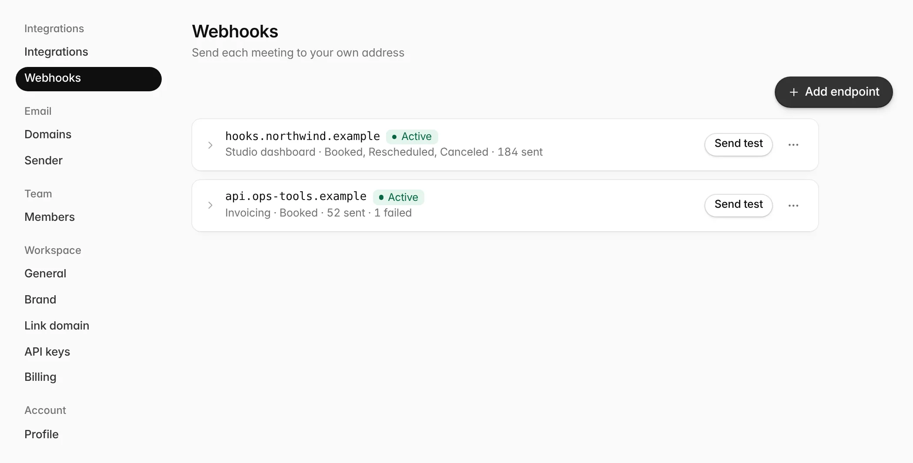

import { Aside, CardGrid, LinkCard, Steps } from '@astrojs/starlight/components';

Claritia sends a signed `POST` to your address each time something happens. You can set up an address two ways:

- **Settings › Webhooks** in the app. It sends meeting changes.
- **[`POST /hooks`](/api-reference/hooks/)** from your code or an automation app. It sends meeting changes, form fills and routing results.

Both send the same envelope, headers and signature.

## The events

| Event | Label in the app | Sent when | `data` holds |
| - | - | - | - |
| `meeting.booked` | Booked | A guest books, or a paid meeting's payment goes through | `meeting` |
| `meeting.rescheduled` | Rescheduled | A meeting moves to a new time | `meeting` |
| `meeting.canceled` | Canceled | The guest or a host cancels | `meeting` |
| `meeting.held` | Held | A host marks the meeting held | `meeting` |
| `meeting.no_show` | No-show | A host marks the guest as a no-show | `meeting` |
| `form.submitted` | | A form gets a fill (hooks only) | `fill` |
| `lead.routed` | | A lead is given an owner, or no rule takes it (hooks only) | `lead` |

## The envelope

```json
{
  "id": "evt_1042",
  "event": "meeting.booked",
  "created_at": "2026-11-18T15:05:02.000Z",
  "workspace_id": "00000000-0000-4000-8000-000000000001",
  "test": false,
  "data": { "meeting": { } }
}
```

| Field | Type | Description |
| - | - | - |
| `id` | string | The event's id. A retry keeps the same id. |
| `event` | string | The event kind. |
| `created_at` | string | When it happened. |
| `workspace_id` | string | Your workspace's id. |
| `test` | boolean | `true` for **Send test** and sample sends. |
| `data` | object | The meeting, fill or lead. |

## The meeting object

```json
{
  "id": "22222222-bbbb-4000-8000-000000000000",
  "status": "booked",
  "start_time": "2026-11-20T15:00:00.000Z",
  "end_time": "2026-11-20T15:30:00.000Z",
  "guest_timezone": "America/New_York",
  "source": "form",
  "created_at": "2026-11-18T15:05:02.000Z",
  "type": { "id": "11111111-aaaa-4000-8000-000000000001", "name": "Intro call", "slug": "intro-call", "kind": "one" },
  "hosts": [{ "id": "8d6f3a2e-...", "name": "Sam Lee", "email": "sam@example.com", "timezone": "America/Chicago" }],
  "guest": { "name": "Ada Park", "email": "ada@example.com", "contact_id": "7c0e1f52-..." },
  "answers": { "q.goals": "A new website by spring" },
  "location": { "kind": "google_meet", "url": "https://meet.google.com/abc-defg-hij" },
  "submission_id": "44444444-cccc-4000-8000-000000000000",
  "cancel_reason": null,
  "rescheduled_from": null,
  "payment": null,
  "manage_url": "https://app.tryclaritia.com/book/m/..."
}
```

| Field | Type | Description |
| - | - | - |
| `id` | string | The meeting's id. |
| `status` | string | `pending_payment`, `booked`, `canceled`, `held` or `no_show`. |
| `start_time`, `end_time` | string | The meeting's start and end, in UTC. |
| `guest_timezone` | string | The guest's time zone, like `America/New_York`. |
| `source` | string | Where it was booked: `page` (a booking page), `form`, `handoff`, `one_off`, `poll` or `api`. |
| `type` | object or null | The meeting type's `id`, `name`, `slug` and `kind`. `kind` is `one`, `round_robin`, `collective`, `owner_first`, `double` or `group`. |
| `hosts` | array | Each host's `id`, `name`, `email` and `timezone`. |
| `guest` | object | The guest's `name`, `email` and `contact_id`. |
| `answers` | object | Answers to the booking page's questions. |
| `location` | object | Where it happens. `kind` is `google_meet`, `teams`, `zoom`, `webex`, `whereby`, `phone_guest`, `phone_host`, `in_person` or `link`, with `url`, `number` or `address` when there is one. |
| `submission_id` | string or null | The form fill the booking came from. |
| `cancel_reason` | string or null | On `meeting.canceled`, the reason given. |
| `rescheduled_from` | string or null | On `meeting.rescheduled`, the old start time. |
| `payment` | object or null | For paid meetings: `amount` in the smallest unit (cents), `currency` and `status`. |
| `manage_url` | string or null | The guest's link to move or cancel. `null` once the meeting is canceled. |

The first send of a booking waits a minute, so the video link from the calendar event is usually in `location.url`.

## The fill object

Sent with `form.submitted`. The fields match [`GET /events`](/api-reference/events/#formsubmitted): `id`, `submitted_at`, `test`, `form`, `email`, `answers`, `answers_by_label`, `fields`, `contact` and `meta`. The envelope's `id` is `evt_` and the fill's id with no dashes.

## The lead object

Sent with `lead.routed`:

```json
{
  "id": "9b1f7f3a-1c2d-4e5f-8a9b-0c1d2e3f4a5b",
  "result": "routed",
  "owner": { "id": "8d6f3a2e-...", "name": "Sam Lee", "email": "sam@example.com", "tz": "America/Chicago" },
  "by": "rule",
  "queue": null,
  "reason": "form",
  "submission_id": "44444444-cccc-4000-8000-000000000000",
  "routed_at": "2026-11-18T15:04:12.000Z",
  "contact": { "id": "7c0e1f52-...", "email": "ada@example.com", "first_name": "Ada", "last_name": "Park", "title": null, "company": "Example Co" }
}
```

| Field | Description |
| - | - |
| `result` | `routed` when the lead got an owner, `unassigned` when nothing took it. |
| `owner` | The person who got the lead, or `null`. |
| `by` | How the owner was picked, like `rule` for a rule or `queue` for a team's turn. |
| `queue` | The team's id when a team picked the owner. |
| `reason` | What started it, like `form` or `booking`. |

## Headers

| Header | Value |
| - | - |
| `content-type` | `application/json` |
| `user-agent` | `Claritia-Webhooks/1` |
| `x-claritia-event` | The event, like `meeting.booked` |
| `x-claritia-delivery` | The id of this send. Retries keep it. |
| `x-claritia-signature` | `t=<unix seconds>,v1=<signature>` |

## Check the signature

The signature is a hex HMAC-SHA256 of the time, a dot, and the raw body, made with the endpoint's secret.

```js
import { createHmac, timingSafeEqual } from "node:crypto";

export function verify(secret, rawBody, header) {
  const parts = Object.fromEntries(header.split(",").map((p) => p.split("=")));
  const expected = createHmac("sha256", secret).update(`${parts.t}.${rawBody}`).digest("hex");
  const fresh = Math.abs(Date.now() / 1000 - Number(parts.t)) < 300;
  return fresh && expected.length === parts.v1.length && timingSafeEqual(Buffer.from(expected), Buffer.from(parts.v1));
}
```

```python
import hashlib, hmac, time

def verify(secret: str, raw_body: bytes, header: str) -> bool:
    parts = dict(p.split("=", 1) for p in header.split(","))
    expected = hmac.new(secret.encode(), f"{parts['t']}.".encode() + raw_body, hashlib.sha256).hexdigest()
    fresh = abs(time.time() - int(parts["t"])) < 300
    return fresh and hmac.compare_digest(expected, parts["v1"])
```

Check the body exactly as it arrived, before you parse it. The 5-minute window is a check on your side; pick what suits you.

## Retries

- Answer with any `2xx` within **15 seconds**.
- A timeout, a `408`, `425` or `429`, or any `5xx` is tried again: after about 1, 5 and 30 minutes, then 2 and 6 hours, up to **8 tries** in all. A `Retry-After` header is respected, up to 6 hours.
- A redirect (`3xx`) fails at once: `It answered 301 (a redirect). Use the final address.`
- Any other `4xx` fails at once and shows the status and the start of your answer.
- Each retry sends the same body and the same delivery id.
- An address on a private network fails: `That address is on a private network.`
- A paused endpoint's sends fail with `The endpoint is paused.`

<Aside type="tip">
Answer `200` first, then do the slow work in the background. Use `x-claritia-delivery` to drop a send you already handled.
</Aside>

## Set up Settings › Webhooks

Only workspace owners can see and change this page. Others see **No access**.

<Steps>

1. **Open Webhooks**

   Go to **Settings**, then **Webhooks**, and click **Add endpoint**.

   

1. **Fill in the endpoint**

   Type the **Address**, starting with `https://`. Add a **Name** if you like, up to 120 characters, like "Zapier". Under **Events**, every event is on to start. Switch off the ones you don't want. Keep at least one.

1. **Copy the secret**

   Click **Add endpoint**. The **Signing secret** dialog shows the secret once. Click **Copy secret**, then **Done**.

1. **Send a test**

   Click **Send test** on the endpoint. It sends a sample of the endpoint's first event with `"test": true`, and shows **Sent, 200** or the reason it failed.

</Steps>

A workspace can have up to 10 endpoints here.

### Endpoint states

| State | Means |
| - | - |
| **Active** | On, and the last send worked. |
| **Failing** | The last send failed. The reason shows under the endpoint. |
| **Paused** | Off. Nothing is sent. |

Under each endpoint you see its name, its events, how many sends went out and how many failed in the last 30 days.

### Each send

Click an endpoint to open **Last 50 sends**, with the end of its secret, like `whsec_…4f2a`. Each send shows the event, its state (**Waiting**, **Retrying**, **Sent** or **Failed**), a **Test** tag for tests, the status code or error, and the time. Click a send to see its body.

**Send again** sends a real send that worked or failed once more, with the same body. Sends are kept for 30 days.

### The menu

| Item | Does |
| - | - |
| **Edit** | Change the address, name or events. Leave **Address** empty to keep it. |
| **Pause** / **Resume** | Stop or start sends. |
| **Roll secret** | Makes a new secret. The current one stops working now. |
| **Delete** | Removes the endpoint and its sends. |

## Errors when you save

| Message | Fix |
| - | - |
| `Enter the full address, starting with https://.` | Type the whole address. |
| `Webhooks need an https:// address.` | Use `https://`. |
| `Take the name and password out of the address.` | Remove `user:pass@`. |
| `That address is too long.` | Use an address under 2,000 characters. |
| `Pick at least one event.` | Switch on an event. |
| `Only workspace owners can change this.` | Ask an owner. |

## Related

<CardGrid>
  <LinkCard title="POST /hooks" href="/api-reference/hooks/" description="Subscribe from code, with fills and routing." />
  <LinkCard title="Webhooks guide" href="/integrations/webhooks/" description="The short version." />
</CardGrid>
