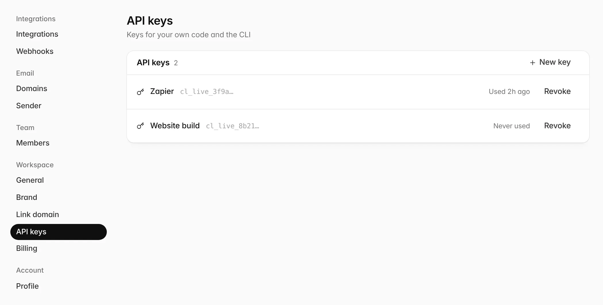

import { Aside, CardGrid, LinkCard, Steps } from '@astrojs/starlight/components';

The REST API lets your own code, or an automation app, read what comes into Claritia and act on it. Every call uses an API key from your workspace.

For every field, parameter and error, see the [API reference](/api-reference/).

## Make an API key

<Steps>

1. **Open API keys**

   Go to **Settings**, then **API keys**, and click **New key**.

   

1. **Name it**

   Give it a name that says what uses it, like "GitHub Actions". Click **Create key**.

1. **Copy it now**

   The key shows once. Copy it and keep it somewhere safe. It starts with `clr_`.

</Steps>

The list shows each key's name, the start of the key and when it was last used. Click **Revoke** to turn a key off. Anything using it stops working at once.

<Aside type="note">
A key acts for the person who made it. Some actions, like publishing a form or sending to a list, need a key made by a workspace owner.
</Aside>

## Call the API

Send the key in the `Authorization` header:

```bash
curl https://app.tryclaritia.com/api/v1/me \
  -H "Authorization: Bearer clr_..."
```

Each key can make 120 calls a minute. Past that, the API answers `429` with `Retry-After: 60`.

## Endpoints

| Method and path | What it does |
| - | - |
| `GET /api/v1/me` | The key's workspace: `{ workspace: { id, name }, app }` |
| `GET /api/v1/forms` | The workspace's forms, newest first: `id`, `name`, `status`, `created_at` |
| `GET /api/v1/events` | The latest events of one kind, newest first, as a hook would send them |
| `POST /api/v1/hooks` | Subscribe an address to an event |
| `DELETE /api/v1/hooks/{id}` | Unsubscribe a hook |
| `GET /api/v1/workflows` | The workspace's live workflows: `id`, `name` |
| `POST /api/v1/workflows/{id}/contacts` | Add a person to a live workflow |

### Read recent events

```bash
curl "https://app.tryclaritia.com/api/v1/events?event=form.submitted&form=FORM_ID&limit=3" \
  -H "Authorization: Bearer clr_..."
```

Add `email=` to find one person's fills. Add `sample=1` to get one made-up item, marked as a test, when the workspace has none yet.

### Subscribe a hook

```bash
curl -X POST https://app.tryclaritia.com/api/v1/hooks \
  -H "Authorization: Bearer clr_..." \
  -H "Content-Type: application/json" \
  -d '{"url": "https://example.com/claritia", "event": "form.submitted", "form": "FORM_ID"}'
```

The answer holds the hook's `id`, its signing `secret`, its `events` and its `forms`. Keep the secret to check each send.

| Event | Sent when |
| - | - |
| `form.submitted` | A form gets a fill. You can limit it to up to 50 forms. |
| `meeting.booked` | A meeting is booked |
| `meeting.rescheduled` | A meeting moves |
| `meeting.canceled` | A meeting is canceled |
| `meeting.held` | A meeting is marked held |
| `meeting.no_show` | A meeting is marked no-show |
| `lead.routed` | A lead is assigned to a person |

Each send is a signed `POST`, the same as a meeting webhook. Fill events carry the answers by key and by label, the contact and where the fill came from. Spam fills and fills past your plan's monthly limit aren't sent. See [Webhooks](/integrations/webhooks/#check-the-signature) to check the signature.

A workspace can have up to 200 hooks.

### Add a person to a workflow

```bash
curl -X POST https://app.tryclaritia.com/api/v1/workflows/WORKFLOW_ID/contacts \
  -H "Authorization: Bearer clr_..." \
  -H "Content-Type: application/json" \
  -d '{"email": "ada@example.com", "first_name": "Ada", "last_name": "Park"}'
```

Claritia finds the person by email, or adds them. The answer is `{ "added": true, "contact_id": "..." }` when a run started. `added` is `false` when the workflow's enroll rules kept them out, or they're already in it today. The workflow must be live.

## Zapier and Make

Zapier and Make use these same endpoints. When you sign in to Claritia from Zapier or Make, Claritia makes a key named after the app. Revoking it in **API keys** signs the app out and removes its hooks.

## Errors

Errors come back as JSON with one plain line: `{ "error": "Workflow not found." }`. Common statuses are `400` for a bad request, `401` for a missing or revoked key, `404` for something that isn't there, `409` for a workflow that isn't live, and `429` for too many calls.

## Next steps

<CardGrid>
  <LinkCard title="API reference" href="/api-reference/" description="Every endpoint, field and error." />
  <LinkCard title="Connect your AI app" href="/developers/mcp/" description="Use Claritia from Claude, ChatGPT or Cursor." />
  <LinkCard title="Embed script" href="/forms/share-and-embed/#for-developers" description="Forms and calendars on your own site." />
</CardGrid>
