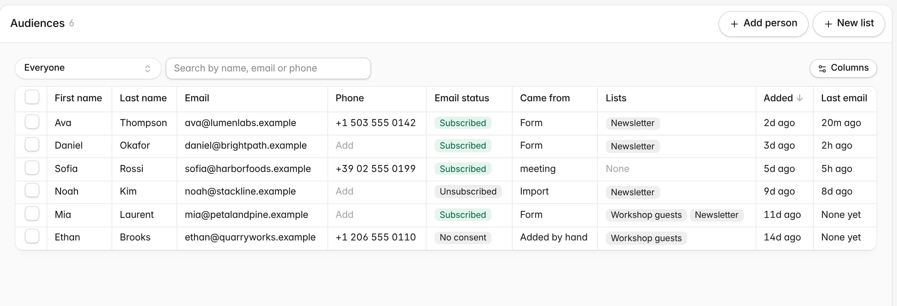
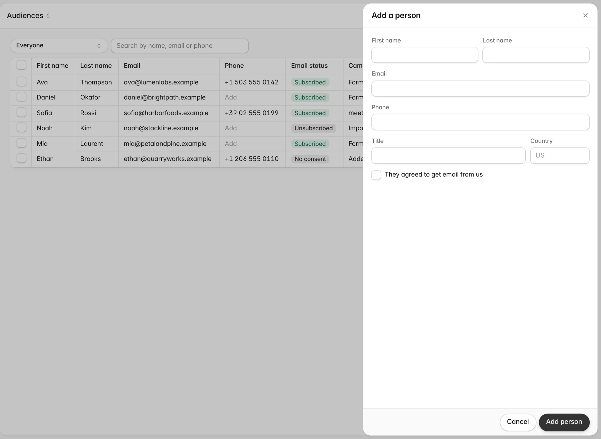

import { Aside, CardGrid, LinkCard, Steps } from '@astrojs/starlight/components';

**Audiences** holds the people your emails go to. Everyone who sends a form or books a meeting shows up here, along with anyone you add or import. Open **Email**, then **Audiences**, in the sidebar.

## The people table

**Everyone** lists all your people. Search by name, email or phone, and click **Columns** to choose what shows. Columns include first and last name, email, phone, title, country, lists, email status, where they came from, when they were added and their last email.

### Email status

| Status | What it means |
| - | - |
| **Subscribed** | Can get your emails |
| **Unsubscribed** | Asked to stop getting marketing emails |
| **Bounced** | Their address didn't accept an email |
| **Marked as spam** | They reported one of your emails as spam |
| **No consent** | Hasn't agreed to marketing emails |

Bounces and spam reports stop sending to that address at once.

## Lists

A list is a group of people, like a "Workshop waitlist". Lists show beside **Everyone**.

- Click **Create** to make a list and name it.
- A list's menu renames or deletes it. Deleting a list keeps its people.
- To fill a list from a form, turn on **Add to a list** in the form's Ending. Each person who sends the form joins the list. See [On submission](/forms/on-submission/).

## Add people

<Steps>

1. **Open a list**

   Pick the list people should join.

1. **Add one person, or import many**

   Click **Add a person** to type one in. To bring in many, open **Import** and drop a CSV file, or paste people one a line.

   

1. **Match the columns**

   Claritia matches each column in your file to a field by its header. Change any match you like. Pick which column holds the email.

1. **Say whether they agreed**

   Tick **They agreed to get email from us** only if they did.

</Steps>

Claritia cleans each address, leaves out repeats and throwaway addresses, and tells you about shared inboxes like `info@`. You can import up to 5,000 people at a time, from a file of up to 20 MB. Split larger files and import each part. Every import stays in the list's history.

<Aside type="note">
When a member who isn't an owner imports people without ticking that they agreed, the import waits for an owner to approve it. It shows under **Imports waiting for an owner**.
</Aside>

## Next steps

<CardGrid>
  <LinkCard title="Triggers and steps" href="/email/triggers-and-steps/" description="Start a workflow when someone joins a list." />
  <LinkCard title="Your sending domain" href="/email/sending-domain/" description="Send from your own address." />
</CardGrid>
