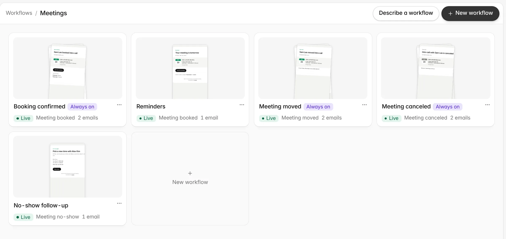
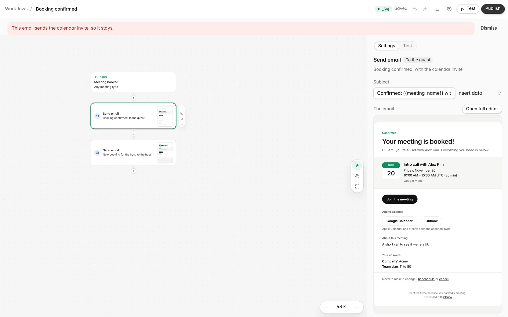
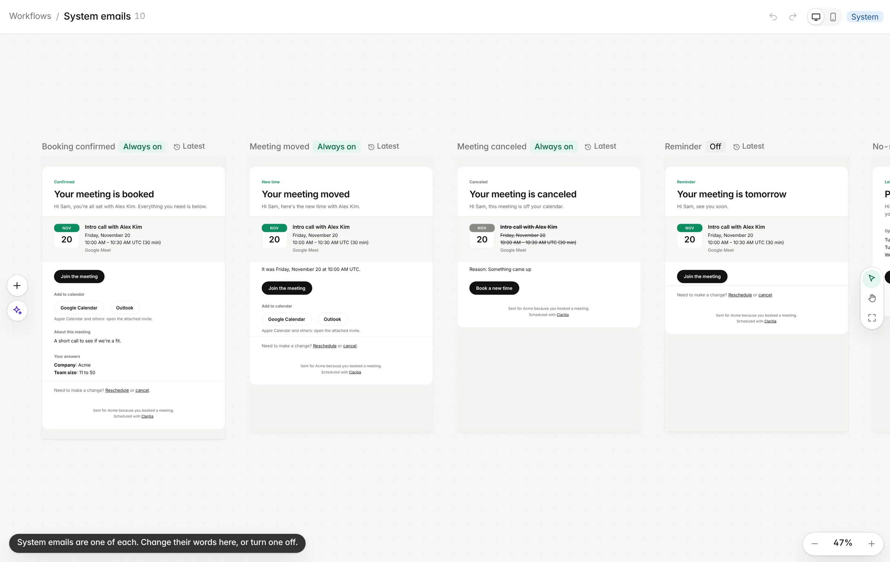

import { Aside, CardGrid, LinkCard } from '@astrojs/starlight/components';

Claritia sends emails for every meeting: the confirmation with the calendar invite, reminders, and notes when a meeting moves or is canceled. They're ready from day one, and you can change their words and design. They live as live workflows in the **Meetings** folder of **Email**, then **Workflows**.

## The meeting workflows

| Workflow | Starts when | What it sends |
| - | - | - |
| **Booking confirmed** | A meeting is booked | **Booking confirmed** to the guest, with the calendar invite, and **New booking** to the host |
| **Reminders** | A meeting is booked | A reminder 1 day before and another 1 hour before |
| **Meeting moved** | A meeting is moved | **Meeting moved** to the guest, with the new invite, and **Moved booking** to the host |
| **Meeting canceled** | A meeting is canceled | **Meeting canceled** to the guest, and **Canceled booking** to the host |
| **After the meeting** | A meeting is booked | **How did it go** to the host, when the meeting ends |
| **No-show follow-up** | A meeting is marked no-show | **No-show follow-up** to the guest, with a link to book again |
| **Pick a time** | A form is sent with no booking | **Pick a time** to the lead, with open times |

Booking confirmed, Meeting moved and Meeting canceled show **Always on**. They carry the calendar invite, so they can't be paused or deleted, and the guest's email can't be removed. You can still add steps to them, like a Slack note or a text.

## Change an email

Click a meeting workflow, then click its email step. The panel shows the email with a sample meeting's details in place of the real ones, so you can see how it reads. Type in place, or click **Open full editor** to design it on the canvas. Then click **Publish**.

Meeting emails can include the guest's name, the host's name, the meeting's name, date, time, length and place, the join link, the reschedule link, add-to-calendar links and the guest's answers. Parts that need a value only show when the meeting has one. For example, the **Join** button only shows when there's a meeting link.

## Change when reminders go

Open the **Reminders** workflow. Each reminder waits on a **Delay** step set to **Before the meeting**. Change the days and hours, then publish. Reminders already waiting keep their time.

To add another reminder, add a **Delay** and a **Send email** step. To stop reminders, pause the **Reminders** workflow.

<Aside type="note">
If you build your own workflow with a **Before the meeting** delay and publish it, the meeting's own reminder emails stop for your workspace, so nobody gets two.
</Aside>

## Turn an email off

Pause its workflow, or take its step out and publish. You can't turn off the three emails that carry the invite.

To stop the no-show email for one meeting type only, turn off **No-show follow-up** in that meeting type's **Notifications** section.

## Who the emails come from

Meeting emails go from Claritia's meeting address until your workspace has its own verified sending domain. See [Your sending domain](/email/sending-domain/).

## Next steps

<CardGrid>
  <LinkCard title="Triggers and steps" href="/email/triggers-and-steps/" description="Build your own follow-ups." />
  <LinkCard title="Upcoming meetings" href="/meetings/upcoming/" description="Mark meetings held or no-show." />
</CardGrid>
