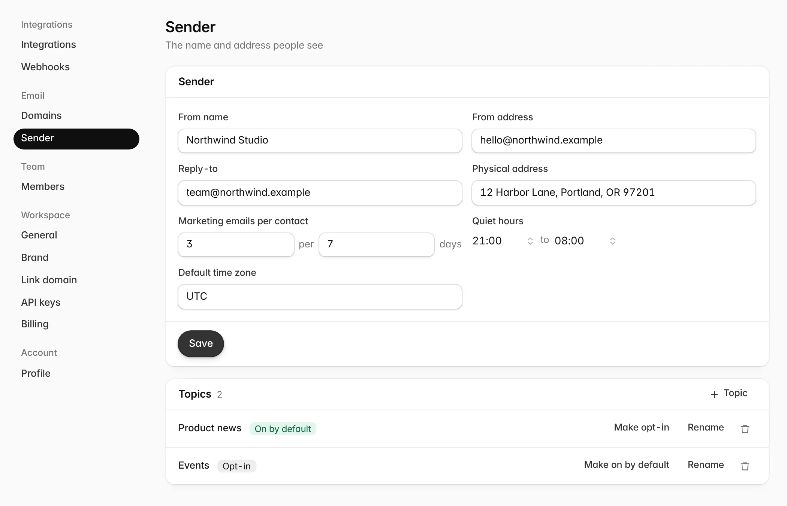

import { Aside, CardGrid, LinkCard, Steps } from '@astrojs/starlight/components';

**Settings**, then **Sender**, sets the name and address people see on your workflow and campaign emails, and the rules every marketing email follows. Only owners can change it. Other members see it read-only. A non-owner who tries gets `Only the workspace owner can change sending`.

## The sender

| Field | Example | What it does |
| - | - | - |
| **From name** | `Acme` | The name in people's inbox. Your company, or a person. |
| **From address** | `news@mail.yourcompany.com` | The address emails come from. Use one on a domain verified in **Settings**, then **Domains**. Until it is, emails are skipped with **Domain not verified**. |
| **Reply-to** | `team@yourcompany.com` | Where replies go, if not the from address. |
| **Physical address** | `1 Main St, City, Country` | Your postal address. It goes in the footer of marketing emails, as anti-spam laws ask. |

Click **Save**. The button reads **Saving…** while it saves.

## Limits

| Field | Default | Range | What it does |
| - | - | - | - |
| **Marketing emails per contact** | 3 emails in 7 days | 1 to 50 emails, in 1 to 60 days | The most marketing emails one person gets in that many days. More wait until they fit. |
| **Quiet hours** | 21:00 to 08:00 | Any hours | Marketing emails wait while it's quiet hours in each person's own time zone. Pick **Quiet from** and **Quiet until**. |
| **Default time zone** | `UTC` | Any time zone | Used for quiet hours when Claritia doesn't know a person's time zone. |

These limits apply to marketing emails, like campaigns and nurture workflows. Meeting emails, like confirmations and reminders, go at once.

## Topics

Topics let people pick which emails they get, like "Product news" or "Events". A campaign can go only to people on one topic. When an email is part of a topic, its unsubscribe page offers **Unsubscribe from [topic]** as well as **Unsubscribe from all**.

<Steps>

1. **Add a topic**

   Under **Topics**, click **New topic**. Type a name, like "Product news".

1. **Pick on or opt-in**

   A new topic is **On by default**: people get it unless they turn it off. Click **Make opt-in** to make it **Opt-in**: people only get it if they turn it on. Click **Make on by default** to switch back.

1. **Rename or delete**

   Click the topic's name to rename it. Click its trash icon and confirm **Delete [topic]?** to remove it.

</Steps>

## When sending is paused

If too many emails bounce or are marked as spam, Claritia pauses sending on its own. A red **Paused** line shows at the top of **Sender** and **Domains**, with the reason. Sending pauses when spam complaints reach 0.2%, or hard bounces 5%, of the week's sends, once enough have gone out to judge.

Fix the cause first, like a bad list. Then an owner clicks **Resume** and confirms **Resume sending?**.

<Aside type="note">
Workflow and campaign emails also count toward your plan's emails a month. Past it, they wait for the next month or an upgrade. They're never dropped. See [Plan limits](/reference/plan-limits/).
</Aside>

## Next steps

<CardGrid>
  <LinkCard title="Sending domain" href="/email/sending-domain/" description="Add and verify the domain you send from." />
  <LinkCard title="Audiences" href="/email/audiences/" description="Who gets your emails, and their consent." />
</CardGrid>
