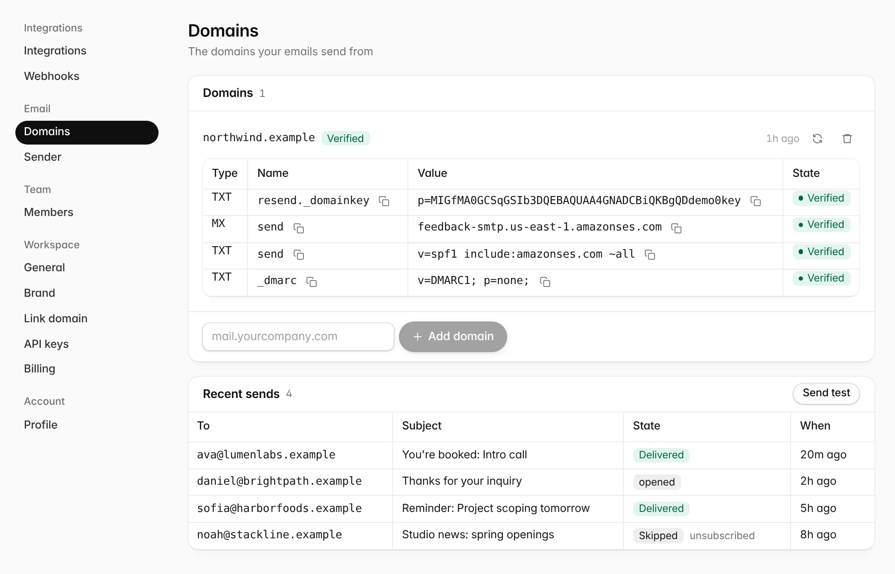
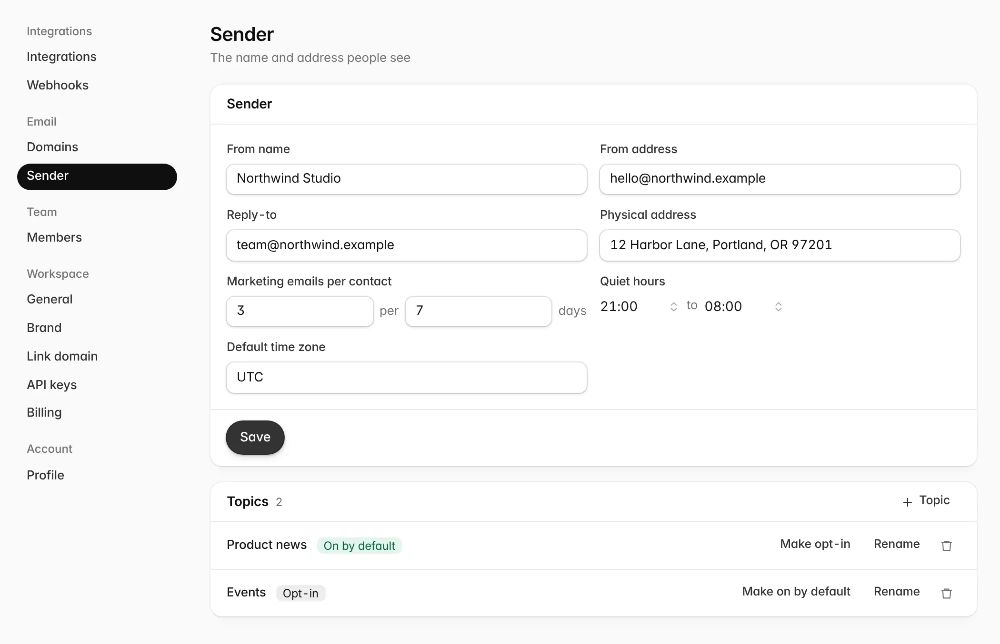

import { Aside, CardGrid, LinkCard, Steps } from '@astrojs/starlight/components';

Until you add your own domain, Claritia sends your emails from its own address. Sending from your domain, like `mail.acme.com`, helps your emails reach the inbox and look like they come from you. You set this up once, in **Settings**, under **Email**.

## Add your domain

<Steps>

1. **Open Domains**

   Go to **Settings**, then **Domains**. Only workspace owners can add a domain.

1. **Add it**

   Type your domain and click **Add domain**. A subdomain just for email, like `mail.acme.com`, keeps it apart from your main site's email.

1. **Add the DNS records**

   Claritia shows the records with their **Type**, **Name** and **Value**. Copy each one into your domain's DNS settings, at the company where you bought the domain.

1. **Wait for the check**

   Each record shows **Verified**, **Waiting** or **Wrong**. Claritia checks them every few minutes until they're right. Click **Check now** to check at once. Sending from the domain starts once DKIM, SPF and DMARC check out. Until then, your emails keep going as they do now.

   

</Steps>

<Aside type="tip">
DNS changes can take from a few minutes to a day to show everywhere. If a record still says **Wrong** after an hour, check for a typo or a duplicate record.
</Aside>

To stop using a domain, click **Remove domain**. Emails from that domain stop at once.

## Set your sender

Go to **Settings**, then **Sender**.

| Setting | What it's for |
| - | - |
| **From name** | The name people see, like your company or a person |
| **From address** | The address emails come from, on your verified domain |
| **Reply-to** | Where replies go, if not the From address |
| **Physical address** | Your postal address, shown in the email footer |
| **Marketing emails per contact** | The most marketing emails one person gets in a number of days |
| **Quiet hours** | Hours when marketing emails wait, in each person's time zone |
| **Default time zone** | Used when a person's time zone is unknown |

### Topics

Topics let people choose which emails they get, like "Product news". Click **New topic** to add one. A topic is either **On by default**, so people get it unless they opt out, or **Opt-in**, so they only get it if they ask.

## Recent sends

The **Domains** page lists your recent emails with their state, such as **Delivered**, **Bounced** or **Complained**. Click **Send test** to send yourself a test from your domain.

## How Claritia protects your sending

- Every email is checked the moment it leaves: consent by region, unsubscribes, bounces, the per-contact cap and quiet hours.
- Bounces and spam complaints stop sending to that address at once.
- If complaints pass 0.2% of emails, sending pauses. An owner can click **Resume** once the cause is fixed.

<Aside type="note">
Follow-up emails from your own domain are on Pro and Business. See [Plans and billing](/workspace/plans-and-billing/).
</Aside>

## Next steps

<CardGrid>
  <LinkCard title="Workflows" href="/email/workflows/" description="Build the emails you'll send." />
  <LinkCard title="Troubleshooting" href="/reference/troubleshooting/" description="Fixes for email that doesn't arrive." />
</CardGrid>
