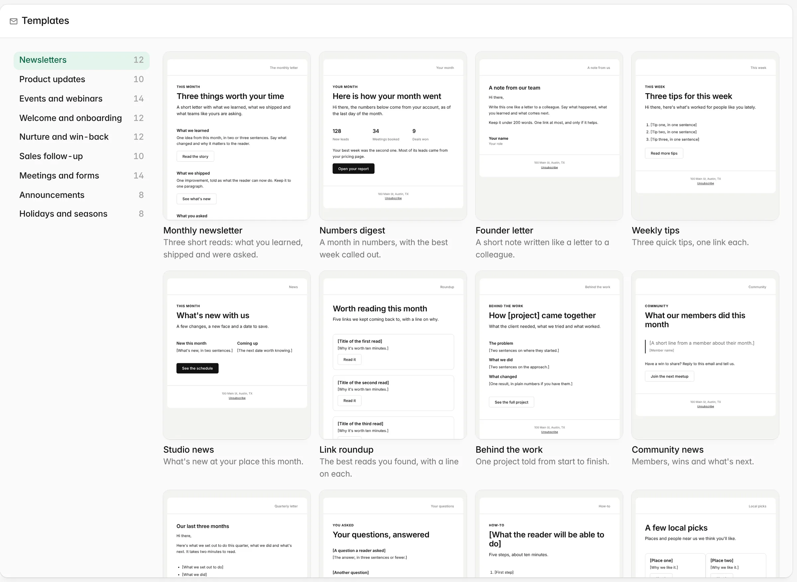

import { Aside, CardGrid, LinkCard, Steps } from '@astrojs/starlight/components';

**Templates** holds ready-made emails. Open it in the sidebar under **Email**. The top part is Claritia's library of 100 templates. Below it, **Your templates** holds the emails your team saved to reuse.



## The library

The library has 100 templates in nine folders. Each one is drawn in your brand's colors and logo, so you see what it would look like when it arrives.

| Folder | Templates | Examples |
| - | - | - |
| **Newsletters** | 12 | Monthly newsletter, Founder letter, Weekly tips, Link roundup |
| **Product updates** | 10 | Feature launch, Release notes, Pricing change, Planned downtime |
| **Events and webinars** | 14 | Webinar invite, Save the date, Last seats, Replay is ready |
| **Welcome and onboarding** | 12 | Welcome, Trial ending, Getting started guide, First week check-in |
| **Nurture and win-back** | 12 | Customer story, Still thinking it over, We miss you, Refer a friend |
| **Sales follow-up** | 10 | After the demo, Proposal, Quote follow-up, Closing the loop |
| **Meetings and forms** | 14 | Meeting confirmed, Meeting reminder, Form thank you, Leave a review |
| **Announcements** | 8 | New location, New hours, New team member, We're moving |
| **Holidays and seasons** | 8 | Holiday hours, Year in review, Season's greetings, Gift cards |

Click a folder on the left to see its templates. Each card shows the name and one line on what it's for.

### Use a library template

<Steps>

1. **Open it**

   Click a template. A large preview opens with its name.

1. **Click Use template**

   Claritia makes a new draft email from it, named after the template, and opens it in the email editor. The button reads **Opening…** while it does.

1. **Fill it in**

   Change the words yourself, or ask Tia to fill it in for your news. See [The email editor](/email/email-editor/).

</Steps>

If you came from a canvas's **Add email**, the new email lands in that group on the canvas, picked and ready.

The template pages on Claritia's website link here too. Their **Use this template** opens the same preview.

## Your templates

Your own templates are emails your team writes once and uses everywhere. Any workflow's **Send email** step, or a one-time email, can start from one.

With none saved yet, this part shows **Write an email once, use it everywhere** and **New template**.

<Steps>

1. **Click New template**

   Name it, like "Product update". You can also use **Create** in the sidebar, then **Email template**.

1. **Write it**

   Fill in the **Subject**, the **Preview text** that shows after the subject in the inbox, the message, a **Button** label and its **Button link**. It's the same form as a workflow's email step.

1. **Let it save**

   A template saves itself a moment after each change. The top shows **Saving…**, then **Saved**.

</Steps>

To rename a template, change the **Name** at its top. To remove one, click **Delete** on it and confirm **Delete [name]?**. Workflow steps that started from it keep their own copy.

### Merge fields

Merge fields fill in each person's details when the email goes out. Write them in double braces, with a fallback after a bar for people Claritia knows less about:

```text
Hi {{first_name|there}}, thanks for your time on {{meeting_time|our call}}.
```

| Field | Fills in |
| - | - |
| `{{first_name}}` | First name |
| `{{last_name}}` | Last name |
| `{{company}}` | Company |
| `{{title}}` | Job title |
| `{{meeting_time}}` | The meeting's time, in their time zone |
| `{{meeting_link}}` | The video link |
| `{{reschedule_link}}` | Their link to move or cancel |

A field with no fallback, or one Claritia doesn't know, is flagged. A workflow won't publish until you give it a fallback, like `{{first_name|there}}`. The footer's `{{unsubscribe_url}}` and `{{company_address}}` need none.

<Aside type="tip">
In a workflow, open an email step and click **Use a template** to start from one of yours.
</Aside>

## Next steps

<CardGrid>
  <LinkCard title="The email editor" href="/email/email-editor/" description="Edit an email on the canvas." />
  <LinkCard title="Workflows" href="/email/workflows/" description="Send emails on their own." />
</CardGrid>
