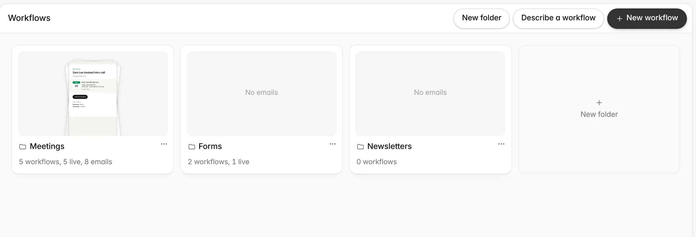
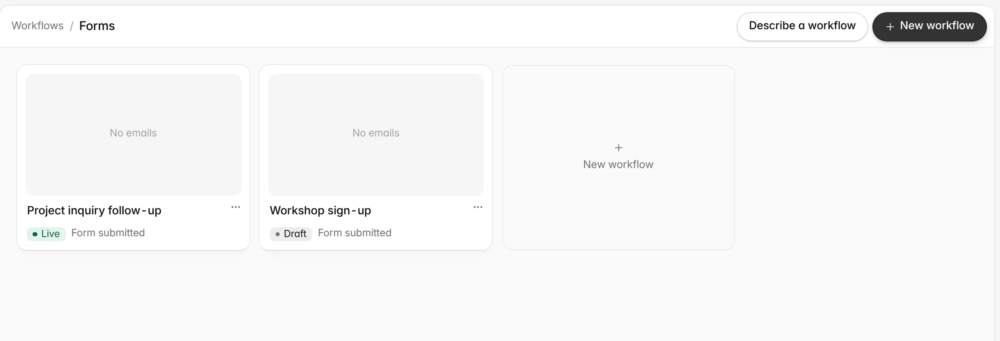
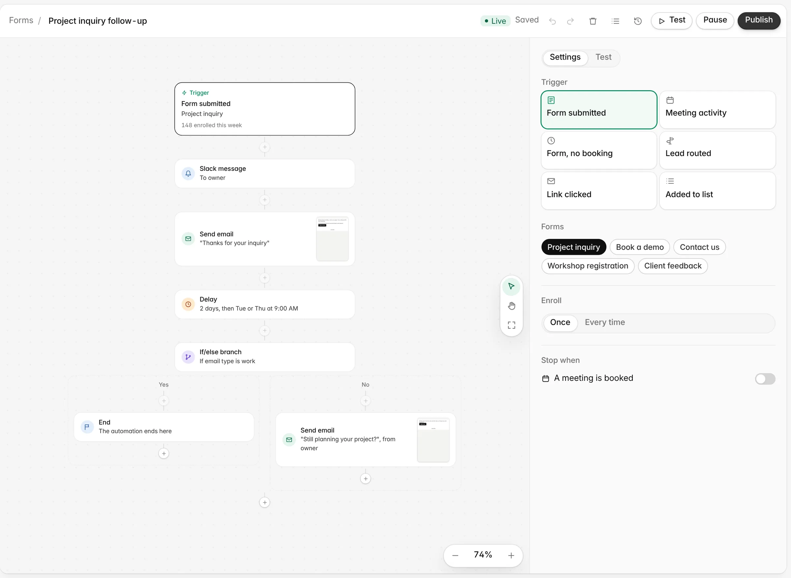

import { Aside, CardGrid, LinkCard, Steps } from '@astrojs/starlight/components';

A workflow is a set of steps that runs on its own when something happens, like a form fill or a booked meeting. Every email Claritia sends for you lives in a workflow, meeting reminders included. Open **Email**, then **Workflows**, in the sidebar.

<video class="cl-clip" src="/videos/workflows.mp4" autoplay muted loop playsinline preload="metadata" width="1280" height="800" aria-label="Opening the Meetings folder, the Reminders workflow and its email step" title="Opening the Meetings folder, the Reminders workflow and its email step"></video>

## Folders

Workflows opens on your folders. Each card shows a stack of the folder's emails, its name, and how many workflows, live workflows and emails it holds.

- **New folder** makes a folder.
- A folder's menu adds a workflow to it, renames it, moves it left or right, or deletes it. Deleting a folder keeps its workflows. They move to **No folder**.
- Click a folder to see its workflows. Each card shows its emails, its state, its trigger and how many emails it sends. A card's menu moves the workflow to another folder.

The **Meetings** folder holds the emails Claritia sends for every meeting. See [Meeting emails and reminders](/email/meeting-emails/).

## Make a workflow

<Steps>

1. **Start one**

   Click **New workflow**, inside a folder or on the folders page. You can also use **Create**, then **Workflow**.

1. **Pick a starting point**

   Start from a template, or click **Describe a workflow** and tell Tia what you want, like "Email people who send the demo form but don't book, then remind them two days later." Tia builds the steps for you.

1. **Set the trigger**

   Click the first card and choose what starts the workflow. See [Triggers and steps](/email/triggers-and-steps/).

1. **Add steps**

   Click **+** between cards to add a step. The menu is searchable.

1. **Publish**

   Click **Publish**. It shows every email in the workflow once, with its subject and sender and what changed. Confirm, and the workflow goes live.

</Steps>

### Templates

| Template | What it does |
| - | - |
| **Form announcement** | A thank-you right away, and a Slack note for their owner |
| **Form follow-up** | An email the day after they send a form |
| **Demo request follow-up** | Routes the lead, and follows up until they book |
| **Not booked follow-up** | For leads who sent a form but didn't pick a time |
| **Meeting reminders** | A day before and an hour before, following any reschedule |
| **Text reminders** | A text an hour before each meeting, or an email when the text can't go |
| **No-show follow-up** | An email and a Slack note for their owner |
| **Event registration** | Confirms, reminds the day before, and follows up after |
| **Welcome** | Three emails over two weeks for new subscribers |

Emails in a new template start as drafts. Nothing sends until you publish the workflow.

<Aside type="tip">
Every workspace gets two drafts to start from: **Form announcement** and **Form follow-up**. They send nothing until someone publishes them.
</Aside>

## The editor

The workflow sits on a canvas that you can pan and zoom. Each card says its settings in one line.

- **Move a step**: drag its card onto a **+**.
- **Copy a step**: pick it and press ⌘D (or Ctrl+D).
- **Remove a step**: pick it and press Delete.
- **Undo** and **Redo** sit in the header.

The panel on the right has two tabs. **Settings** holds the trigger and each step's fields. **Test** lets you pick a person and see what each step would do for them. Nothing is sent.

### The header

| Button | What it does |
| - | - |
| **Test** | Opens the Test panel |
| **Versions** | Earlier published versions, to look at or bring back |
| **Run history** | Each person who went through the workflow and what happened |
| **Pause** or **Resume** | Stops or restarts the workflow. People already in it stay where they are until you resume. |
| **Delete workflow** | Deletes it and its history |
| **Publish** | Makes your changes live. It's off when there's nothing new, or when something needs fixing. |

An email edited since the last publish shows **Changed since publish** on its card and in the panel.

## Who enters, and when they leave

In the trigger's settings:

- **Enroll**: **Once** per person, or **Every time** the trigger happens, with a number of days between.
- **Stop when**: end the workflow early for a person, for example with **Stop when a meeting is booked**.

## Workflow emails on your plan

| Plan | Workflow emails a month |
| - | - |
| Free | 1,000 |
| Starter | 10,000 |
| Pro | 50,000 |
| Business | 200,000 |

Past the monthly number, emails wait. They're never dropped.

## Next steps

<CardGrid>
  <LinkCard title="Triggers and steps" href="/email/triggers-and-steps/" description="Every trigger and step you can use." />
  <LinkCard title="The email editor" href="/email/email-editor/" description="Write and design each email." />
</CardGrid>
