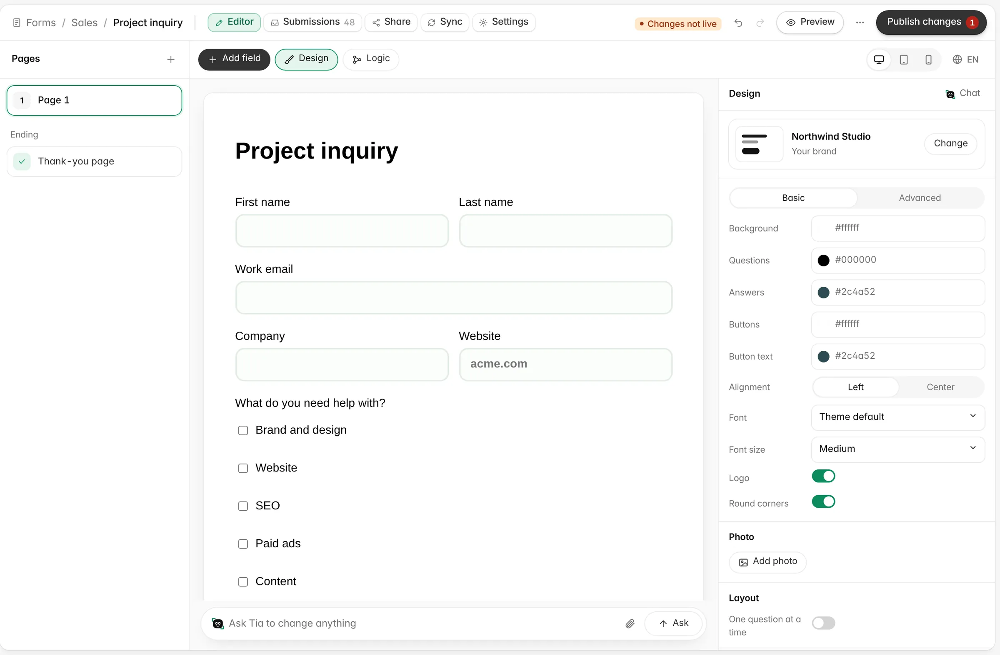
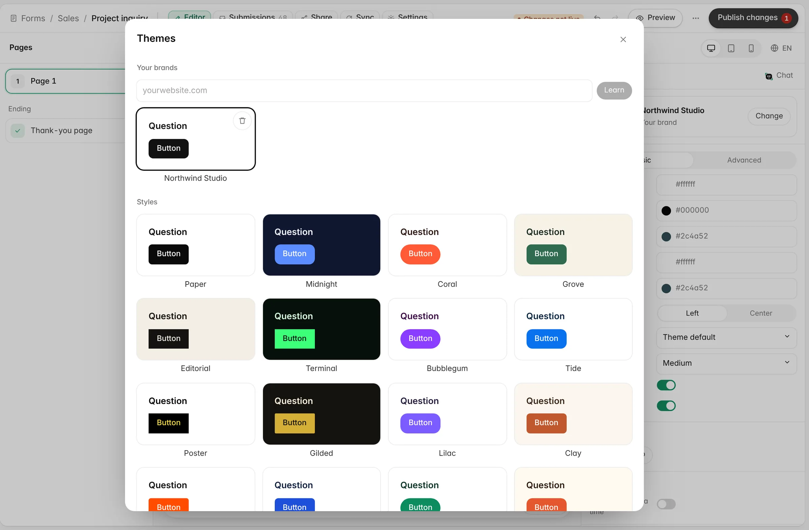

import { Aside, CardGrid, LinkCard, Steps } from '@astrojs/starlight/components';

Every form starts from a theme. A theme is either your own brand, read from your website, or one of Claritia's 18 styles. You can then change any part of the look in **Design**.

## Pick a theme

<Steps>

1. **Open Design**

   In Form Studio, click **Design** in the bar over the form.

   

1. **Open the themes**

   Click the current theme at the top of the panel. **Themes** opens with every style and **Your brands**.

   

1. **Pick one**

   Click a style or a brand. The form changes at once. Your questions and logic stay the same.

</Steps>

### Use your own brand

Pick **Use your own brand** and type your website, like `acme.com`. Claritia reads your site's colors, fonts, buttons and fields and turns them into a brand. When it's done, click **Start building**. If the read looks off, try reading the brand again.

Your brands are shared across the workspace. The same brand dresses your booking page. See [Brand and domains](/workspace/brand-and-domains/).

## Change the look

The Design panel has two levels. Switch between them at the top.

| Level | What you can change |
| - | - |
| **Basic** | Background, questions, answers, buttons and button text colors, alignment, font, font size, logo, round corners and the progress bar |
| **Advanced** | Separate settings for the form, typography, inputs, choices and buttons, such as width, card, title size, field style, spacing and button shape |

**Reset advanced settings** puts the advanced changes back to the theme's own.

Under the levels you can add a photo to the form and turn on **One question at a time**.

<Aside type="tip">
Check the look on each device with the desktop, tablet and phone buttons at the top right of the editor.
</Aside>

## The Claritia badge

Live forms show a small Claritia badge. Its size depends on your plan.

| Plan | Badge |
| - | - |
| Free | The full badge |
| Starter | A small badge |
| Pro and Business | No badge |

## Calendar style in the form

When a form books a meeting, paid plans show the calendar in the form's own style. Free shows a plain calendar.

## Next steps

<CardGrid>
  <LinkCard title="Share and embed" href="/forms/share-and-embed/" description="Put the styled form on your site." />
  <LinkCard title="Brand and domains" href="/workspace/brand-and-domains/" description="Your brand book and your own address." />
</CardGrid>
