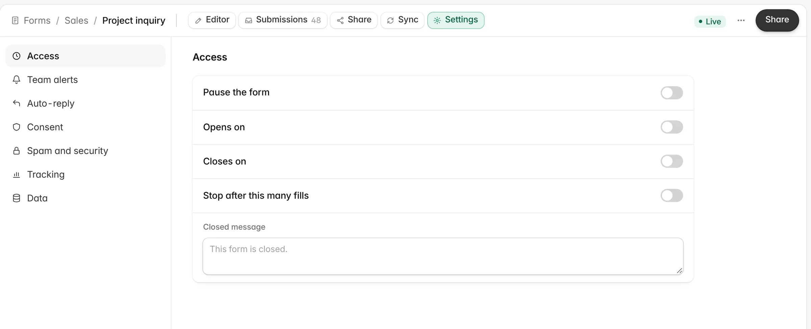
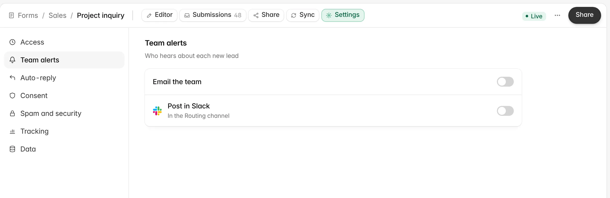
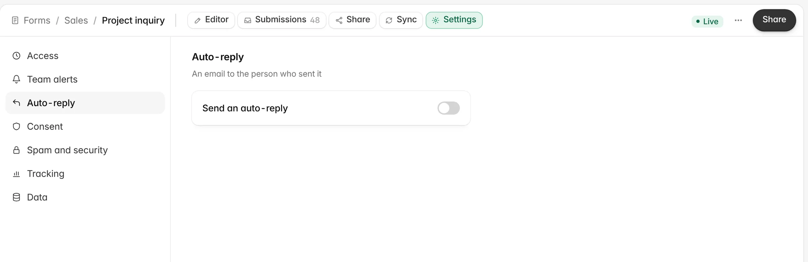
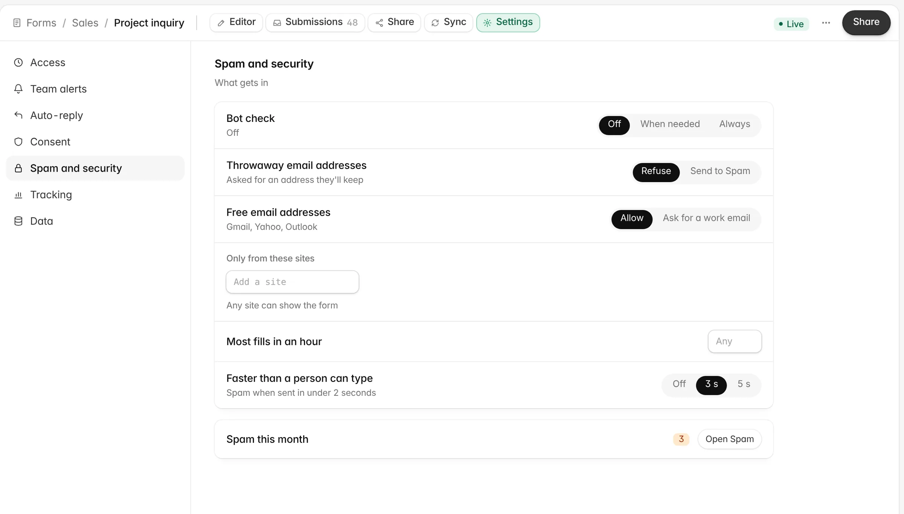

import { Aside, CardGrid, LinkCard } from '@astrojs/starlight/components';

Open a form and click its **Settings** tab. The list on the left holds each part. Every change saves to your draft, so you can undo it, and it goes live when you publish.

## Access

When the form takes fills.

- **Pause the form**: stop all fills now. People see your closed message.
- **Opens on** and **Closes on**: open and close the form on set dates.
- **Stop after this many fills**: close the form once it reaches a number.
- **Closed message**: what people see when the form is closed.

## Team alerts

Who hears about each new lead.

- **Email the team**: add the emails that get an alert, and set the subject. Turn on **Include every answer** to put the answers in the email.
- **Post in Slack**: post each new lead in your team's Slack channel.

The same alert shows as **Email the team** and **Post to Slack** in the form's Ending. See [On submission](/forms/on-submission/).

## Auto-reply

An email to the person who sent the form.

- **Send an auto-reply**: turn it on, then set **From**, the subject and the message. **From** can be your team or the lead's owner.
- **Add a booking link**: include a link to the meeting they were offered. It's left out once they book.
- **Only to work emails**: skip the reply for free email addresses.

The auto-reply goes 5 minutes after the fill, so it knows whether they booked.

## Consent

Permission to send people marketing emails.

- **Checkbox text**: the words next to the box.
- **Show the checkbox to**: **EU and UK visitors**, **Everyone** or **No one**.
- **Required to send the form**: people must tick it to send.
- **Confirm by email first**: people click a link in an email before they get marketing emails.

Leads who don't give consent still get your sales emails, like the confirmation and the auto-reply. They don't get marketing emails.

## Spam and security

What gets in. Caught fills go to the form's **Spam** list. See [Responses and spam](/forms/responses-and-spam/).

| Setting | Choices |
| - | - |
| **Bot check** | **When needed** shows a check only when a fill looks like a bot. **Always** shows it to everyone. |
| **Throwaway email addresses** | **Refuse** asks for an address they'll keep. **Send to Spam** lets the fill in, as spam. |
| **Free email addresses** | **Allow** Gmail, Yahoo or Outlook, or **Ask for a work email** |
| **Only from these sites** | List the sites that may show the form, like `acme.com`. Fills from other sites go to Spam. The form's own link page always works. |
| **Most fills in an hour** | A cap on fills per hour |
| **Faster than a person can type** | Catches fills sent too fast to be real |

## Tracking

Send the form's views, starts, fills and bookings to your own tags, after consent.

| Tag | What you enter |
| - | - |
| **Google Tag Manager** | Turn it on to push events into the page's dataLayer |
| **Google Analytics 4** | Your measurement ID, like `G-ABC123DEF4` |
| **Meta Pixel** | Your pixel ID. With Meta connected, fills and bookings also go from the server through the **Conversions API**. |
| **Google Ads conversion** | Your conversion ID and label. With Google Ads connected, **Offline conversions** sends fills that carry a Google click ID. |

## Data

How long answers are kept and what fills in on its own.

- **Fill in from the link**: let questions fill in from values in the form's link, or keep every question empty.
- **Keep submissions**: keep them forever, or for a set time.
- **Export every submission**: download all answers.
- **Delete every submission**: removes all answers for this form. You type the form's name to confirm.

<Aside type="caution">
Deleting every submission can't be undone. Export first if you might need them.
</Aside>

## Next steps

<CardGrid>
  <LinkCard title="Responses and spam" href="/forms/responses-and-spam/" description="What gets caught and how to let a lead in." />
  <LinkCard title="Security and privacy" href="/workspace/security-and-privacy/" description="How Claritia protects your data." />
</CardGrid>
