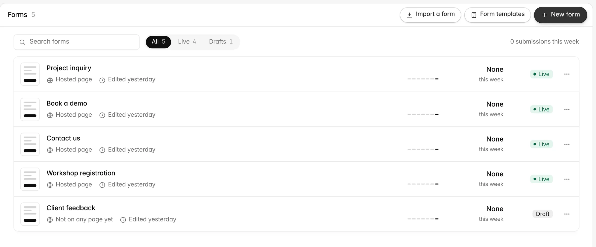
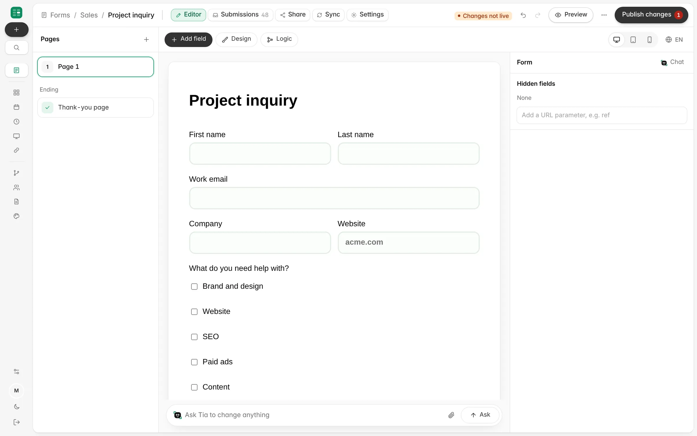
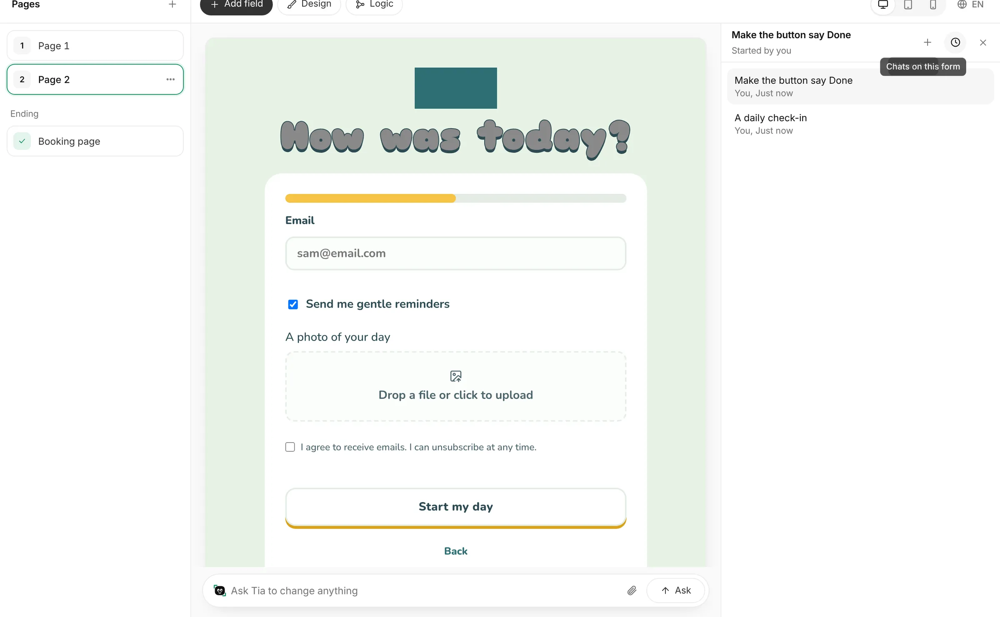
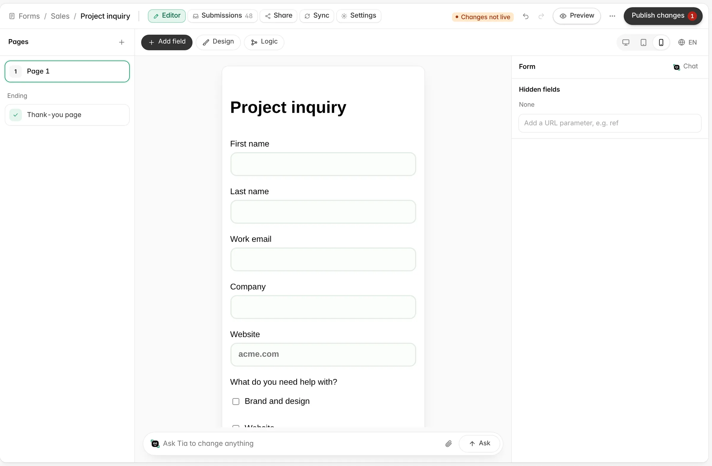

import { Aside, CardGrid, LinkCard, Steps } from '@astrojs/starlight/components';

Form Studio is where you build and change a form. You can chat with Tia, Claritia's AI assistant, or click and type yourself. Both change the same form, and you can mix them freely.

## The Forms page

**Forms** in the sidebar lists every form with its state: **Live**, **Draft** or **Paused**. Search by name, or show only live forms or drafts. The top of the page holds **Import a form**, **Form templates** and **New form**.

Each form's menu lets you open it, duplicate it, move it to a folder, copy its link, pause or resume it, and delete it. Folders keep forms in groups. Deleting a folder keeps its forms.

## One form's screen

Open a form to see its header and five tabs:

| Tab | What it's for |
| - | - |
| **Editor** | Form Studio, where you build the form |
| **Submissions** | Every answer, the people who left early, and spam. See [Responses and spam](/forms/responses-and-spam/) |
| **Share** | The link, website embeds, email and QR code. See [Share and embed](/forms/share-and-embed/) |
| **Sync** | Where each lead goes, like your CRM or a webhook. See [Send leads to your tools](/integrations/send-leads/) |
| **Settings** | Access, team alerts, auto-reply, consent, spam, tracking and data. See [Form settings](/forms/form-settings/) |

The header also shows the form's name (click it to rename), its state, and the main button. That button says **Publish** for a new form, **Publish changes** when your draft differs from the live form, and **Share** when everything is live.

## The editor

| Part | Where | What it does |
| - | - | - |
| **Pages** | Left sidebar | Lists the Welcome screen, each page and the Ending. Drag a page to move it. |
| **Add field** | Bar over the form | Opens the list of question types. Search it, then click or drag one in. |
| **Design** | Bar over the form | Colors, fonts, corners, buttons and the theme. See [Themes and design](/forms/design/). |
| **Logic** | Bar over the form | Shows the form as a flow, with page skips and conditions. See [Questions, pages and logic](/forms/questions-and-logic/). |
| **Device** | Top right | Shows the form on desktop, tablet or phone. |
| **Panel** | Right side | Settings for whatever you clicked: a question, a page, the Ending or the form. |
| **Ask Tia** | Under the form | The box where you tell Tia what to change. |

Your work saves as you go. Undo and redo cover both your clicks and Tia's changes.

## Build with Tia

<Steps>

1. **Pick a look first**

   A new form asks you to **Pick your brand or a style**. Tia builds in that look. You can change it any time from **Design**.

1. **Tell Tia what you need**

   Type in the **Ask Tia** box. Say who the form is for and what to ask. For example: "A roof estimate form that asks about the job, the ZIP code and photos, then books a visit."

1. **Watch it build**

   The form appears in the canvas as Tia works. When Tia is done, try it in the canvas or keep asking for changes.

1. **Change one thing at a time**

   Click a question, then ask Tia about it. Tia keeps the change to what you picked. You can also attach a picture, a PDF or a text file, up to 5 files a message, for Tia to work from.

</Steps>

### Chats on a form

Each form can have many chats with Tia, so you can keep separate ideas apart. In Tia's header, **New chat** starts a fresh one and **Chats on this form** lists earlier ones, with who started each. Clearing a chat leaves the form as it is.

### AI credits

Each thing Tia does for you uses AI credits. A small change uses 1 credit. A whole new form uses about 10. When the month's credits run out, Tia waits for the next month. Your forms, meetings and reminders keep running.

| Plan | AI credits a month |
| - | - |
| Free | 100 |
| Starter | 500 |
| Pro | 2,000 |
| Business | 5,000 |

## Preview and the form check

Click **Preview** to see the form on the whole screen, as people will see it. Click **Restart** to start over with nothing filled in.

Before a form goes live, **Publish** runs the form check. It stops on real problems, such as:

- A rule that reads a question you deleted, or a blank value
- A meeting the form books that was deleted
- A page or part that depends on a question asked on a later page
- **Email the team** turned on with no email address

Some findings are warnings, like a routing rule that can never run because an earlier rule always catches its leads. Warnings don't block publishing.

<Aside type="tip">
Publishing a paused form also resumes it.
</Aside>

## Next steps

<CardGrid>
  <LinkCard title="Questions, pages and logic" href="/forms/questions-and-logic/" description="Every question type and how to add pages and skips." />
  <LinkCard title="Templates" href="/forms/templates/" description="840 ready forms in 18 styles." />
</CardGrid>
