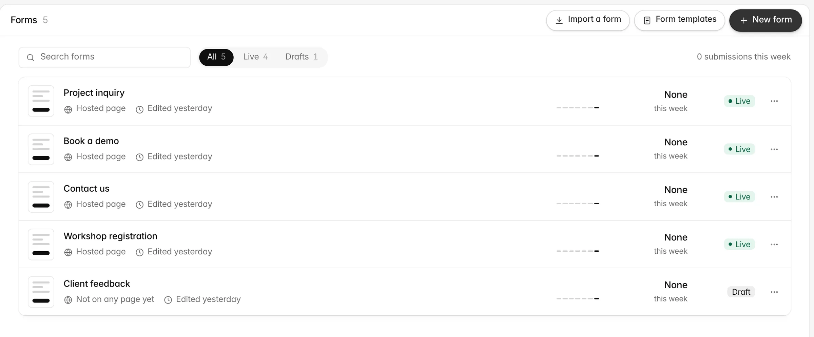

import { Aside, CardGrid, LinkCard, Steps } from '@astrojs/starlight/components';

**Forms** is the first item in the sidebar and the page Claritia opens on. It lists every form in your workspace, with how each one is doing.

With no forms yet, the page opens Form Studio, so you can describe a form to Tia or pick a template right away. See [Build your first form](/get-started/first-form/).

## The buttons at the top

| Button | What it does |
| - | - |
| **New form** | Opens Form Studio for a new form. In a folder, the new form goes into that folder. |
| **Form templates** | Opens the template library. See [Templates](/forms/templates/). |
| **Import a form** | Copies a form from a Google Forms, Typeform or Tally link. See [Import a form](#import-a-form). |

## What each row shows

Each form is one row. From left to right:

| Part | Shows |
| - | - |
| **Name** | The form's name. A red **[n] not synced** tag means that many leads didn't reach their CRM. **Check failed** means the last form check found a problem. |
| **Where it lives** | **Not on any page yet**, **Hosted page**, the website page it's on, **[n] pages**, or **Hosted page and [page]**. |
| **Last fill** | How long ago the last fill came in, or **Edited [time]** when it has none. |
| **Send rate** | **[n]% of visitors send it**: fills out of views. |
| **Bars** | Fills on each of the last 7 days. Today is the dark bar. |
| **This week** | Fills this week, or **None**. |
| **State** | **Draft**, **Paused**, **Live**, or **Live, edited** when the live form has changes not published yet. |

On a phone, the row keeps the name, where it lives and the menu.

Click a row to open the form in Form Studio.

## Find a form

- Type in **Search forms** to filter by name. With no match, the list says **No matches** and **Try another name**.
- Use **Show** to pick **All**, **Live** or **Drafts**. Each shows its count. **Live** includes paused forms. Claritia remembers your pick on this computer.

## Folders

Folders keep forms in groups, like Sales, Hiring or Events. They show in the sidebar under **Forms**.

<Steps>

1. **Make a folder**

   Click **New folder** under **Forms** in the sidebar. Type a name, like "Sales", and click **Create folder**.

1. **Move a form in**

   On a form's row, click **More**, then **Move to folder**, and pick the folder. Claritia says **Moved to [folder]**. Pick **No folder** to take it out.

1. **Open the folder**

   Click the folder in the sidebar. The page shows only its forms. An empty folder says **No forms in this folder** with **New form**.

</Steps>

Inside a folder, the top bar has **Rename folder** and **Delete folder**. Deleting asks **Delete [folder]?**. Its forms stay, under **All forms**.

## The row menu

Click **More** at the end of a row:

| Item | What it does |
| - | - |
| **Open** | Opens the form in Form Studio. |
| **Copy link** | Copies the form's hosted link. Claritia says **Link copied**. |
| **Duplicate** | Makes a copy as a draft. Claritia says **Duplicated as a draft**. |
| **Move to folder** | Picks a folder, or **No folder**. |
| **Pause the form** / **Resume the form** | Takes a live form offline, or puts it back. A draft can't be paused. |
| **Delete** | Asks **Delete [form]?** and deletes the form. |

### Pause or delete a live form

**Pause the form** takes it off every page it's on and stops new fills. Its answers stay, and **Resume the form** puts it back as it was.

**Delete** on a live form says it comes off the pages it's on, and that its submissions stay on your contacts. On a draft, it says **It's a draft, so nothing else changes.**

## Import a form

<Steps>

1. **Click Import a form**

   On the Forms page, click **Import a form**. A box asks for the **Form link**.

1. **Paste the link**

   Paste a Google Forms, Typeform or Tally link and click **Import**. The button reads **Importing** while Claritia reads it.

1. **Sign in to Google if asked**

   The first Google Forms import asks you to sign in to Google. Then Claritia picks up with the same link. Typeform and Tally need no sign-in.

1. **Check the draft**

   The form opens as a draft, with **Imported [n] questions**. If something couldn't be carried over, Claritia lists it as **Not carried over: ...**.

</Steps>

A link Claritia can't read shows **Paste a Google Forms, Typeform or Tally link.**

<Aside type="tip">
Importing makes a Claritia form for good. To keep using Typeform or Tally and only bring their answers in, connect them in **Settings**, then **Integrations** instead. See [Typeform](/integrations/typeform/) and [Tally](/integrations/tally/).
</Aside>

## Who can do what

Every member can see, make, edit, publish, pause and delete forms. See [Roles and permissions](/reference/roles-and-permissions/).

## Next steps

<CardGrid>
  <LinkCard title="Form Studio and Tia" href="/forms/form-studio/" description="Build and change a form." />
  <LinkCard title="Templates" href="/forms/templates/" description="Start from 840 ready-made forms." />
</CardGrid>
