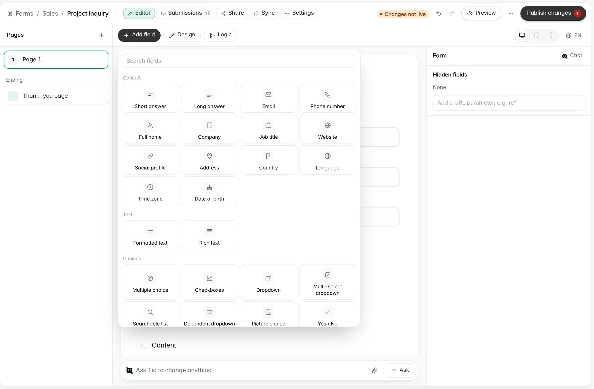
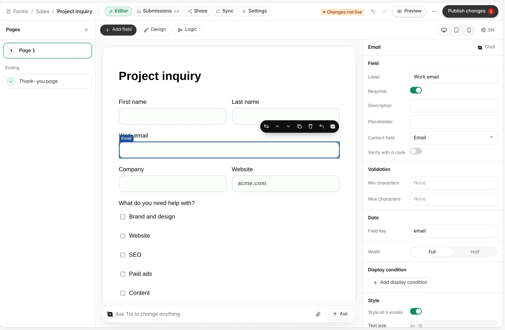
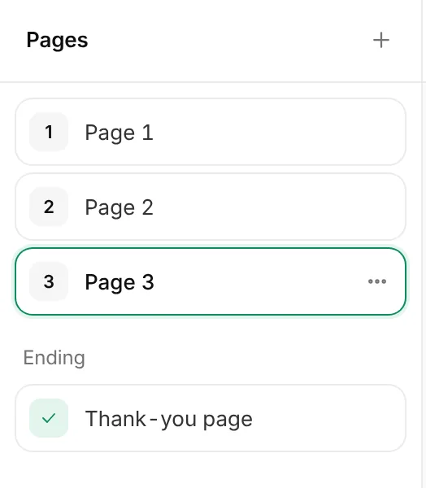
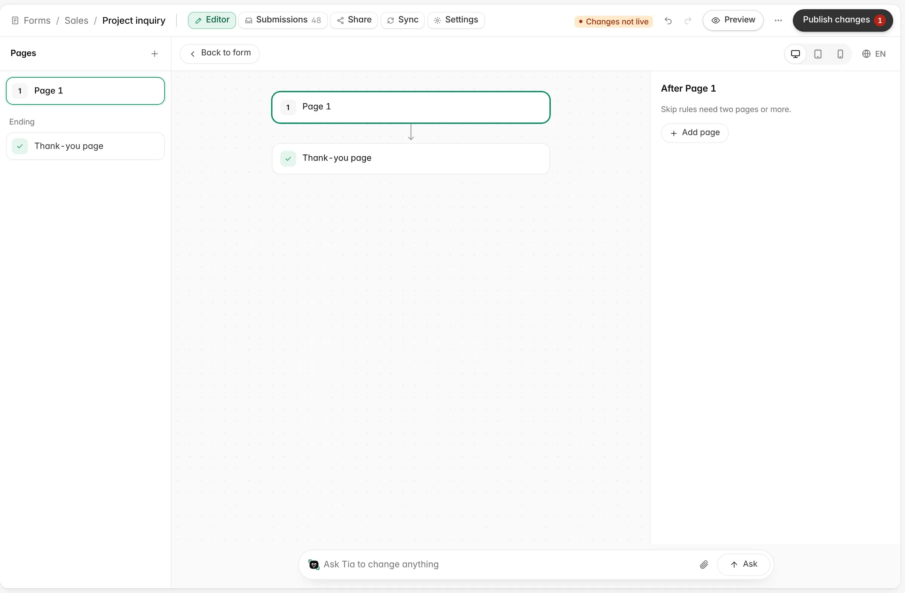

import { Aside, CardGrid, LinkCard, Steps } from '@astrojs/starlight/components';

This page covers what you can put in a form and how the form moves from page to page.

## Add a question

<Steps>

1. **Open the list**

   Click **Add field** in the bar over the form. Type in **Search fields** to find a type fast.

   

1. **Add it**

   Click a type to add it, or drag it to the spot you want.

1. **Set it up**

   Click the new question. In the panel on the right, change its label, make it **Required**, add a placeholder or change its options.

   

</Steps>

To change a question into another type, pick it and use **Change field type**. To show a person's earlier answer inside a later question, type the answer's name in braces, like `{first_name}`.

## Question types

| Group | Types |
| - | - |
| **Contact** | Short answer, Long answer, Email, Phone number, Full name, Company, Job title, Website, Social profile, Address, Country, Language, Time zone, Date of birth |
| **Text** | Formatted text, Rich text |
| **Choices** | Multiple choice, Checkboxes, Dropdown, Multi-select dropdown, Searchable list, Dependent dropdown, Picture choice, Yes / No, Toggle, Ranking, Matrix, Likert scale, Agreement, Text consent |
| **Ratings** | Rating, Opinion scale, Net Promoter Score, Smiley scale, Thumbs up or down, Semantic scale, Points to spread |
| **Numbers and payments** | Number, Number with unit, Slider, Range slider, Currency, Percentage, Amount picker, Product picker, Payment |
| **Date and time** | Date picker, Time picker, Date and time, Month, Date range, Duration, Availability grid |
| **Files and media** | File upload, Image upload, Camera photo, Image with crop, Audio or video answer, Signature, Drawing |
| **Location** | Current location, Map pin |
| **Quiz and logic** | Quiz question, Score, Calculation, Hidden field, Color picker |
| **Structure** | Section, Repeating group, Table input, Answer review, Progress bar |
| **Workspace** | Meeting type, Team member |
| **Display** | Heading, Paragraph, Divider, Image, Video |

### A few types worth knowing

- **Email** can be set to **Verify with a code**, so the person types a code from their inbox before they send the form.
- **Calculation** works out a number from the answers, such as a price. Choices can carry their own amounts.
- **Payment** charges a fixed amount or a calculation through Stripe. Taking payments needs Starter or higher and a connected Stripe account. See [Paid meetings](/meetings/paid-meetings/).
- **Hidden field** holds a value the person never sees, such as a UTM tag from the link.
- **Quiz question** and **Score** let you build quizzes and assessments that add up points.
- **Text consent** asks permission before your workflows send text messages.

## Split a form into pages

The **Pages** list in the left sidebar holds every screen of the form, from the Welcome screen to the Ending.

- **Add page** adds a Welcome screen (until you have one), a plain page, a payment page or a scheduling page.
- Drag a page in the list to move it.
- Each page's menu lets you rename, duplicate, copy, set a timer or delete it. A copied page can be pasted into this form or another one from **Add page**.

Every form can show a **Progress bar** at the top, set in **Design**. Pages slide in as people move forward, and back the other way.

<Aside type="tip">
You can also show one question at a time, like a chat. Turn on **One question at a time** in **Design**.
</Aside>

## Skip pages and show questions

Click **Logic** in the bar over the form. The form turns into its flow: each page with its skips and conditions, then the Ending. Click any step to change it on the right.

| Rule | What it does |
| - | - |
| **Page skip rules** | After a page, send people to a later page based on an answer. Other answers continue to the next page. |
| **Display condition** | Show a page, a question or a part only when an earlier answer matches. |

Rules can test an answer in many ways. A choice can be or not be one of its options. A number can be less than, more than, at most, at least, between or equal to a value. Text can contain, be, not be or start with a value. Any question can be answered or empty.

Skip rules need two pages or more. The form check stops publishing when a rule reads a question that was deleted, or a page depends on a question asked later.

Click **Back to form** to return to the editor.

## Next steps

<CardGrid>
  <LinkCard title="Themes and design" href="/forms/design/" description="Colors, fonts, corners and the progress bar." />
  <LinkCard title="On submission" href="/forms/on-submission/" description="Route each lead to the right meeting." />
</CardGrid>
