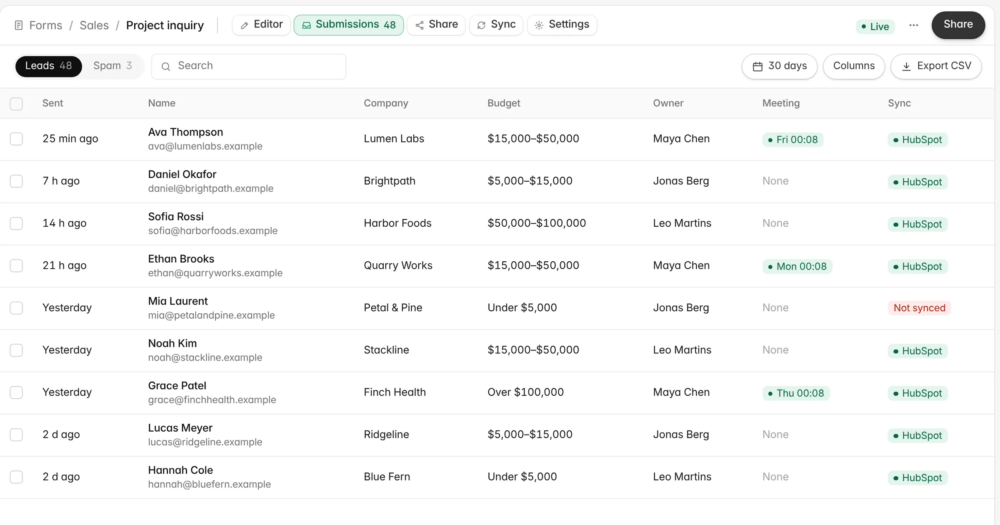
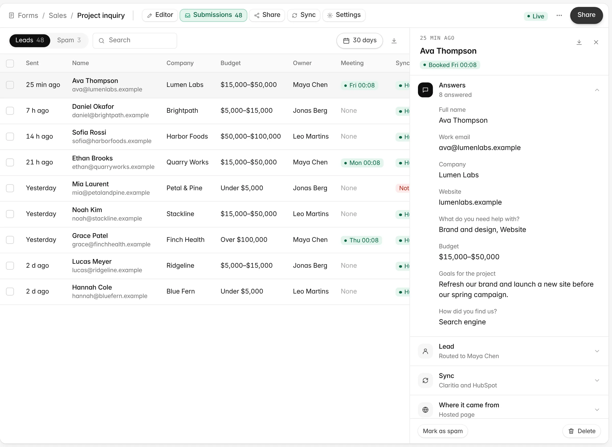
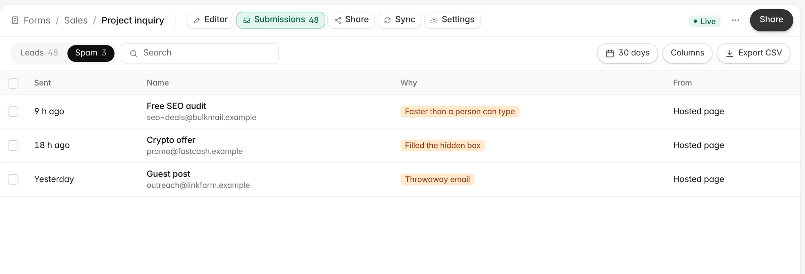

import { Aside, CardGrid, LinkCard } from '@astrojs/starlight/components';

Every answer people send is saved in the form's **Submissions** tab. Open a form and click **Submissions** to see them.

## The funnel

The top of the tab shows the last 30 days for the form: how many people saw it, started it, sent it and booked a meeting. Use it to spot where people stop.

## Three lists

| List | What's in it |
| - | - |
| **Leads** | Every real submission, newest first |
| **Left early** | Visits that started the form and didn't send it, with the question they were on. Their answers are never saved. |
| **Spam** | Submissions any spam check caught |

**Left early** is on the Business plan. On other plans the list shows **Upgrade to see**.

## Find and sort submissions

- Type in **Search** to find a name, an email or an answer.
- Pick a date range, or **Any time**.
- Pick where people came from, like your site, the hosted page or a campaign.
- Click **Columns** to choose which answers show as columns.

Each row shows the person, the meeting they booked, their owner and whether the lead reached your other tools.

## Open one submission

Click a row to open its panel. It shows every answer, the person, where they came from, and where the lead was sent. If a send to another tool failed, click **Try again**. From the panel you can **Download PDF**, **Mark as spam** or **Delete** it.

## Work with many at once

Tick the boxes on the left, or **Select all**. A bar appears at the bottom with what you can do to all of them. Click **Export CSV** at the top of the list to download every submission as a spreadsheet.

## Spam

Claritia checks every submission before it counts. A submission goes to **Spam** when it:

- Fails the bot check
- Fills a hidden box people never see
- Is sent faster than a person can type
- Uses a throwaway email address
- Comes from a site that isn't on the form's list
- Goes past the form's hourly limit

Each spam row says why it was caught. If a real lead lands there, open it and click **Not spam**. The lead is let in, and routing, alerts and the auto-reply run as if it had just arrived.

Spam is cleared after 7 days. You set how strict the checks are in the form's **Settings**, under **Spam and security**. See [Form settings](/forms/form-settings/).

<Aside type="note">
Moving a submission to Spam stops that contact's alerts and emails.
</Aside>

## Over your monthly limit

Free includes 250 submissions a month. When a form goes past it, the form keeps working and every submission is saved. The extra submissions show once you upgrade, or on the 1st of the next month. No lead is lost. See [Plans and billing](/workspace/plans-and-billing/).

## Next steps

<CardGrid>
  <LinkCard title="Form settings" href="/forms/form-settings/" description="Spam checks, alerts and how long answers are kept." />
  <LinkCard title="Send leads to your tools" href="/integrations/send-leads/" description="CRMs, sheets and webhooks." />
</CardGrid>
