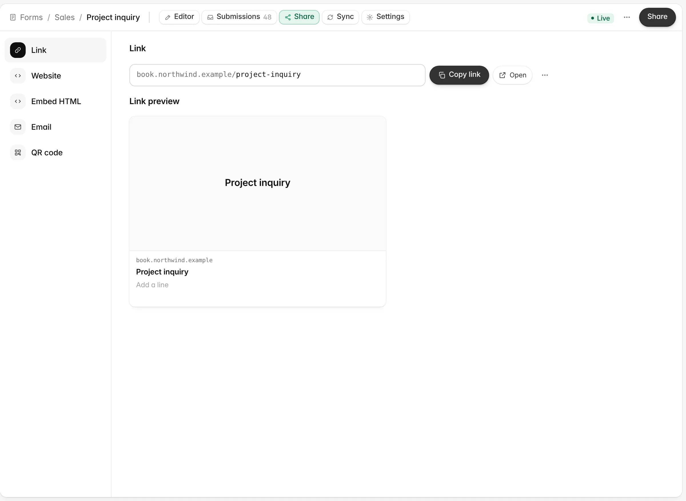
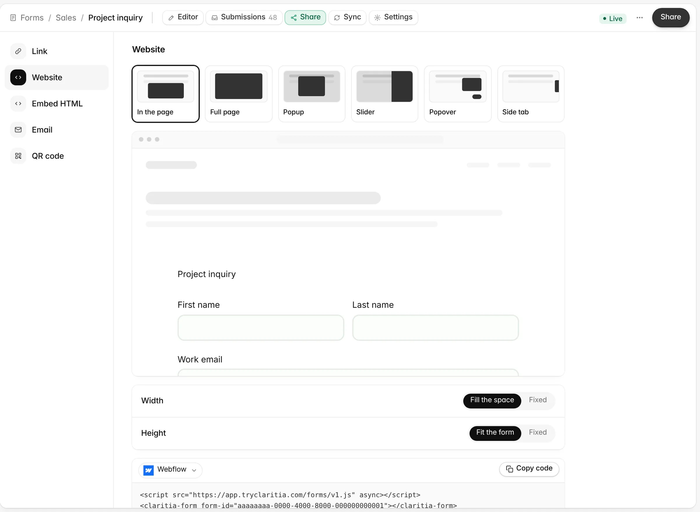
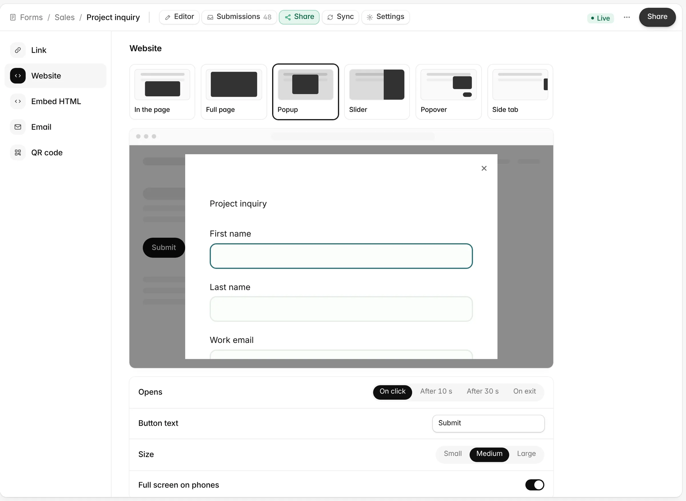
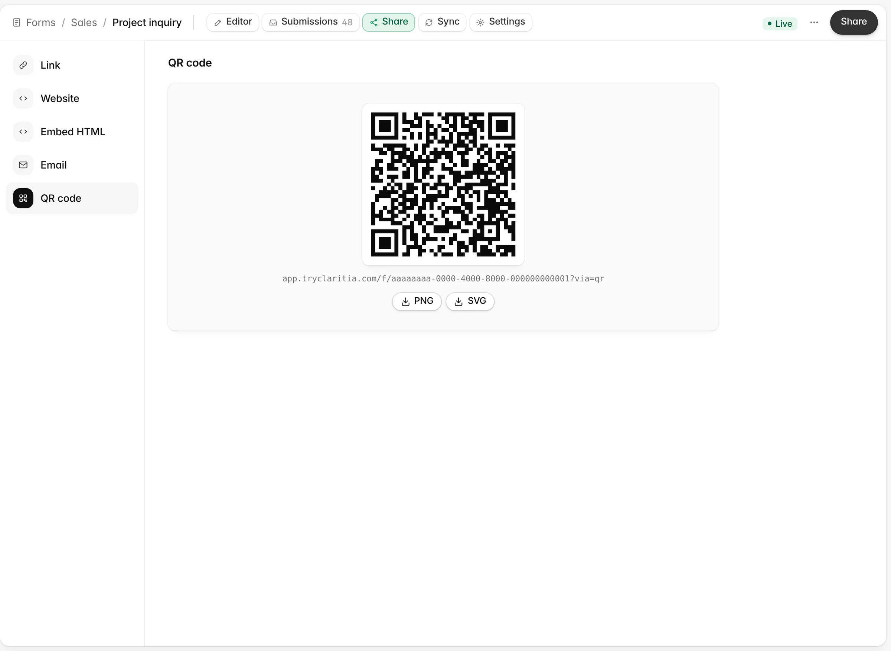

import { Aside, CardGrid, LinkCard, Steps, TabItem, Tabs } from '@astrojs/starlight/components';

Open a form and click the **Share** tab. The ways to share are on the left. The one you pick shows on the right, with a preview and the code to copy. Publish the form first, so people see the live version.

<video class="cl-clip" src="/videos/share-website.mp4" autoplay muted loop playsinline preload="metadata" width="1280" height="800" aria-label="Share, Website: switching between In the page, Popup, Slider and Popover with a live preview" title="Share, Website: switching between In the page, Popup, Slider and Popover with a live preview"></video>

## Share the link

The **Link** opens the form on its own page at Claritia. Click **Copy link** and paste it in an email, a chat or a social post.



- **Link ending**: give the link a readable ending, like `demo-request`, when your workspace has its own address. See [Brand and domains](/workspace/brand-and-domains/).
- **Link preview**: change the title, line and picture people see when you paste the link in a chat app.

## Put it on your website

Pick **Website**, then pick how the form shows:



| Way | How it looks |
| - | - |
| **In the page** | The form sits inside your page, where you paste the code |
| **Full page** | The form fills the whole page |
| **Popup** | The form opens over the page |
| **Slider** | The form slides in from the left or right edge, full height |
| **Popover** | A round button in the corner opens the form above it |
| **Side tab** | A tab on the right edge opens the form |

Options change with the way you pick. A popup can open on click, after 10 or 30 seconds, or when the visitor moves to leave. It can come in three sizes. Timed popups can skip people who already sent the form. A popover can show a chat, calendar, form or logo icon, with a short note. A side tab takes its own words. Over the page on a phone, the form fills the screen unless you turn off **Full screen on phones**.



### Add the code to your site

Claritia shows the steps for your site builder under the code:

<Tabs>
  <TabItem label="Webflow">

For a form in the page, open the page in the Webflow Designer, drag a **Code Embed** element to where the form goes, paste the code, then **Save and close** and publish the site.

For a popup, slider, popover or side tab, open **Site settings**, then **Custom code**, and paste the code in **Footer code**. Save and publish.

  </TabItem>
  <TabItem label="WordPress">

Open the page in the WordPress editor. Click **+** where the form goes and add a **Custom HTML** block. Paste the code, then click **Update** or **Publish**.

  </TabItem>
  <TabItem label="Framer">

For a form in the page, click **Insert**, search for **Embed** and drag it in. Set its type to **HTML** and paste the code. Set the width to **Fill** and the height to **Fit**, then publish.

For a form over the page, open **Site settings**, then **General**, then **Custom code**, and paste the code at the end of the body tag.

  </TabItem>
  <TabItem label="Squarespace">

Edit the page and click **Add block** where the form goes. Add an **Embed** block, open **Code snippet**, click **Embed data** and paste the code.

For a form over the page, use **Settings**, then **Advanced**, then **Code injection**, and paste it in **Footer**. Squarespace needs its Business plan or higher for code injection.

  </TabItem>
  <TabItem label="Shopify and others">

On Shopify, paste the code in the page's HTML view. On any other site, paste it into the page's HTML where the form should show.

  </TabItem>
</Tabs>

<Aside type="note">
Under **Settings**, then **Spam and security**, a form can accept fills only from the sites you list. The form's own link page always works. See [Form settings](/forms/form-settings/).
</Aside>

## Other ways

- **Embed HTML** gives the form as HTML you can drop into your own code.
- **Email** puts the form inside an email. Copy it and paste it into your email app.
- **QR code** opens the form's link. It always uses the form's id link, so a printed code keeps working if you change the link ending later.



## For developers

Every website option uses one script. Add it once to your page:

```html
<script src="https://app.tryclaritia.com/forms/v1.js" async></script>
```

Then place a form with its id:

```html
<claritia-form form-id="FORM_ID"></claritia-form>
```

| Attribute | What it does |
| - | - |
| `full` | Fills the page |
| `popup="click"`, `popup="delay:10"`, `popup="exit"` | Opens over the page on a button click, after a number of seconds, or when the visitor moves to leave. A button with `data-claritia-open="FORM_ID"` opens it. |
| `size="s"`, `"m"` or `"l"` | The popup's width |
| `slider="left"` or `"right"` | Full height from that side |
| `popover` with `icon="chat"` and `note="Questions?"` | A round button in the corner opens the form |
| `side-tab="Contact us"` | A tab on the right edge opens the form |
| `once` | A timed or exit popup won't open again for someone who sent it |
| `mobile="keep"` | On a phone, keep the box instead of filling the screen |

### Meeting calendars

The same script shows a meeting's calendar:

```html
<claritia-book type="WORKSPACE/MEETING"></claritia-book>
<claritia-book type="WORKSPACE/MEETING" mode="button" text="Book a demo"></claritia-book>
<a href="#" data-claritia-book="WORKSPACE/MEETING">Book a demo</a>
```

### window.Claritia

```js
Claritia.open("FORM_ID", { prefill: { email: "dana@acme.com" }, size: "l" });
Claritia.open("WORKSPACE/MEETING");
Claritia.close();
Claritia.prefill({ email: "dana@acme.com", company: "Acme" });
const off = Claritia.on("submitted", (d) => console.log(d.submissionId));
```

Calls made before the script loads run once it's ready:

```html
<script>window.Claritia = window.Claritia || { q: [] }; Claritia.q.push(["prefill", { email: "dana@acme.com" }]);</script>
```

### Events

Each event bubbles to the document as `claritia:<name>`, with these details:

| Event | Details |
| - | - |
| `ready` | `formId` |
| `step` | `formId`, `step` (from 0), `of` |
| `open`, `close` | `formId` |
| `submitted` | `formId`, `submissionId` |
| `booked` | `formId` for a form's calendar, `start`, `end` |

## Next steps

<CardGrid>
  <LinkCard title="On submission" href="/forms/on-submission/" description="Decide what happens after they send it." />
  <LinkCard title="Responses and spam" href="/forms/responses-and-spam/" description="See what comes in." />
</CardGrid>
