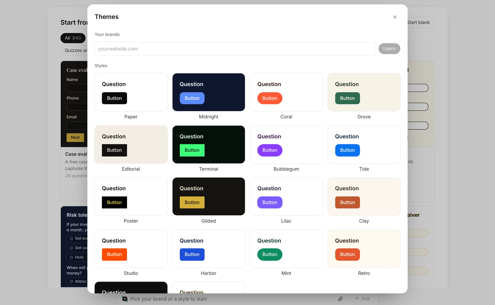
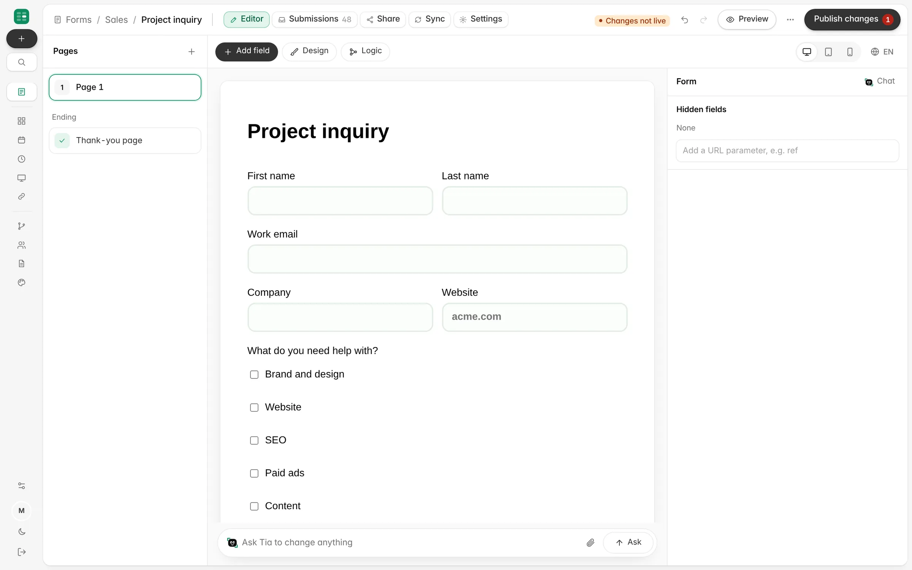
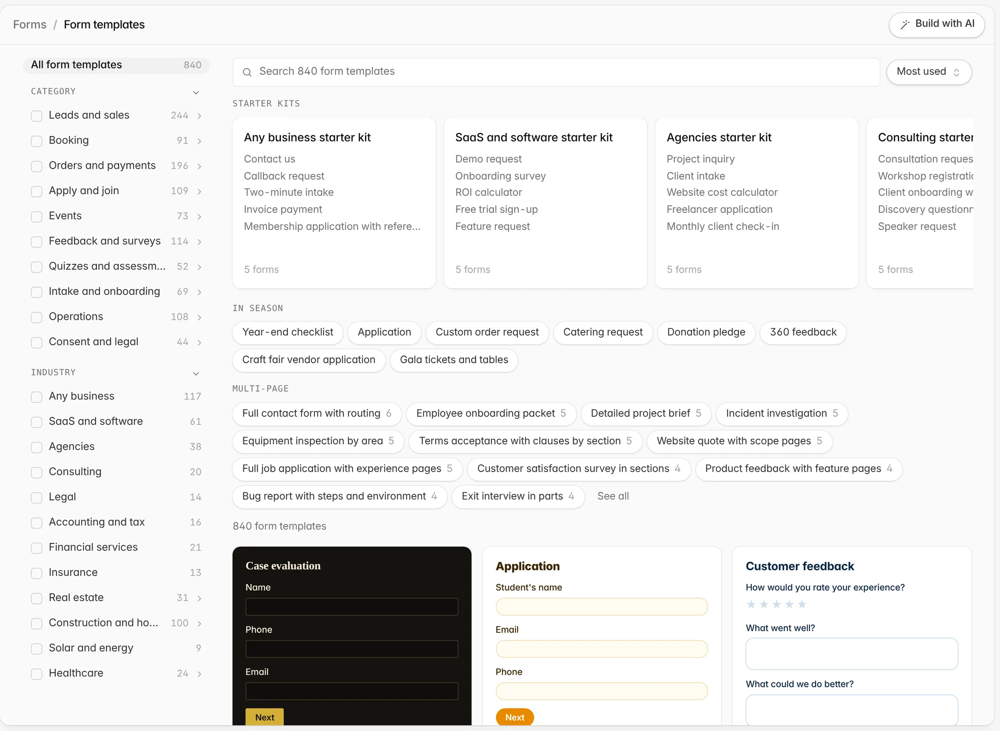
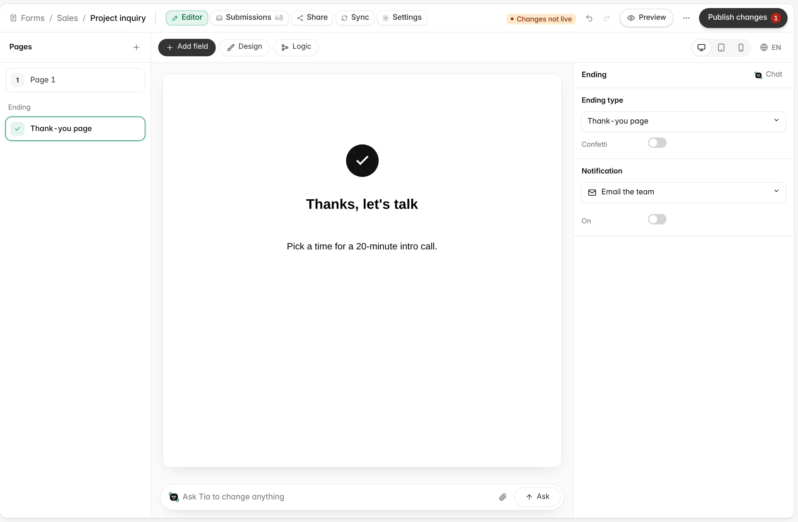
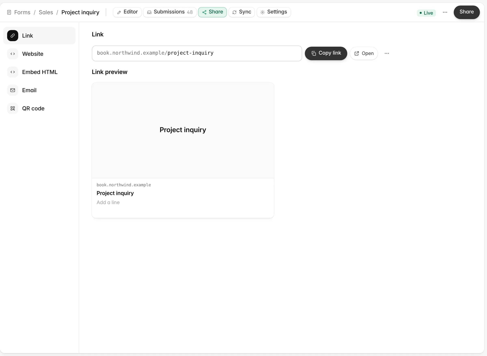

import { Aside, CardGrid, LinkCard, Steps, TabItem, Tabs } from '@astrojs/starlight/components';

You can have a live form in a few minutes. Pick one way to start, then publish it and share it.

## Start the form

<Tabs>
  <TabItem label="With Tia">

<Steps>

1. **Open Form Studio**

   Go to **Forms** and click **New form**. With no forms yet, Form Studio is the first thing you see.

1. **Pick a look**

   Click **Pick your brand or a style**. Choose your own brand, one of the 18 styles, or **Use your own brand** to type your website and let Claritia read its colors and fonts.

   

1. **Say what the form is for**

   Type one sentence in the **Ask Tia** box, like "A demo request that asks for team size and books a call". Tia builds the form in front of you.

   

1. **Keep changing it**

   Ask Tia for more, like "make the phone number optional". You can also click any question to change it in the panel on the right.

</Steps>

  </TabItem>
  <TabItem label="From a template">

<Steps>

1. **Open the templates**

   Go to **Forms** and click **Form templates**.

   

1. **Find one that fits**

   Search, or filter by category, industry, team and features. Click a card to see the form and what it comes with.

1. **Use it**

   Pick a look, then click **Use form template**. The form opens in Form Studio, ready to change.

</Steps>

  </TabItem>
</Tabs>

<Aside type="tip">
Building a whole new form with Tia uses about 10 AI credits. A small change uses 1. Free includes 100 credits a month. See [Plans and billing](/workspace/plans-and-billing/).
</Aside>

## Decide what happens when they send it

Click **Ending** in the left sidebar of Form Studio, then pick an **Ending type**:

| Ending type | What the person sees |
| - | - |
| **Thank-you page** | Your thank-you message. This is the default. |
| **Redirect** | A page on your own site, at the address you type. |
| **Booking page** | A calendar to book a meeting, right under the thank-you message. |

To let leads book, you need a meeting type first. See [Meeting types](/meetings/meeting-types/), then [On submission](/forms/on-submission/).

## Publish it

Click **Publish** at the top right. Claritia runs the form check first. If it finds something to fix, the button shows how many problems there are. Click it to see the list, and click a problem to jump to it.

Once the check passes, the form goes live and shows a green **Live** tag. Later changes stay in your draft and the tag reads **Changes not live** until you click **Publish changes**.

## Share it

Open the form's **Share** tab and pick a way:

| Way | Use it for |
| - | - |
| **Link** | A page of its own on Claritia. Copy the link and send it anywhere. |
| **Website** | Put the form on your site: in the page, full page, as a popup, a slider, a popover or a side tab. |
| **Embed HTML** | The form as plain HTML for your own code. |
| **Email** | The form inside an email you send. |
| **QR code** | A code to print, which opens the form's link. |

For each website option, Claritia shows a live preview and the steps for Webflow, WordPress, Framer, Squarespace, Shopify or any other site. See [Share and embed](/forms/share-and-embed/).

## Next steps

<CardGrid>
  <LinkCard title="Connect your calendar" href="/get-started/connect-your-calendar/" description="So leads only see times you're free." />
  <LinkCard title="Form Studio and Tia" href="/forms/form-studio/" description="Everything in the editor, step by step." />
</CardGrid>
