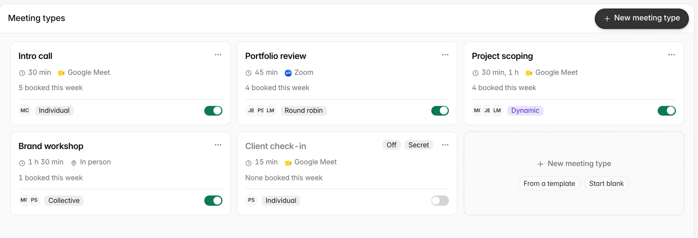
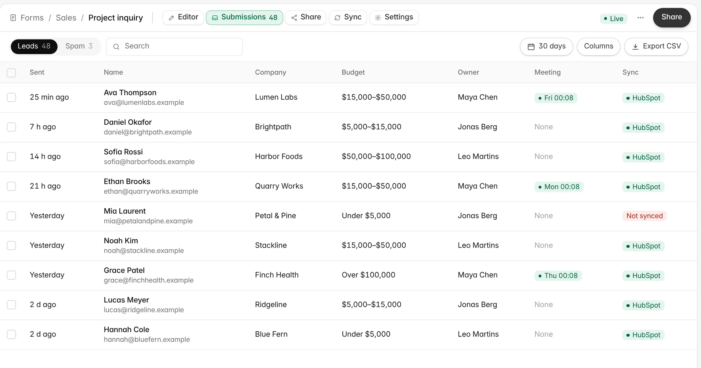
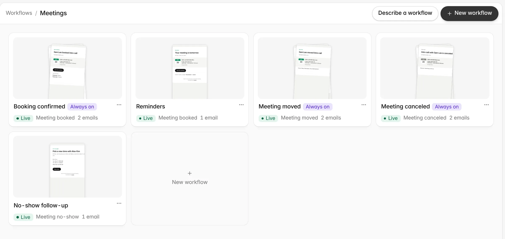

import { Aside, CardGrid, LinkCard, Steps } from '@astrojs/starlight/components';

This plan gets a new workspace from empty to booked meetings. Each step takes a few minutes. The **Get started** card in the sidebar tracks the same steps and ticks each one off.

<Steps>

1. **Day 1: connect your calendar**

   Open **Meetings**, then **Availability**, and connect Google Calendar or Outlook. Set your working hours while you're there. [Connect your calendar](/get-started/connect-your-calendar/)

1. **Day 1: make a meeting type**

   Open **Meeting types** and click **New meeting type**. Start from a template like **Intro call** or **Product demo**, or start blank. [Meeting types](/meetings/meeting-types/)

   

1. **Day 2: put a form live**

   Build a form with Tia or a template and click **Publish**. [Build your first form](/get-started/first-form/)

1. **Day 2: book meetings from the form**

   In Form Studio, open the **Ending** and set **Ending type** to **Booking page**. Pick the meeting it books. Publish again. [On submission](/forms/on-submission/)

1. **Day 3: share it**

   Put the form on your site from the **Share** tab, or send its link. Watch the **Submissions** tab as answers come in. [Share and embed](/forms/share-and-embed/)

   

1. **Day 4: follow up**

   Open **Email**, then **Workflows**. The meeting emails are already live in the **Meetings** folder. Add a follow-up for people who send the form but don't book. [Workflows](/email/workflows/)

   

1. **Day 5: invite your team**

   Go to **Settings**, then **Members**, and click **Invite**. Teammates who only build forms or read answers don't need a paid seat. [Members and seats](/workspace/members-and-seats/)

1. **Day 5: connect your CRM**

   Go to **Settings**, then **Integrations**, and connect the CRM your team uses. Then open the form's **Sync** tab to send each lead there. [Send leads to your tools](/integrations/send-leads/)

</Steps>

## Getting-started emails

In your first weeks, Claritia sends the person who made the workspace a few short emails. Each one asks for one step, and Claritia skips it once that step is done. You get at most one a day, during working hours in your workspace's time zone.

To turn them off, go to **Settings**, then **Profile**, and switch off **Getting-started tips**. Each email also has a link to turn them off.

<Aside type="tip">
Send a test fill of your own form before you share it. Book a time from it and check that the event lands on your calendar and the confirmation email arrives.
</Aside>

## Next steps

<CardGrid>
  <LinkCard title="Form Studio and Tia" href="/forms/form-studio/" description="Everything you can do in the form editor." />
  <LinkCard title="Questions people ask" href="/reference/faq/" description="Seats, credits, limits and more." />
</CardGrid>
