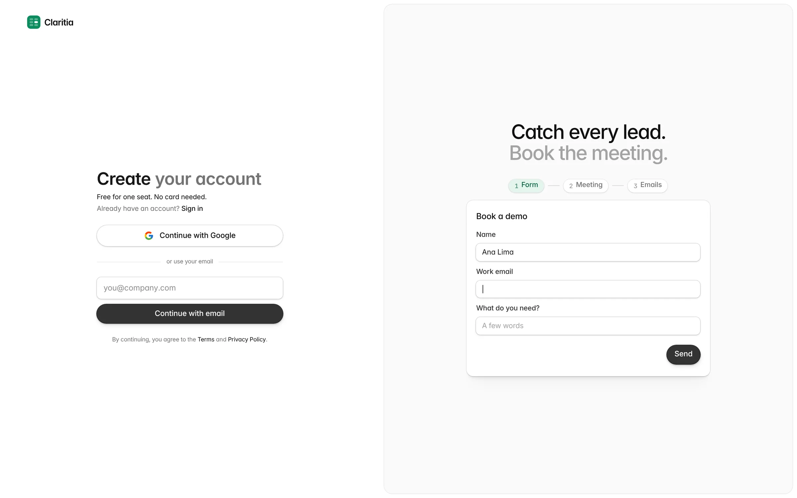
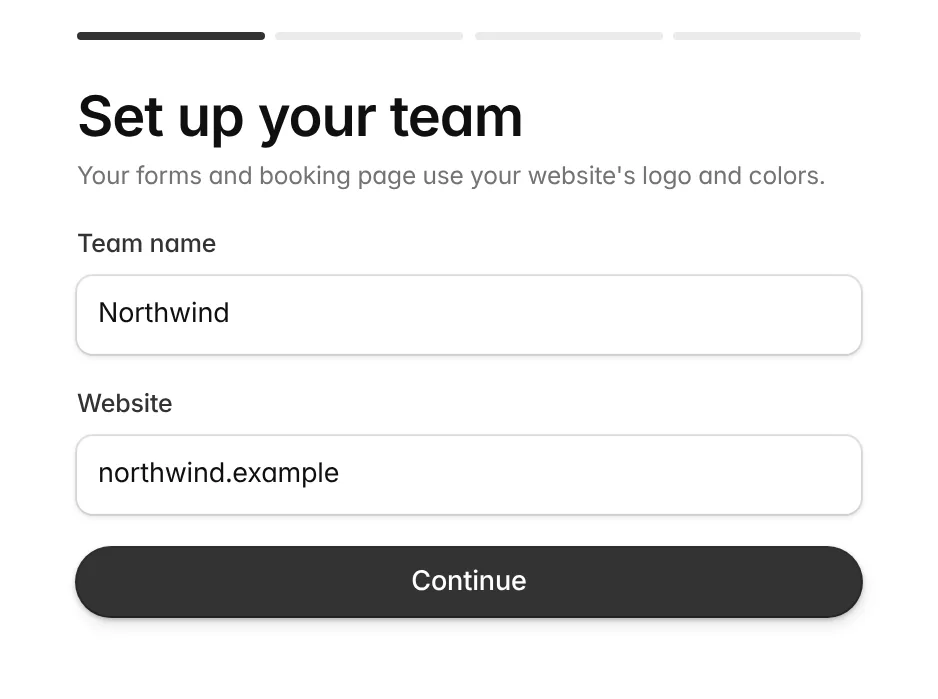
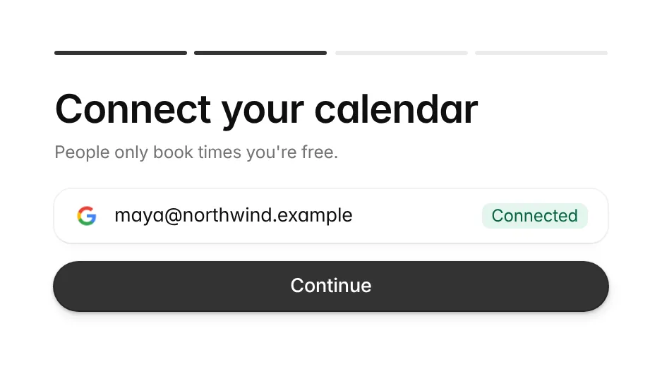
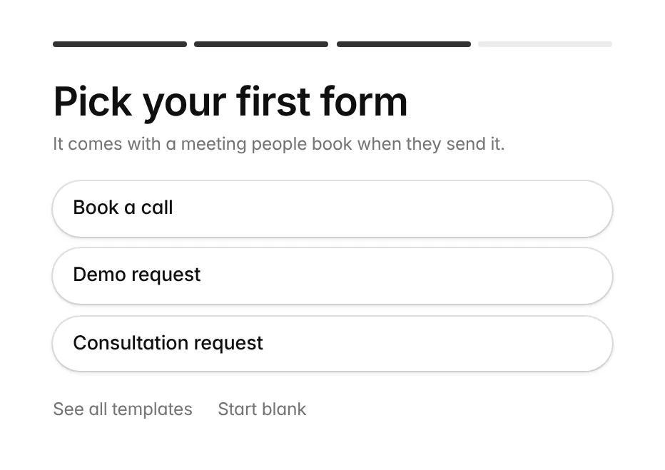
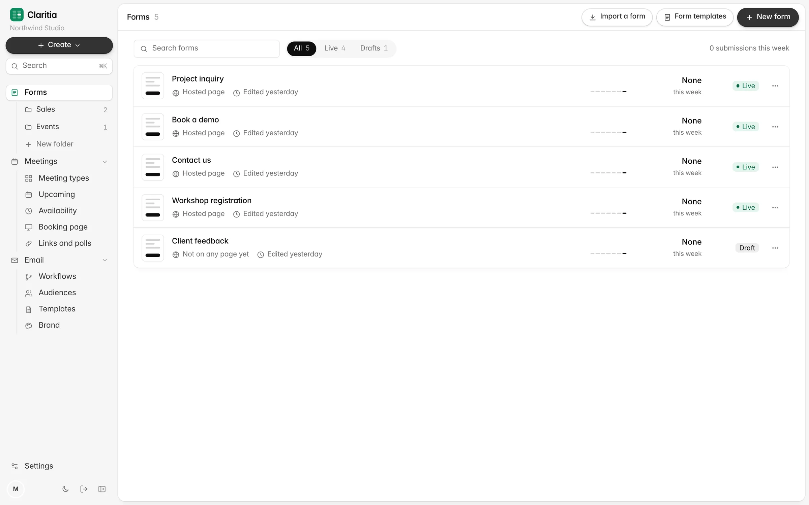

import { Aside, CardGrid, LinkCard, Steps } from '@astrojs/starlight/components';

Claritia is free for one seat, and you don't need a card. This page walks you through making an account and the short setup that follows.

## Create your account

<Steps>

1. **Open the sign-up page**

   Go to [app.tryclaritia.com/signup](https://app.tryclaritia.com/signup), or click **Start free** on tryclaritia.com. The page says **Create your account**.

   

1. **Pick how to sign in**

   Click **Continue with Google** or **Continue with Microsoft**. You can also type your email and click **Continue with email** to get a sign-in link.

1. **Open the link, or type the code**

   If you used email, open the message from Claritia and click the link. The same email has a 6-digit code. Type it in the box on the **Check your inbox** screen if the link opens in a different browser.

</Steps>

<Aside type="tip">
If you typed your email a letter off, like `gmial.com`, Claritia asks **Did you mean** with the fixed address. One click fixes it.
</Aside>

## Follow the guided setup

Your first sign-in makes a new workspace. If you made it, you see four short steps. You can skip the ones you don't need yet.

<Steps>

1. **Set up your team**

   Type your team's name and website. With a work email, Claritia guesses both for you. It reads your website's logo and colors, so your first form and your booking page look like your brand.

   

1. **Connect your calendar**

   Click **Google Calendar** or **Outlook** and sign in. People can then only book times when you're free. You can skip this step and do it later. See [Connect your calendar](/get-started/connect-your-calendar/).

   

1. **Pick your first form**

   Choose **Book a call**, **Demo request** or **Consultation request**. Claritia makes the form in your brand and makes a meeting type for it, so people can book a time when they send it. You can also open all templates or start blank.

   

1. **Invite your team**

   Type your teammates' emails with commas between them, then click **Send invites**. You can skip this and invite people later from **Settings**, then **Members**.

</Steps>

When you finish, the new form opens in Form Studio and Claritia sends you a welcome email with your next steps.

<Aside type="note">
Signed in with the wrong account? Your email and **Sign out** sit at the top of every setup step.
</Aside>

## Join a team you were invited to

If a teammate invited you, open the invite email and click its link. The page says **Join** and your team's name, with your email already filled in. Sign in with that same email to open the team's workspace.

If you belong to more than one workspace, switch between them from the workspace name at the top of the sidebar.

## Find your way around

The sidebar on the left holds every page:

| Item | What it holds |
| - | - |
| **Create** | One menu to make a form, a meeting type, a single-use link, a poll, an email template or a workflow |
| **Search** | Find any page or action. Press ⌘K (or Ctrl+K) |
| **Forms** | Your forms, their folders and Form templates |
| **Meetings** | Meeting types, Upcoming, Availability, Booking page, and Links and polls |
| **Email** | Workflows, Audiences, Templates and Brand |
| **Settings** | Integrations, webhooks, email domains, members, brand, billing and your profile |

The **Get started** card in the sidebar lists six first steps and ticks each one off when you finish it.

## Next steps

<CardGrid>
  <LinkCard title="Build your first form" href="/get-started/first-form/" description="Ask Tia or start from a template, then publish." />
  <LinkCard title="Connect your calendar" href="/get-started/connect-your-calendar/" description="Google Calendar, Outlook and Zoom." />
</CardGrid>
