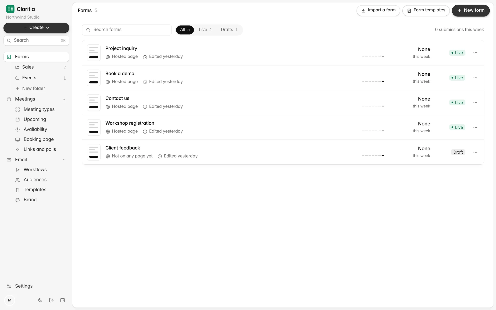

import { Aside, CardGrid, LinkCard } from '@astrojs/starlight/components';

Claritia has one sidebar on the left and one page on the right. Every page has its own address, so you can bookmark it, share it with a teammate or open it in a new tab.

## The sidebar

From top to bottom, the sidebar holds:

| Part | What it does |
| - | - |
| **Workspace name** | Your workspace. If you're in more than one, click the name to switch. |
| **Create** | Makes something new. See [Create](#create). |
| **Search** | Opens the command bar, the same as ⌘K. |
| **Forms** | Your forms, with your form folders under it. |
| **Meetings** | **Meeting types**, **Upcoming**, **Availability**, **Booking page** and **Links and polls**. |
| **Email** | **Workflows**, **Audiences**, **Templates** and **Brand**. |
| **Settings** | Integrations, email sending, members, workspace and account settings. |
| **Your account** | Your email, the light or dark switch, and **Sign out**. |

**Meetings** and **Email** are rows that open and fold, like folders. Claritia keeps them the way you left them on this computer.

A number beside an item is a count, like the meetings coming up in **Upcoming**. A small dot means something there needs a step.

### Fold the sidebar

Click **Collapse the sidebar** to fold it to icons. Click **Keep the sidebar open** to open it again. Folded, it opens over the page while your pointer is on it. On screens between 768 and 1,280 pixels wide, it folds on its own. It also folds while Form Studio is open, so the form has room, and comes back the way it was when you leave.

On a phone, the sidebar becomes a bar across the top.

## Create

Click **Create** at the top of the sidebar to make something new from any page.

| Group | Item | Opens |
| - | - | - |
| Forms | **Form** | A new form, from Tia, a template or blank |
| Meetings | **Meeting type** | A new meeting type |
| Meetings | **Single-use link** | **Links and polls**, with a new single-use link |
| Meetings | **Poll** | **Links and polls**, with a new poll |
| Emails | **Email template** | **Templates**, with a new template |
| Emails | **Workflow** | A new workflow |

## The command bar

Press **⌘K** on a Mac or **Ctrl+K** on Windows, or click **Search**. A box opens that says **Go to…**. Type a few letters, use the arrow keys to move, and press Enter to pick. Press Esc to close.

It finds:

- Every page in the sidebar, like **Availability** or **Audiences**.
- Every Create item, as **New form**, **New meeting type**, **New poll** and the rest.
- **Copy my booking link**, which copies your own booking page's address. If you haven't picked one yet, it opens **Booking page**.
- **Dark mode** or **Light mode**.
- **Sign out**.

When nothing fits, it says **No matches**.

## The Get started card

A new workspace shows a small **Get started** card at the foot of the sidebar, with a progress bar and six steps:

1. **Connect your calendar**
2. **Make a meeting type**
3. **Put a form live**
4. **Book meetings from a form**
5. **Invite a teammate**
6. **Connect your CRM**

Click a step to go where it's done. Each one ticks itself once Claritia sees it done. The card goes away when all six are done, or when you click **Close**. It shows on wide screens only.

## Workspaces

A workspace holds your forms, meetings, emails and team. One person can be in several, like a company workspace and a client's.

- When you're in more than one, the workspace name has a menu. Pick another to switch. Claritia opens the one you picked last on this computer.
- A workspace you just joined from an invite opens first.
- To rename a workspace, see [Settings › General](/workspace/general/).

## Light and dark

Claritia follows your computer's light or dark setting until you pick one. Switch with the sun or moon in your account row, or **Dark mode** and **Light mode** in the command bar. Claritia remembers your pick on this computer.

## Addresses you can share

Each page has its own address. Some useful ones:

| Address | Opens |
| - | - |
| `/forms` | Forms |
| `/forms/<id>` | One form in Form Studio |
| `/scheduling/types` | Meeting types |
| `/scheduling/upcoming` | Upcoming meetings |
| `/scheduling/availability` | Availability |
| `/emails/automations` | Workflows |
| `/settings/<page>` | A settings page, like `/settings/team` |

Old addresses from removed parts of Claritia open Forms.

<Aside type="tip">
The app opens on **Forms**. If you sign in from a link, like an invite or a meeting, Claritia takes you to that page after sign-in.
</Aside>

## Next steps

<CardGrid>
  <LinkCard title="Your first week" href="/get-started/first-week/" description="A day-by-day plan." />
  <LinkCard title="Forms list and folders" href="/forms/forms-list/" description="Find, sort and organize your forms." />
</CardGrid>
