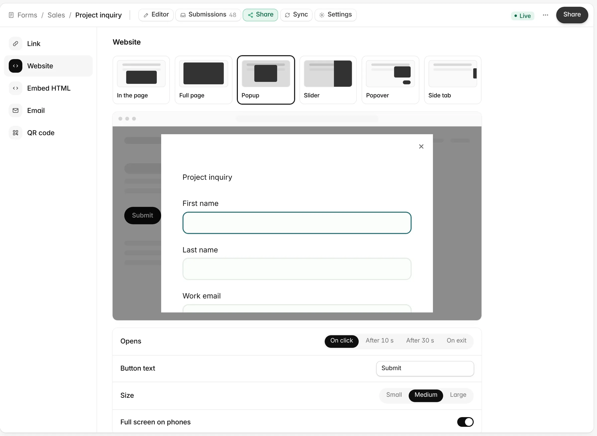
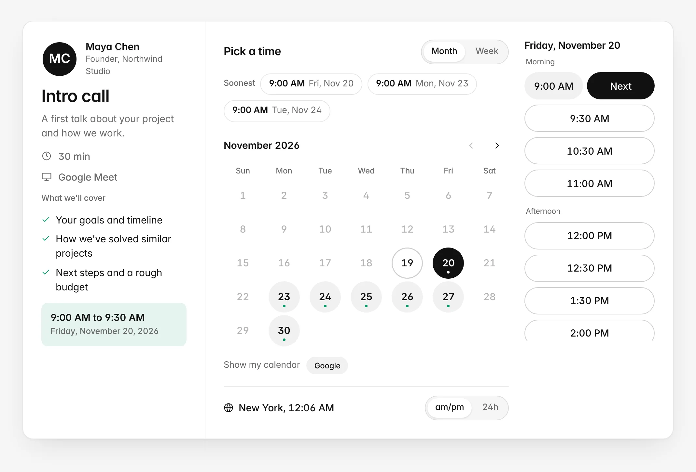

import { Card, CardGrid, LinkCard, Steps, TabItem, Tabs } from '@astrojs/starlight/components';

In Claritia, every part of the app shares the same lead. **Forms** catch the lead. **Meetings** let them book a time before they leave your page. **Workflows** send every email that comes after. Tia, the AI assistant in the app, can build a form from one sentence.

## Explore the docs

<CardGrid>
  <Card title="Get started" icon="rocket">
    Sign up, set up your team, build a form and connect your calendar. [Start here](/get-started/sign-up/)
  </Card>
  <Card title="Forms" icon="document">
    Form Studio, Tia, 840 templates, question types, logic, design and sharing. [Build forms](/forms/form-studio/)
  </Card>
  <Card title="Meetings" icon="clock">
    Meeting types, availability, teams that take turns, booking pages, polls and paid meetings. [Set up meetings](/meetings/meeting-types/)
  </Card>
  <Card title="Email and workflows" icon="email">
    Folders of workflows, triggers and steps, the email editor, audiences and your sending domain. [Follow up](/email/workflows/)
  </Card>
  <Card title="Integrations" icon="puzzle">
    Send leads to your CRM, sheets and other tools, and get webhooks for each meeting. [See the list](/integrations/)
  </Card>
  <Card title="Reference" icon="information">
    Glossary, answers to common questions and fixes for common problems. [Look something up](/reference/glossary/)
  </Card>
</CardGrid>

## How a lead moves through Claritia

<Steps>

1. **They fill your form**

   The form lives on your site, on its own link or in a popup. It can ask anything, from a work email to a budget. [Form Studio](/forms/form-studio/)

   

1. **The form picks the meeting**

   When they send it, routing rules read their answers and pick the meeting to book. [On submission](/forms/on-submission/)

1. **The meeting picks the person**

   One host, or a team that takes turns. The lead sees that person's open times and books on the spot. [Team meetings](/meetings/team-meetings/)

   

1. **Workflows follow up**

   The confirmation with the calendar invite goes out at once. Reminders go a day and an hour before. Your own workflows can send more. [Meeting emails](/email/meeting-emails/)

</Steps>

## Three ways to start a form

<Tabs>
  <TabItem label="Ask Tia">

Open **Forms**, then **New form**. Pick your brand or a style, then tell Tia what the form is for in one sentence. Tia builds it in front of you, and you keep changing it by chatting or by clicking. [Form Studio and Tia](/forms/form-studio/)

  </TabItem>
  <TabItem label="Use a template">

Open **Forms**, then **Form templates**. Filter 840 templates by use, industry, team and features, then click **Use form template**. Booking templates come with their meeting. [Templates](/forms/templates/)

  </TabItem>
  <TabItem label="Import one">

Click **Import a form** on the Forms page and paste a Google Forms, Typeform or Tally link. Claritia brings over the questions. [Templates and imports](/forms/templates/#import-a-form-you-already-have)

  </TabItem>
</Tabs>

## Plans

| | Free | Starter | Pro | Business |
| - | - | - | - | - |
| Price per seat a month | $0 | $15, or $12 yearly | $39, or $31 yearly | $79, or $63 yearly |
| Seats | 1 | Unlimited | Unlimited | Unlimited |
| Submissions a month | 250 | 2,000 | 5,000 | Unlimited |
| AI credits a month | 100 | 500 | 2,000 | 5,000 |
| Workflow emails a month | 1,000 | 10,000 | 50,000 | 200,000 |

A seat is a teammate people can book a meeting with. Teammates who only build forms or read answers are free. See [Plans and billing](/workspace/plans-and-billing/) for what each plan adds.

## Need help?

<CardGrid>
  <LinkCard title="Questions people ask" href="/reference/faq/" description="Seats, credits, the free plan, booking and more." />
  <LinkCard title="Email the team" href="mailto:hello@tryclaritia.com" description="Write to hello@tryclaritia.com and a person will answer." />
</CardGrid>
