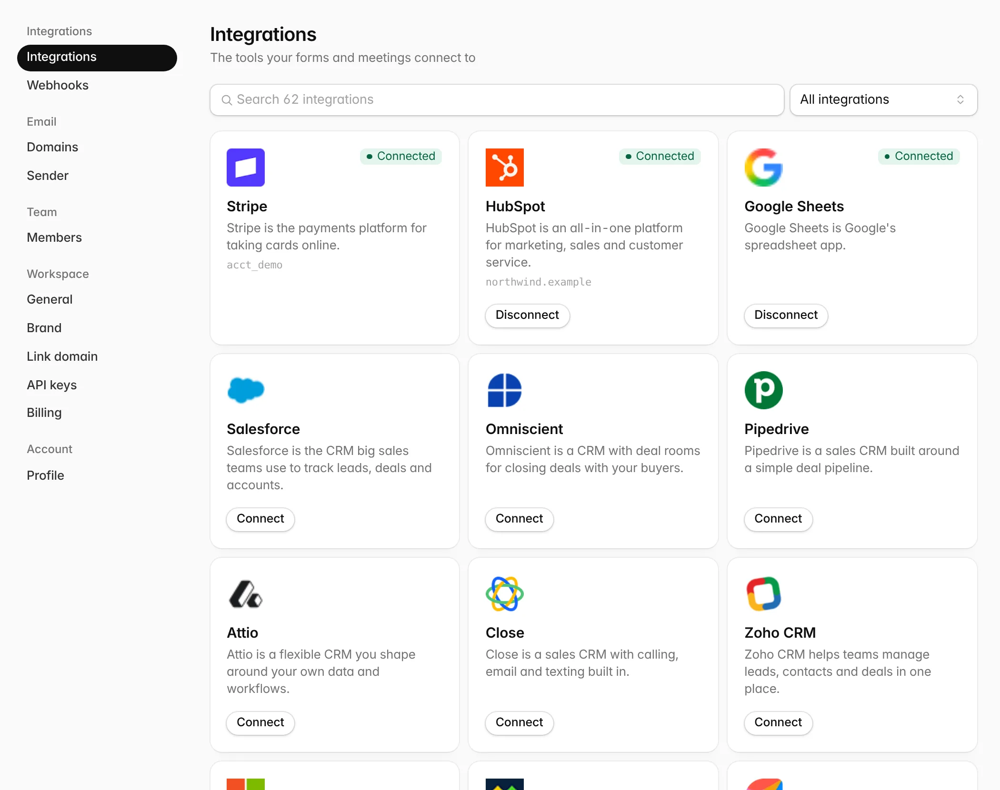

import { Aside, CardGrid, LinkCard, Steps } from '@astrojs/starlight/components';

Claritia connects to the tools your team already uses. Most connect with one click and a sign-in. Open **Settings**, then **Integrations**.

<video class="cl-clip" src="/videos/integrations.mp4" autoplay muted loop playsinline preload="metadata" width="1280" height="800" aria-label="Searching Settings, Integrations and opening the HubSpot sheet" title="Searching Settings, Integrations and opening the HubSpot sheet"></video>

## Connect a tool

<Steps>

1. **Find it**

   Type in the search box, or pick a category from the menu next to it.

1. **Click Connect**

   Most tools open their own sign-in page. Approve Claritia there, and you come back with the card marked **Connected**. A few tools need one detail, like a signing secret or database details. Those open a short form.

1. **Use it**

   Once connected, a CRM or other tool shows in a form's **Sync** tab and in workflow steps. See [Send leads to your tools](/integrations/send-leads/).

</Steps>

Click anywhere else on a card to read what the tool does in Claritia, the access it gives, and where it's used. To stop using a tool, open it and click **Disconnect**. Forms stop sending leads to it.

## What you can connect

| Category | Tools |
| - | - |
| **CRMs** | [HubSpot](/integrations/hubspot/), [Salesforce](/integrations/salesforce/), [Omniscient](/integrations/omniscient/), [Pipedrive](/integrations/pipedrive/), [Attio](/integrations/attio/), [Close](/integrations/close/), [Zoho CRM](/integrations/zoho-crm/), [Dynamics 365](/integrations/dynamics-365/), [GoHighLevel](/integrations/gohighlevel/), [Freshsales](/integrations/freshsales/), [Copper](/integrations/copper/), [Keap](/integrations/keap/), [monday CRM](/integrations/monday-crm/) |
| **Email lists** | [Mailchimp](/integrations/mailchimp/), [Klaviyo](/integrations/klaviyo/), [ActiveCampaign](/integrations/activecampaign/), [Brevo](/integrations/brevo/), [Kit](/integrations/kit/), [MailerLite](/integrations/mailerlite/) |
| **Sheets and databases** | [PostgreSQL](/integrations/postgresql/), [MySQL](/integrations/mysql/), [Google Sheets](/integrations/google-sheets/), [Airtable](/integrations/airtable/), [Excel Online](/integrations/excel-online/), [Notion](/integrations/notion/) |
| **Tasks and tickets** | [Intercom](/integrations/intercom/), [Linear](/integrations/linear/), [Trello](/integrations/trello/), [ClickUp](/integrations/clickup/), [monday.com](/integrations/monday-com/), [SmartSuite](/integrations/smartsuite/), [Zendesk](/integrations/zendesk/), [Freshdesk](/integrations/freshdesk/) |
| **Documents and files** | [Google Docs](/integrations/google-docs/), [DocuSign](/integrations/docusign/), [PandaDoc](/integrations/pandadoc/), [Google Drive](/integrations/google-drive/), [OneDrive](/integrations/onedrive/), [Dropbox](/integrations/dropbox/), [Box](/integrations/box/), [Amazon S3](/integrations/amazon-s3/) |
| **Messages and texts** | [Microsoft Teams](/integrations/microsoft-teams/), [Discord](/integrations/discord/), [Twilio](/integrations/twilio/) |
| **Forms** | [Typeform](/integrations/typeform/), [Tally](/integrations/tally/), [Webflow forms](/integrations/webflow-forms/) |
| **Meetings** | [Calendly](/integrations/calendly/), [Cal.com](/integrations/cal-com/), [Webex](/integrations/webex/), [Whereby](/integrations/whereby/) |
| **Calendars and video** | [Google Calendar](/integrations/google-calendar/), [Outlook Calendar](/integrations/outlook-calendar/), [Zoom](/integrations/zoom/) |
| **Payments** | [Stripe](/integrations/stripe/), [PayPal](/integrations/paypal/), [Square](/integrations/square/) |
| **Analytics and ads** | [Segment](/integrations/segment/), [PostHog](/integrations/posthog/), [Mixpanel](/integrations/mixpanel/), [Amplitude](/integrations/amplitude/), [Meta Conversions API](/integrations/meta-conversions-api/), [Google Ads](/integrations/google-ads/) |
| **Automation** | [Zapier](/integrations/zapier/), [Make](/integrations/make/) |

Each tool has its own page: how to connect it, what syncs and when, the access it asks for, and how to disconnect.

Your calendars and Zoom connect in **Meetings**, then **Availability**, not here. See [Google Calendar](/integrations/google-calendar/), [Outlook Calendar](/integrations/outlook-calendar/) and [Zoom](/integrations/zoom/).

## Bring in fills and bookings from other tools

If you keep using another form or scheduling tool, Claritia can take in what it collects:

- **Typeform**, **Tally** and **Webflow forms**: fills come into Claritia, so the same routing, alerts and workflows run on them.
- **Calendly** and **Cal.com**: bookings come in and link to the form fill they followed.

When you connect one of these, Claritia gives you a webhook address to paste in that tool.

To move a form into Claritia for good, use **Import a form** on the Forms page instead. See [Templates](/forms/templates/#import-a-form-you-already-have).

## Zapier and Make

Zapier and Make connect from their own side. In Zapier or Make, add the Claritia app and sign in. Claritia makes an API key named after the app. Disconnecting it in Claritia revokes the key and removes the app's hooks. See [API and webhooks](/developers/api/).

## Tracking tags

Google Analytics 4, Google Tag Manager, Meta Pixel and Google Ads conversion tags are set per form, in the form's **Settings**, then **Tracking**. See [Form settings](/forms/form-settings/#tracking).

## Which plans include what

| Feature | Plan |
| - | - |
| Webhooks, CSV export, tracking tags, Google Forms import, website embeds | Every plan |
| HubSpot, Omniscient and the other CRMs, email lists, sheets, tasks, documents, Teams and Discord, analytics, Twilio texts, Webex, Whereby, PayPal, Square, and fills from Typeform, Tally, Webflow, Calendly and Cal.com | Starter and up |
| Salesforce | Business |

On a lower plan, a tool's card shows its plan and **Upgrade** in place of **Connect**. A form's **Sync** tab shows **Integrations are on Starter and up.** or **Salesforce is on Business.** on that tool, with **Upgrade**.

If your workspace moves to a lower plan, nothing is deleted:

- Tools you connected stay connected. You can still disconnect them.
- New fills stop going to tools and Slack. Each fill stays in Claritia. Its send shows as skipped, with the plan's line as the reason. After you upgrade, click **Send again** to send it.
- Fills and bookings from Typeform, Tally, Webflow, Calendly and Cal.com wait in Claritia. They come in once you upgrade.
- Webhooks keep sending on every plan.

<Aside type="note">
Connecting needs no API keys in the usual case. A pasted key is only a fallback for the few tools that can't sign in.
</Aside>

## Next steps

<CardGrid>
  <LinkCard title="Send leads to your tools" href="/integrations/send-leads/" description="Set up a form's Sync tab." />
  <LinkCard title="Webhooks" href="/integrations/webhooks/" description="Send forms and meetings to your own address." />
</CardGrid>
