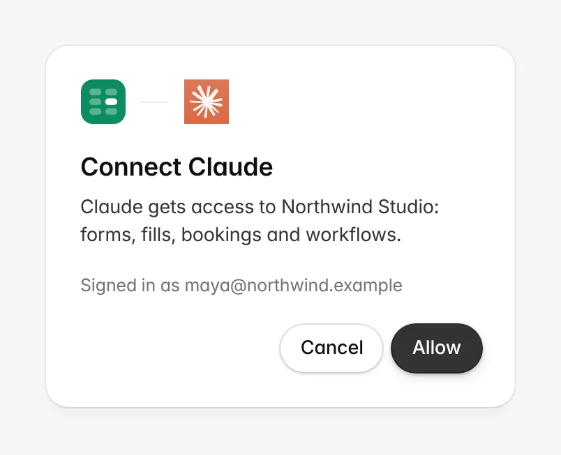

import { Aside, CardGrid, LinkCard, Steps } from '@astrojs/starlight/components';

Make builds visual automations, called scenarios, that connect your apps. You drag steps onto a canvas to move data between tools, with no code.

With Claritia, Make can start a scenario on a form fill, a meeting change or a routing result, and add a person to a Claritia workflow.

| | |
| - | - |
| Category | Automation |
| Connects with | Sign in to Claritia from Make |
| Used in | Your Make scenarios |
| Who can connect | Any member, from Make. Owners disconnect in Claritia. |
| Plan | Every plan |

## Connect Make

Make connects from its own side. There's no key to paste.

<Steps>

1. **Start in Make**

   In Claritia, go to **Settings**, then **Integrations**, and click **Connect** on the Make card. It opens Claritia's page on Make, https://www.make.com/en/integrations/claritia. Or start a new scenario in Make and pick the Claritia app.

1. **Sign in to Claritia**

   Make opens Claritia's approve page, **Connect Make**. It says Make gets access to your workspace's forms, fills, bookings and workflows, and shows the email you're signed in as.

   

1. **Click Allow**

   You go back to Make, signed in. Claritia makes an API key named "Make". The Make card in Integrations now shows **Connected**.

</Steps>

## What Make can do in Claritia

- Start your scenarios when a form is filled or a meeting is booked.
- Read your forms and live workflows, so you can pick one.
- Add a person to a live workflow.

## Triggers

Each trigger is instant: it subscribes a hook when you turn the scenario on, and removes it when you turn it off.

| Trigger | Starts when | Options |
| - | - | - |
| **Watch Fills** | Someone fills in a form | Pick one form, or every form |
| **Watch Bookings** | Someone books a meeting | |
| **Watch Canceled Bookings** | A meeting is canceled | |
| **Watch Routed Leads** | Routing gives a lead an owner, or finds none | |

When you test a trigger, Make reads your latest real item. In a new workspace with none yet, it gets one sample item, marked as a test, so you can map fields.

Fills in **Spam**, test fills and fills past your plan's monthly limit never start a scenario.

## Actions

| Module | Does |
| - | - |
| **Add a Contact to a Workflow** (action) | Adds someone to a live workflow, making the contact if it's new. The workflow's re-entry rules still apply. |
| **Find Fills** (search) | Finds the latest fills from an email. |

These use the same calls as the [API reference](/api-reference/): [`POST /hooks`](/api-reference/hooks/), [`GET /events`](/api-reference/events/), [`GET /forms`](/api-reference/forms/), [`GET /workflows`](/api-reference/workflows/) and [`POST /workflows/{id}/contacts`](/api-reference/workflows/#post-workflowsidcontacts).

## What syncs

| | |
| - | - |
| Direction | Claritia to Make for triggers. Make to Claritia for actions. |
| What's sent | The fill, the meeting or the lead, with answers by key and by label. |
| When | Within seconds. A fill's send waits 5 seconds so its contact and files are in. A booking's send waits a minute so the video link is in. Failed sends are tried again for up to 8 tries. |

## Disconnect

In **Settings**, then **Integrations**, click **Disconnect** on the Make card. Confirm **Disconnect Make?**. Make stops getting events from Claritia: its key is revoked and its hooks are removed. You can also revoke the "Make" key in **Settings**, then **API keys**.

<Aside type="note">
Turn a scenario off in Make and Claritia removes its hook. If Make's address answers `410 Gone`, Claritia removes the hook too.
</Aside>

## Related

<CardGrid>
  <LinkCard title="API reference" href="/api-reference/" description="The calls Make makes." />
  <LinkCard title="All integrations" href="/integrations/" description="Every tool Claritia connects to." />
</CardGrid>
