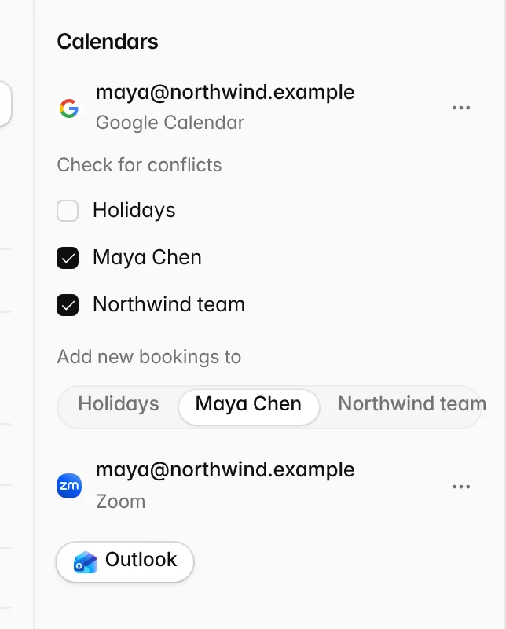

import { Aside, CardGrid, LinkCard, Steps } from '@astrojs/starlight/components';

Outlook Calendar is Microsoft's calendar, in Outlook and Microsoft 365. It covers work and school accounts and personal Outlook.com accounts.

With Claritia, your booking pages and forms offer only the times you're free on Outlook Calendar, and each new booking goes onto it with its Microsoft Teams link and the guest invited.

| | |
| - | - |
| Category | Calendars |
| Connects with | Sign in with Microsoft |
| Used in | **Meetings**, then **Availability**, then **Calendars** |
| Who can connect | Each person connects their own. Owners can disconnect anyone's. |
| Plan | Free: 1 calendar account per seat. Starter, Pro and Business: 6. |

## Connect Outlook Calendar

<Steps>

1. **Open Availability**

   In the sidebar, under **Meetings**, click **Availability**, then the **Calendars** tab.

   

1. **Click Outlook**

   Under the accounts you have, click **Outlook**. You can also click it in the **Connect your calendar** line across the top of the Meetings pages, which shows until a calendar is connected.

1. **Sign in and allow access**

   Sign in with the account that holds your work calendar and approve Claritia. You come back to **Calendars**, and the account shows with its email.

1. **Pick the calendars that block times**

   Under **Check for conflicts**, each calendar in the account has a **Busy** switch. Turn it on for each calendar whose events should block your times.

1. **Pick where bookings go**

   Under **Add new bookings to**, pick the calendar that gets new meetings.

</Steps>

## What Claritia can do in Outlook Calendar

- Read and write your calendars (`Calendars.ReadWrite`): find when you're busy, and add, move and remove the events for meetings booked with you.
- Read your profile (`User.Read`), to show which account is connected.
- Stay signed in (`offline_access`), so Claritia can keep your times fresh while you're away.

Claritia reads only when you're busy. It doesn't copy your event titles or details into Claritia.

## What syncs

| | |
| - | - |
| Direction | Both ways. Outlook Calendar to Claritia for busy times. Claritia to Outlook Calendar for the events of meetings booked with you. |
| What's read | Busy times for the next 60 days, from each calendar with **Busy** on. |
| What's written | One event for each booking, in the calendar under **Add new bookings to**, with the guest invited and the Microsoft Teams link when the meeting's location is Microsoft Teams. Moving or canceling the meeting moves or removes the event. |
| When | Microsoft tells Claritia when your calendar changes, and Claritia also reads it again every 10 minutes. Click **Read now** in the account's menu to read it at once. |

## Use Microsoft Teams links

Pick **Microsoft Teams** as a meeting type's **Location**. Each booking gets its own link, made with the calendar event, so there's no extra step. The link is in the invite, the confirmation email and the meeting's webhook.

## When it needs signing in again

If Claritia loses access, for example after a password change, the account shows **Reconnect**. The line at the top of the Meetings pages says **Reconnect Outlook** too. Until you reconnect, your times leave every booking page, so nobody books a time you can't see.

## Check your times

The top of **Availability** shows how many 30-minute times your booking page offers next week, like "Your page shows 24 open times next week". It turns amber under 5, or says what's missing.

## Disconnect

In **Calendars**, open the account's menu and click **Disconnect**. Confirm **Disconnect [email]?**. Claritia stops reading it, and its times stop blocking your page. Events already made stay on your calendar.

<Aside type="note">
Each person on the team connects their own calendar. Round robin and team meetings only offer a person's times once their calendar is connected.
</Aside>

## Related

<CardGrid>
  <LinkCard title="Connect your calendar" href="/get-started/connect-your-calendar/" description="The quick start." />
  <LinkCard title="Availability and teams" href="/meetings/availability-and-teams/" description="Working hours, days off and teams." />
</CardGrid>
