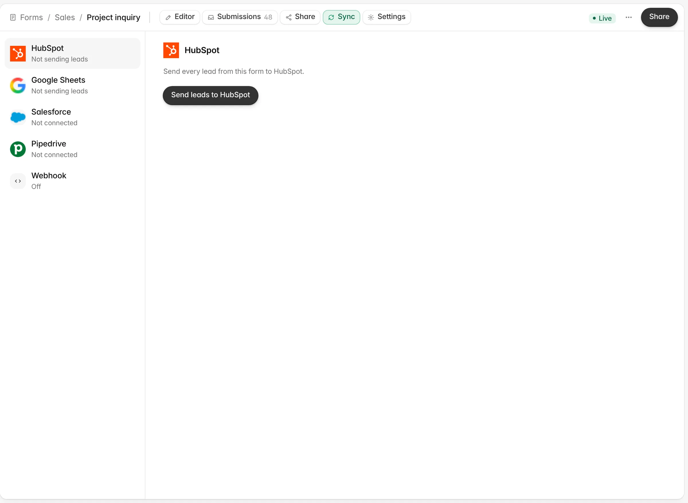

import { Aside, CardGrid, LinkCard, Steps } from '@astrojs/starlight/components';

Every lead is saved in Claritia first. Then the form's **Sync** tab sends a copy to each tool you pick. If a tool is slow or down, Claritia keeps trying, so no lead is lost.

## Send a form's leads to your CRM

<Steps>

1. **Connect the CRM**

   Go to **Settings**, then **Integrations**, and connect it. See [Integrations](/integrations/).

1. **Open the form's Sync tab**

   Open the form and click **Sync**. The left side lists each CRM with its state. Pick the one you connected and turn it on.

   

1. **Choose how leads are made**

   Set **Make them as** to contacts or leads, where your CRM has both. Under **When the email is already in** your CRM, pick **Update it** or **Leave it**. Claritia matches people by email, and in some CRMs also by name and company domain.

1. **Set the owner and consent**

   Pick the owner for new records, such as **Routing's pick**, the person your team meeting assigned. Turn on **Send email consent** to pass on who ticked the consent box.

1. **Map the questions**

   Each question shows the CRM field it goes to. Change any field. For a choice question, click **Check choices** to match its answers to the CRM's options.

1. **Publish the form**

   New leads now go to your CRM as they arrive.

</Steps>

### Leads that didn't arrive

If a lead didn't reach a tool, the tool's card in Sync lists it with **Send again**. In **Submissions**, a lead's panel shows where it synced, with **Try again** for any that failed.

### Pause sending

Click **Pause** or **Turn off** on a tool to stop sending. Fills stay in Claritia, and you can turn it on again any time.

## Other places a lead can go

| Tool kind | What each fill does |
| - | - |
| **Email lists** like Mailchimp | Adds the person to the audience you pick, with tags if you like |
| **Sheets** like Google Sheets or Airtable | Adds a row to a new sheet, or to one you have with **Use a sheet I have** |
| **Tasks and tickets** like Linear or Zendesk | Makes a task or ticket on the board or project you pick |
| **Documents** like Google Docs | Makes a document for each fill from a template doc you choose |
| **Files** like Google Drive or Dropbox | Copies each fill's uploaded files to the folder you pick |
| **Chat** like Microsoft Teams | Posts an alert on each fill in the channel you pick |
| **Analytics** like Segment | Sends a "Form Submitted" event on each fill |

## Send to your own system with a webhook

<Steps>

1. **Add a webhook**

   In the form's **Sync** tab, click **Add a webhook**.

1. **Enter the address**

   Type your **Webhook address**. It must start with `https://`.

1. **Copy the signing secret**

   Claritia signs each send, so your system can check it came from Claritia. Sends are retried, with the same body on every try.

</Steps>

For webhooks on meetings, see [Webhooks](/integrations/webhooks/).

<Aside type="tip">
Once a CRM is connected, you can also pick it in the form's Ending, under **Send to a tool**. Both places change the same setting.
</Aside>

## Plans

Webhooks work on every plan. Tools and Slack are on Starter and up, and Salesforce is on Business. On a lower plan, the tool's pane in **Sync** shows the plan's line and **Upgrade**. Sends to a tool on a lower plan are skipped, and the fill stays in Claritia. See [Plan limits](/reference/plan-limits/#features-held-to-a-plan).

## Next steps

<CardGrid>
  <LinkCard title="Webhooks" href="/integrations/webhooks/" description="Meeting events to your own address." />
  <LinkCard title="Responses and spam" href="/forms/responses-and-spam/" description="Check what synced for each lead." />
</CardGrid>
