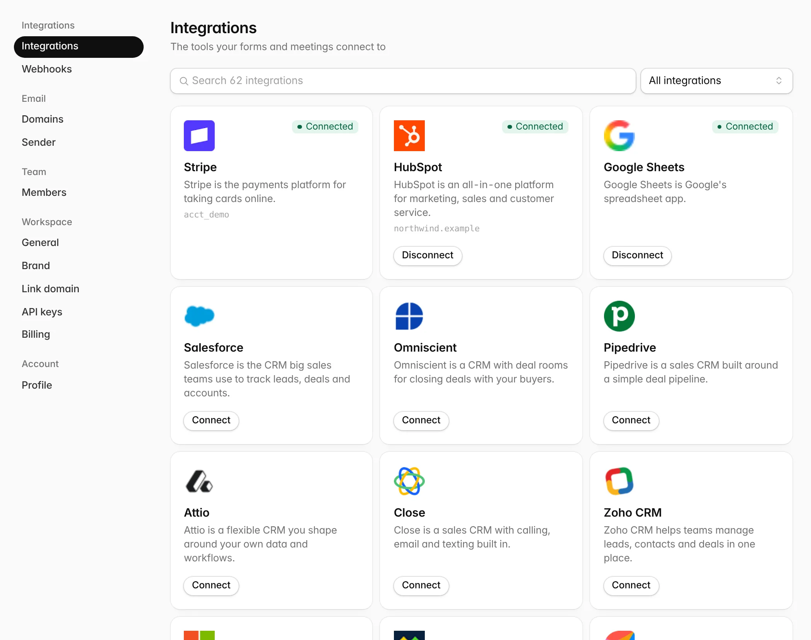
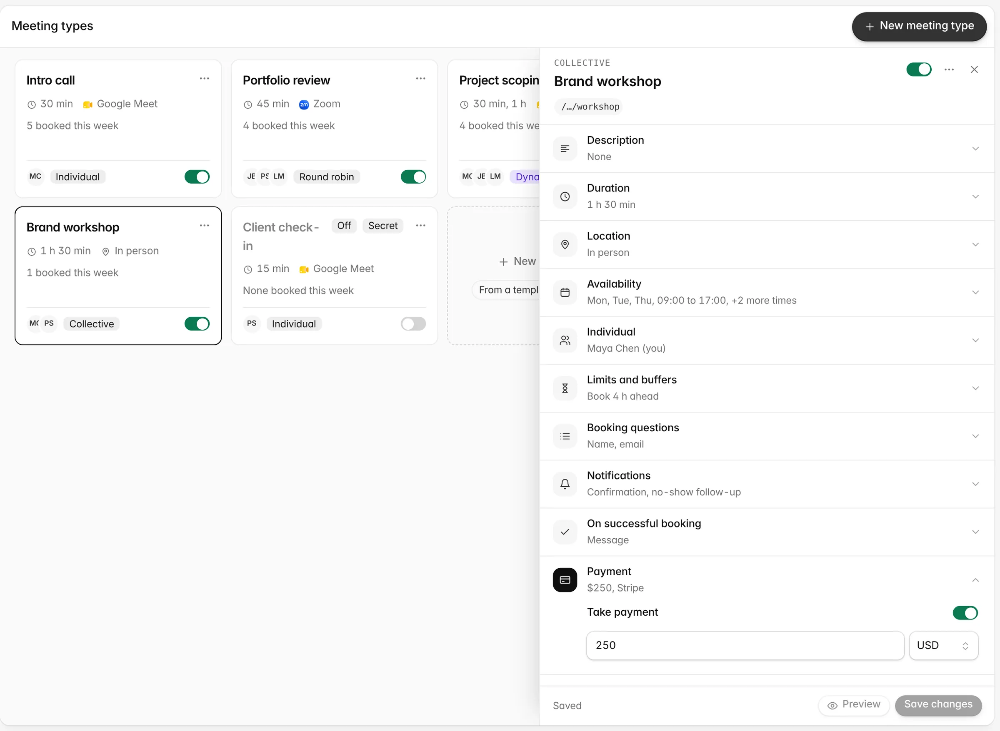

import { Aside, CardGrid, LinkCard, Steps } from '@astrojs/starlight/components';

Stripe is the payments platform millions of businesses use to take card payments online. Money from each payment goes into your Stripe account and then to your bank.

With Claritia, you can charge guests when they book a paid meeting, and take a payment inside a form. Claritia never holds the money. Stripe's own fees come out of each payment.

| | |
| - | - |
| Category | Payments |
| Connects with | Sign in with Stripe (Stripe's own onboarding) |
| Used in | A meeting type's **Payment**, and a form's **Payment** question |
| Who can connect | Workspace owners |
| Plan | Paid meetings: Starter and up |

## Connect Stripe

<Steps>

1. **Open Integrations**

   Go to **Settings**, then **Integrations**. The **Stripe** card is first. Type "Stripe" in **Search integrations**, or pick **Payments** in the category menu.

   

1. **Click Connect**

   The button reads **Opening Stripe…** while Stripe loads. Sign in to Stripe, or make a new Stripe account, and approve Claritia.

1. **Finish on Stripe if asked**

   If Stripe still needs details before your account can take payments, like your bank or business details, the card shows **Finish on Stripe**. Click **Continue on Stripe** to complete them.

1. **Check it's ready**

   When you come back, Claritia reads your account again. Once Stripe says it can take payments, the card shows **Connected** with your Stripe account id, like `acct_…`.

</Steps>

## What Claritia can do in Stripe

- Take payments for your paid meetings, paid straight into your Stripe account.
- Show you whether your account is ready to take payments.

## Charge for a meeting

<Steps>

1. **Open the meeting type**

   Go to **Meeting types** and click the card.

1. **Turn on payment**

   Open **Payment** and switch on **Take payment**. It starts at 50.00 USD.

   

1. **Set the price**

   Type the **Amount**, from 0.50 to 100,000, and pick the **Currency**. In **All settings**, **Paid with** stays **Stripe**. Click **Save changes**.

</Steps>

### What the guest sees

1. The guest picks a time and fills in their details.
2. Claritia holds that time for 10 minutes, so no one else can take it, and opens Stripe's checkout.
3. When Stripe confirms the payment, the meeting is booked. The calendar invite and the confirmation email go out.
4. If the guest leaves checkout, the hold ends and the time opens again.

While the guest pays, the meeting shows **Waiting on payment** in **Upcoming**, and its status is `pending_payment` in webhooks. If the time was taken by someone else before the payment came in, the payment is refunded at once.

### Refunds

When you cancel a paid meeting from its page, click **Cancel and refund**. The guest gets their money back to their card. If the refund doesn't go through, Claritia tells you, and you can refund it in Stripe.

## Take a payment in a form

Add a **Payment** question to a form. It charges a fixed amount, or the result of a **Calculation** question, like a price worked out from the answers. A payment that a rule hides is never charged. See [Questions, pages and logic](/forms/questions-and-logic/).

## What syncs

| | |
| - | - |
| Direction | Claritia to Stripe to start checkout. Stripe to Claritia to confirm each payment. |
| What's sent | The meeting's name, the amount, the currency and the guest's email. |
| When | At each booking, and when Stripe confirms the payment. |
| Where the money goes | Your own Stripe account. |

## Disconnect

The Stripe card has no Disconnect button. To stop taking payments, turn off **Take payment** on each paid meeting type, or remove the **Payment** question from your forms. To cut Claritia's access for good, remove Claritia from your connected apps in your Stripe account (check). Past payments stay in your Stripe account.

<Aside type="tip">
Want PayPal or Square instead? Connect them in **Integrations**, then pick them under **Paid with** on the meeting type. See [PayPal](/integrations/paypal/) and [Square](/integrations/square/).
</Aside>

## Related

<CardGrid>
  <LinkCard title="Paid meetings" href="/meetings/paid-meetings/" description="Every setting for paid meetings." />
  <LinkCard title="All integrations" href="/integrations/" description="Every tool Claritia connects to." />
</CardGrid>
