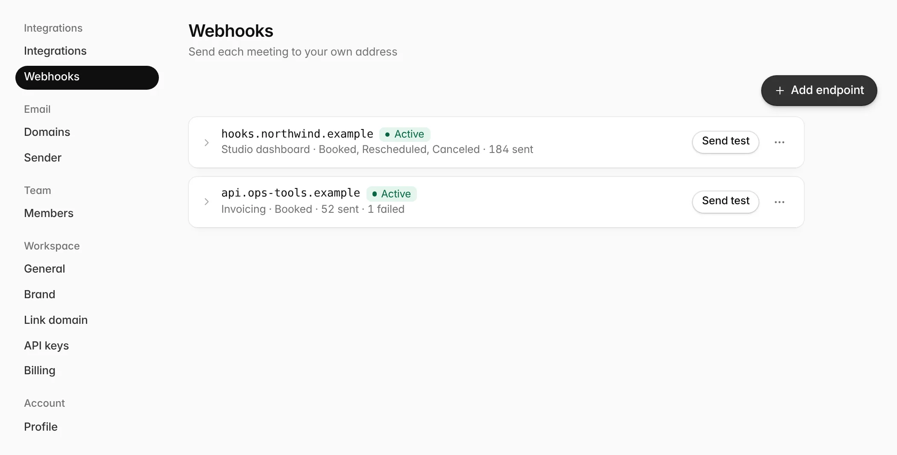

import { Aside, CardGrid, LinkCard, Steps } from '@astrojs/starlight/components';

A webhook sends data to an address you own as soon as something happens. Claritia has two kinds:

- **Meeting webhooks**, in **Settings**, then **Webhooks**: a POST for each meeting change.
- **Form webhooks**, in a form's **Sync** tab: a POST for each fill. See [Send leads to your tools](/integrations/send-leads/#send-to-your-own-system-with-a-webhook).

This page covers meeting webhooks. Both are signed the same way.

## Add an endpoint

<Steps>

1. **Open Webhooks**

   Go to **Settings**, then **Webhooks**. Only owners can add, pause, test or delete endpoints.

1. **Add the address**

   Type your address. It must start with `https://` and be on the public internet.

1. **Pick the events**

   Turn on the events you want: **Booked**, **Rescheduled**, **Canceled**, **Held** and **No-show**.

1. **Copy the secret**

   Each endpoint has its own signing secret. Keep it on your server to check each send.

1. **Send a test**

   Send a test event. It carries sample data and `"test": true`.

</Steps>

Each endpoint shows **Active**, **Failing** or **Paused**, how many sends went out, and its recent sends. A send that failed has **Send again**. An endpoint's menu lets you **Edit**, **Pause** or **Resume**, **Roll secret** or **Delete** it.



## What Claritia sends

Each send is a `POST` with a JSON body:

```json
{
  "id": "evt_...",
  "event": "meeting.booked",
  "created_at": "2026-11-18T15:00:00.000Z",
  "workspace_id": "...",
  "test": false,
  "data": {
    "meeting": {
      "id": "...",
      "status": "booked",
      "start_time": "2026-11-20T15:00:00.000Z",
      "end_time": "2026-11-20T15:30:00.000Z",
      "guest_timezone": "America/New_York",
      "type": { "id": "...", "name": "Intro call", "slug": "intro", "kind": "one" },
      "hosts": [{ "id": "...", "name": "Sam Lee", "email": "sam@example.com", "timezone": "America/Chicago" }],
      "guest": { "name": "Ada Park", "email": "ada@example.com", "contact_id": null },
      "answers": {},
      "location": { "kind": "google_meet", "url": "https://meet.google.com/abc-defg-hij" },
      "cancel_reason": null,
      "rescheduled_from": null,
      "manage_url": "https://..."
    }
  }
}
```

The events are `meeting.booked`, `meeting.rescheduled`, `meeting.canceled`, `meeting.held` and `meeting.no_show`.

### Headers

| Header | Value |
| - | - |
| `x-claritia-event` | The event, like `meeting.booked` |
| `x-claritia-delivery` | The id of this send. Retries keep the same id. |
| `x-claritia-signature` | `t=<unix seconds>,v1=<signature>` |
| `user-agent` | `Claritia-Webhooks/1` |

## Check the signature

The signature is a hex HMAC-SHA256 of the time, a dot, and the raw body, made with your endpoint's secret.

```js
import { createHmac, timingSafeEqual } from "node:crypto";

function verify(secret, rawBody, header) {
  const parts = Object.fromEntries(header.split(",").map((p) => p.split("=")));
  const expected = createHmac("sha256", secret).update(`${parts.t}.${rawBody}`).digest("hex");
  const fresh = Math.abs(Date.now() / 1000 - Number(parts.t)) < 300;
  return fresh && timingSafeEqual(Buffer.from(expected), Buffer.from(parts.v1));
}
```

Check the body exactly as it arrived, before you parse it.

## Retries

- Answer with any 2xx status within 15 seconds.
- A timeout, a 408, 425 or 429, or any 5xx is tried again later. A `Retry-After` header is respected.
- A redirect fails. Use the final address.
- Every retry sends the same body and the same delivery id, so you can drop repeats.

<Aside type="caution">
Claritia never sends to private network addresses. Use a public `https://` address.
</Aside>

## Next steps

<CardGrid>
  <LinkCard title="API and webhooks" href="/developers/api/" description="Subscribe to events from your own code." />
  <LinkCard title="Upcoming meetings" href="/meetings/upcoming/" description="Where held and no-show come from." />
</CardGrid>
