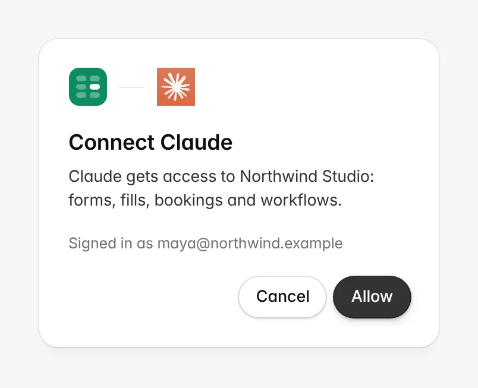

import { Aside, CardGrid, LinkCard, Steps } from '@astrojs/starlight/components';

Zapier connects thousands of apps with automations called Zaps. Each Zap watches for something in one app and then does something in another, with no code.

With Claritia, Zapier can start a Zap on a form fill, a meeting change or a routing result, and add a person to a Claritia workflow.

| | |
| - | - |
| Category | Automation |
| Connects with | Sign in to Claritia from Zapier |
| Used in | Your Zapier Zaps |
| Who can connect | Any member, from Zapier. Owners disconnect in Claritia. |
| Plan | Every plan (check) |

## Connect Zapier

Zapier connects from its own side. There's no key to paste.

<Steps>

1. **Start in Zapier**

   In Claritia, go to **Settings**, then **Integrations**, and click **Connect** on the Zapier card. It opens Claritia's page on Zapier, https://zapier.com/apps/claritia/integrations. Or start a new Zap in Zapier and pick the Claritia app.

1. **Sign in to Claritia**

   Zapier opens Claritia's approve page, **Connect Zapier**. It says Zapier gets access to your workspace's forms, fills, bookings and workflows, and shows the email you're signed in as.

   

1. **Click Allow**

   You go back to Zapier, signed in. Claritia makes an API key named "Zapier". The Zapier card in Integrations now shows **Connected**.

</Steps>

## What Zapier can do in Claritia

- Start your Zaps when a form is filled or a meeting is booked.
- Read your forms and live workflows, so you can pick one.
- Add a person to a live workflow.

## Triggers

Each trigger is instant: it subscribes a hook when you turn the Zap on, and removes it when you turn it off.

| Trigger | Starts when | Options |
| - | - | - |
| **New Fill** | Someone fills in a form | **Form**: pick one, or leave it empty for every form |
| **New Booking** | Someone books a meeting | |
| **Booking Canceled** | A meeting is canceled | |
| **Lead Routed** | Routing gives a lead an owner, or finds none | |

When you test a trigger, Zapier reads your latest real item. In a new workspace with none yet, it gets one sample item, marked as a test, so you can map fields.

Fills in **Spam**, test fills and fills past your plan's monthly limit never start a Zap.

## Actions

| Action | Does | Fields |
| - | - | - |
| **Add Contact to Workflow** | Adds someone to a live workflow, making the contact if it's new. The workflow's re-entry rules still apply. | **Workflow** (required), **Email** (required), **First name**, **Last name** |
| **Find Fill** (search) | Finds the latest fill from an email | **Email** (required), **Form** |

These use the same calls as the [API reference](/api-reference/): [`POST /hooks`](/api-reference/hooks/), [`GET /events`](/api-reference/events/), [`GET /forms`](/api-reference/forms/), [`GET /workflows`](/api-reference/workflows/) and [`POST /workflows/{id}/contacts`](/api-reference/workflows/#post-workflowsidcontacts).

## What syncs

| | |
| - | - |
| Direction | Claritia to Zapier for triggers. Zapier to Claritia for actions. |
| What's sent | The fill, the meeting or the lead, with answers by key and by label. |
| When | Within seconds. A fill's send waits 5 seconds so its contact and files are in. A booking's send waits a minute so the video link is in. Failed sends are tried again for up to 8 tries. |

## Disconnect

In **Settings**, then **Integrations**, click **Disconnect** on the Zapier card. Confirm **Disconnect Zapier?**. Zapier stops getting events from Claritia: its key is revoked and its hooks are removed. You can also revoke the "Zapier" key in **Settings**, then **API keys**.

<Aside type="note">
Turn a Zap off in Zapier and Claritia removes its hook. If Zapier's address answers `410 Gone`, Claritia removes the hook too.
</Aside>

## Related

<CardGrid>
  <LinkCard title="API reference" href="/api-reference/" description="The calls Zapier makes." />
  <LinkCard title="All integrations" href="/integrations/" description="Every tool Claritia connects to." />
</CardGrid>
