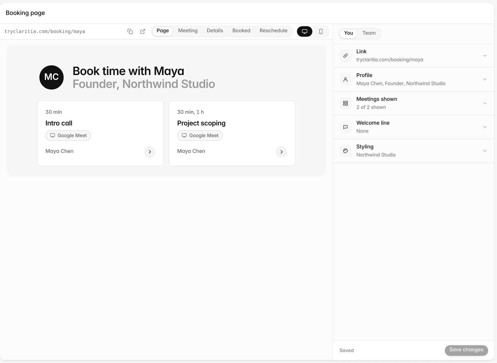
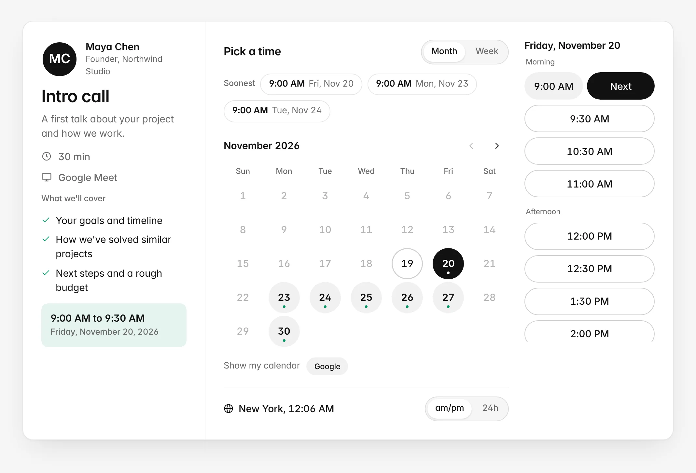
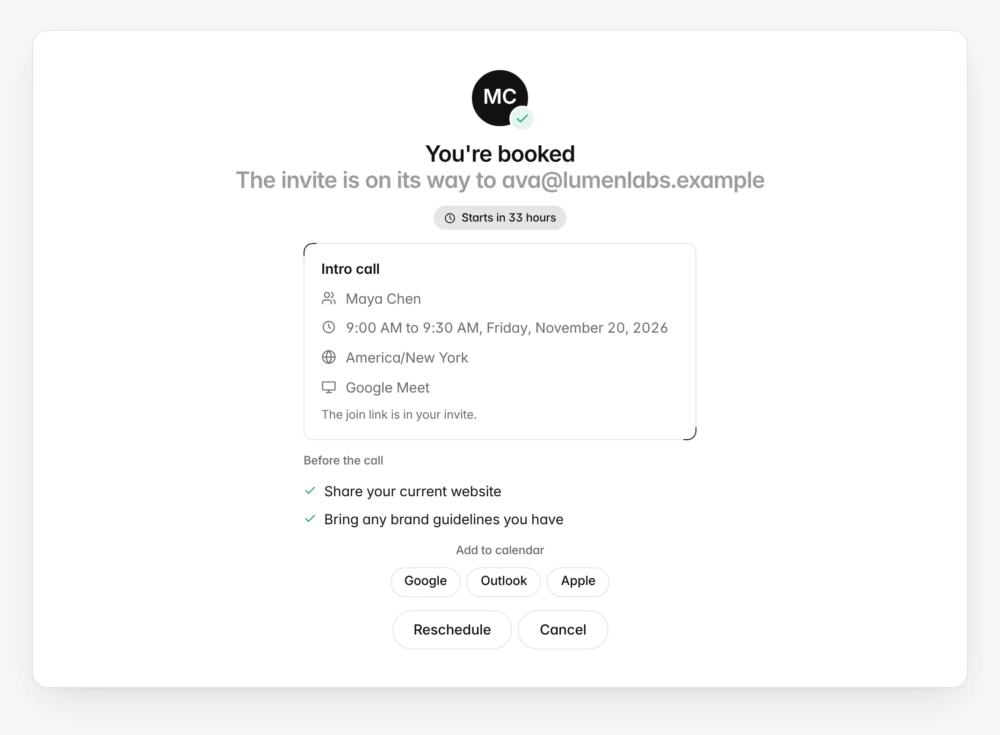
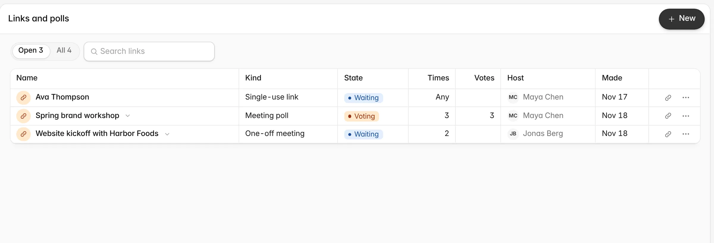
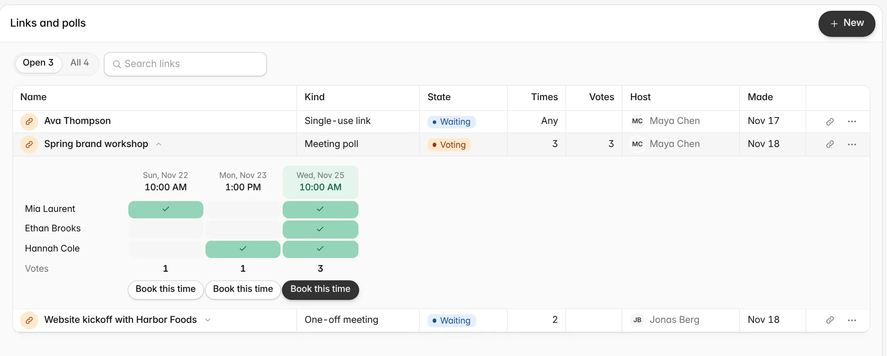

import { Aside, CardGrid, LinkCard, Steps } from '@astrojs/starlight/components';

Besides forms, there are three more ways to let people book. Your booking page lists your meetings. A link books one meeting. A poll lets a group vote on a time.

## Your booking page

A booking page shows a person's or a team's meetings on one page, with a calendar to pick a time. Open it from the sidebar, under **Meetings**, then **Booking page**.

The left side shows the page as guests see it. The panel on the right changes it. Pick **You** for your own page or **Team** for the team's page, then open a section:

| Section | What you set |
| - | - |
| **Link** | Your link's handle, or the team link |
| **Profile** | Your photo, name and headline, like "Account executive" |
| **Meetings shown** | Which meeting types show, and in what order |
| **Welcome line** | A short greeting, with bold, italic, links and lists |
| **Styling** | Claritia's look or one of your brands, and **Show Built by Claritia** |

Click **Save changes** when you're done, or **Discard** to undo. **Open the page** shows the live page.

### What guests see

For the full walk-through, see [What guests see](/meetings/guest-experience/).

- Times show in the guest's own time zone and language.
- When a guest picks a time, Claritia holds it for them for 5 minutes, so nobody else takes it while they type.
- If Claritia already knows the guest's name and email, for example from a form they just sent, the time's button says **Confirm** and books in one click.
- After booking, the guest sees the meeting with **Add to calendar** for Google, Outlook and Apple, plus links to reschedule or cancel. The confirmation email has the same links. None of them needs a sign-in.
- Without a brand, the page follows the guest's dark or light setting.

<Aside type="note">
Booking pages for each person and the team, and your own brand on them, are on Starter and up. Pro removes the Claritia branding.
</Aside>

## Links and polls

For every field, state and rule, see [Links and polls](/meetings/links-and-polls/). In short: open **Links and polls** under **Meetings** to see every link you've made, with its state, who made it, and when.

To make one, click **New** and pick a kind, or use **Create** in the sidebar:

| Kind | What it does |
| - | - |
| **Single-use link** | A link to a meeting type that books once, then closes. Good for one lead. |
| **One-off meeting** | A meeting with your own times, outside your usual meeting types |
| **Meeting poll** | Offer two or more times. Guests vote, then you book the winner. |

<Steps>

1. **Make the link**

   Pick the kind and the meeting type, or pick times for a one-off or a poll. Click **Done**. The link is ready to copy.

1. **Send it**

   Paste the link in an email or a chat.

1. **Follow it**

   Each link shows a state: **Waiting**, **Voting**, **Booked**, **Closed** or **Expired**. For a poll, you see the votes for each time. Click **Book this time** to book it. Everyone who voted gets the invite.

   

</Steps>

Delete a link from its menu. A meeting it already booked stays.

<Aside type="tip">
For a quick reply to a lead, use **Copy times for an email** in a meeting type's menu. It pastes your next open times as text.
</Aside>

Single-use links, one-off meetings, polls and copying times into an email are on Starter and up.

## Next steps

<CardGrid>
  <LinkCard title="Paid meetings" href="/meetings/paid-meetings/" description="Take payment when guests book." />
  <LinkCard title="Upcoming meetings" href="/meetings/upcoming/" description="Every booked meeting in one place." />
</CardGrid>
