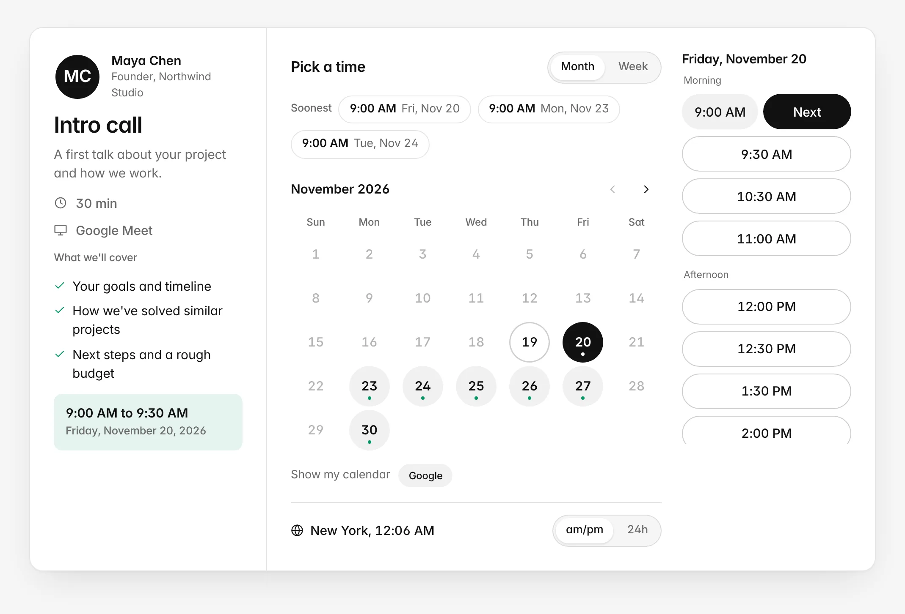
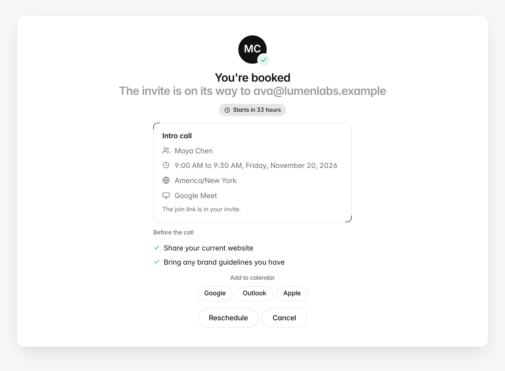

import { Aside, CardGrid, LinkCard, Steps } from '@astrojs/starlight/components';

This page walks through booking from the guest's side, so you know what your leads see. The same booking calendar shows on your booking page, inside a form's ending, on single-use and one-off links, and in embeds on your website. Guests never need an account.

<video class="cl-clip" src="/videos/guest-booking.mp4" autoplay muted loop playsinline preload="metadata" width="1280" height="800" aria-label="A guest picks a time, switches to Week view, and books in one click with Confirm" title="A guest picks a time, switches to Week view, and books in one click with Confirm"></video>

## The host card

On the left, the guest sees who they'll meet:

- With one host, their photo, name and booking-page line, like "Founder, Northwind Studio".
- The meeting's name and description.
- **What we'll cover**: up to 8 short lines from the meeting type, each with a check.
- The length, the place (like Google Meet or an address) and the price for a paid meeting.

## Pick a time

<Steps>

1. **Pick a day**

   Days with open times are marked. Today has a thin ring. **Soonest** jumps to the first open day. Use **Previous month** and **Next month** to move.

1. **Switch the view if you like**

   **Month** shows a calendar with the day's times beside it. **Week** shows seven days side by side with every open time. **Previous week** and **Next week** move it. A week with nothing open says **No times this week**.

1. **Check the time zone**

   Times show in the guest's own time zone, worked out from their browser, in full like "New York, 4:43 AM". Click it to search for another time zone.

1. **Pick a time**

   Click a time. When the host's time zone reads differently, the time also shows the host's clock, like "4:30 PM for Maya".

</Steps>

On a phone, the day's times sit in two columns, split into morning, afternoon and evening.

### The 5-minute hold

When a guest picks a time, Claritia holds it for them for 5 minutes. It leaves other guests' lists while they type their details. Picking another time moves the hold. Booking ends it. Group meetings with several seats don't hold. If someone else got there first, the guest sees **Someone is booking that time. Pick another.**

### Show my calendar

Under the calendar, **Show my calendar** with **Google** lets a guest see their own busy times on your page.

- A small window signs them in to Google with read-only access to free and busy times. It reads the next 62 days once and closes. Nothing is stored.
- Times that clash with their day show dashed with **You're busy**. They can still pick them.
- **Hide** turns it off.

It works with Google only. If it isn't set up, the button says **This isn't set up yet.**, and if the read fails, **Your calendar couldn't be read.**

## Fill in the details

After picking a time, the guest types their **Name** and **Email**, and answers any questions the meeting type asks, like a **Phone number** for a phone call. Then they click **Confirm booking**.

If they leave something out, the page says **Add your name.** or **Add a valid email.**

### One click from a form

When the guest comes from a form they just sent, Claritia already knows their name, email and answers. It fills in each booking question with the same label. The picked time's button then says **Confirm** and books in one click. Above the times, a line says **Booking as [name], [email]**, with **Change**.

The same happens on a booking link made for a fill, and in a browser that booked before. Paid meetings still go through the details step.

## The confirmed screen

After booking, the guest sees:

- A check, and a tag that counts down, like "Starts in 3 days".
- The time in their zone, and the host's clock when it differs.
- **Before the call**: up to 8 lines from the meeting type, like "Share your current website".
- **Add to calendar** for Google, Outlook and Apple.
- **Reschedule** and **Cancel**.
- For a video meeting, **The join link is in your invite.**

The meeting type can send the guest to your own page instead. See [Meeting types](/meetings/meeting-types/).

The confirmation email has a calendar invite and the same links.

## Reschedule or cancel

Every confirmation email and the confirmed screen link to the guest's own page for that meeting. It needs no sign-in.

The page shows the meeting, the time with the time zone, the place, and the price for a paid meeting. Its state is one of:

| State | Means |
| - | - |
| **Booked** | On the calendar |
| **Waiting for payment** | A paid meeting that isn't paid yet. **Complete payment** opens checkout again. |
| **Confirming payment** | Back from checkout, while Claritia hears back from Stripe |
| **Canceled** | Canceled, with the reason if one was given. **Book again** opens the meeting type. |
| **Missed** | Marked as a no-show |
| **Done** | The meeting happened |

To move it, the guest clicks **Reschedule**, picks a new time from the same meeting type and clicks **Move here**. The page says **Moved. The invite is updated.**

To cancel, they click **Cancel**, add a **Reason (optional)** up to 500 characters, and click **Cancel meeting**. **Keep it** goes back. The meeting comes off the calendars, and the reason shows on the meeting in Claritia.

<Aside type="note">
Whether guests can reschedule, and who a moved meeting can go to, is set on the meeting type. See [Meeting types](/meetings/meeting-types/).
</Aside>

## Look and language

- Without a brand, the page uses Claritia's own look and follows the guest's light or dark setting.
- With a brand from **Settings**, then **Brand**, the page keeps your colors and fonts. Branded pages are on Starter and up.
- In an embed, the page follows the site around it.
- Free and Starter pages show **Built by Claritia**. Pro and up can hide it.

## Errors a guest may see

| Message | What it means |
| - | - |
| **Times couldn't load.** | The page couldn't reach Claritia. **Try again in a moment.** |
| **Someone is booking that time. Pick another.** | Another guest holds or booked it. |
| **Add your name.** / **Add a valid email.** | A required detail is missing. |
| **This isn't set up yet.** | Show my calendar isn't on for this page. |
| **Preview only: nothing was booked.** | The page is a preview inside Claritia, so it didn't book. |

## Next steps

<CardGrid>
  <LinkCard title="Booking page" href="/meetings/booking-page-and-links/" description="Set up the page guests see." />
  <LinkCard title="Meeting emails" href="/email/meeting-emails/" description="The emails guests get." />
</CardGrid>
