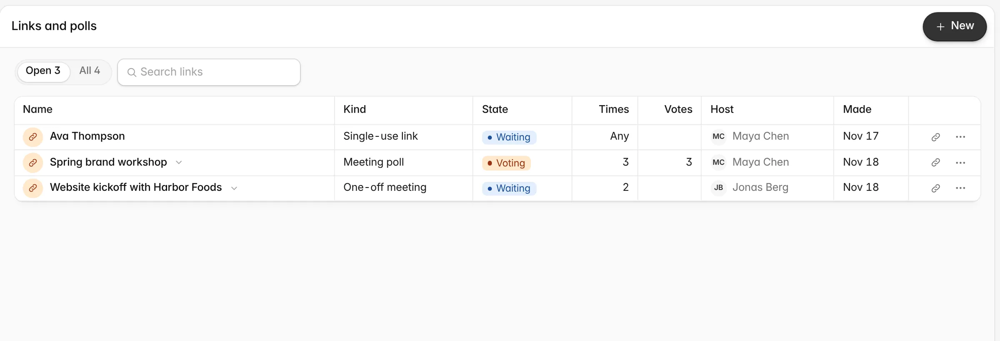
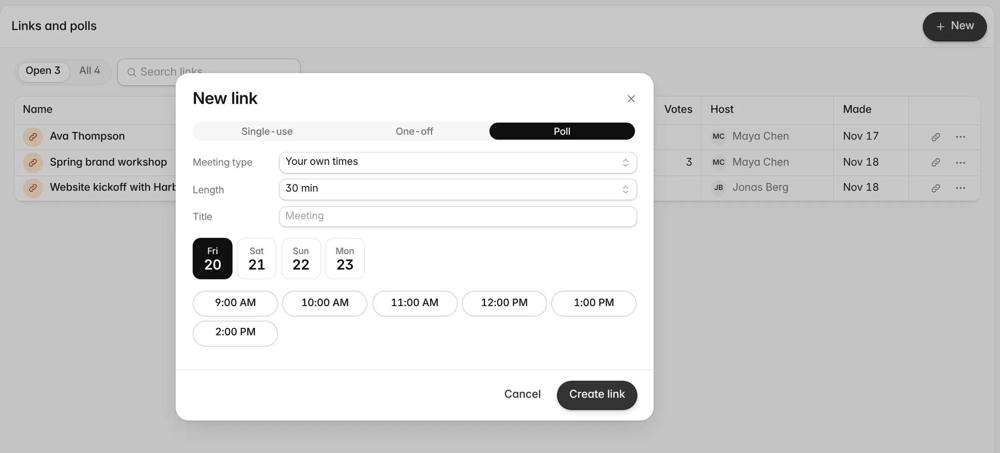
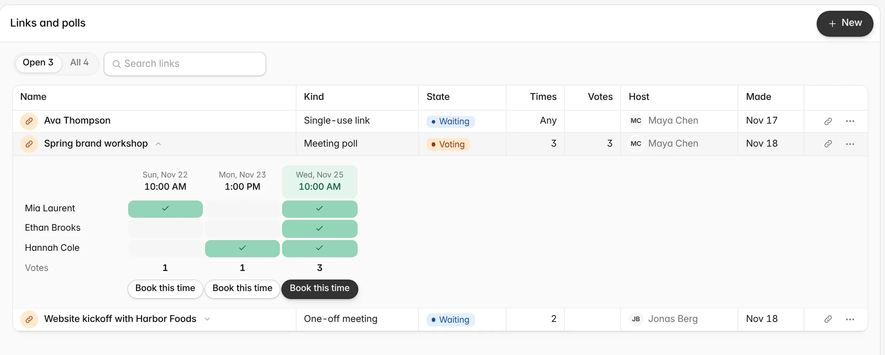

import { Aside, CardGrid, LinkCard, Steps } from '@astrojs/starlight/components';

**Links and polls** holds the booking links you make for one person or one group. Open it in the sidebar under **Meetings**. The first time, it shows **One link for one lead, or let a group vote**.

<video class="cl-clip" src="/videos/new-poll.mp4" autoplay muted loop playsinline preload="metadata" width="1280" height="800" aria-label="Making a meeting poll and picking three times" title="Making a meeting poll and picking three times"></video>

## The three kinds

| Kind | In the list | What it does |
| - | - | - |
| **Single-use** | Single-use link | A link to one of your meeting types that books once, then closes. Good for one lead. |
| **One-off** | One-off meeting | A few of your own free times, outside your meeting types. It closes after one booking. |
| **Poll** | Meeting poll | Two or more times. Guests vote, then you book the time that works. |

## Make a link

<Steps>

1. **Open New link**

   Click **New** on **Links and polls** and pick **Single-use link**, **One-off meeting** or **Meeting poll**. Or use **Create** in the sidebar and pick **Single-use link** or **Poll**. The **New link** dialog opens.

1. **Pick the kind**

   Under **Kind of link**, pick **Single-use**, **One-off** or **Poll**.

1. **Pick the meeting**

   For a single-use link, pick a **Meeting type**. For a one-off or a poll, pick a meeting type, or **Your own times** to set your own **Title** and **Length**.

1. **Pick the times**

   For a one-off or a poll, Claritia shows your free times over the next two weeks: days across the top, each day's times as pills. Click a time to pick it, and again to drop it. A one-off takes up to 10 times. A poll takes up to 20, and needs at least 2.

1. **Copy the link**

   Click **Create link**. The dialog says **Link ready** with the link to copy. Click **Done** to close it, and paste the link in an email or a chat.

   

</Steps>

If you have no free times in the next two weeks, the picker says **No free times in the next two weeks**. Check your [availability](/meetings/availability-and-teams/) and calendars.

### Rules for times

- Every time must be ahead, and within a year.
- A meeting is 5 minutes to 8 hours.
- A link can offer up to 40 times in all.
- A one-off can't offer two times that overlap.
- A link with an end date must end in the future.

## The list

Each link is a row:

| Column | Shows |
| - | - |
| **Name** | The link's title, the meeting type, or the kind |
| **Kind** | Single-use link, One-off meeting or Meeting poll |
| **State** | Where the link stands. See [States](#states). |
| **Host** | Who made it. A person who left the workspace shows as **Former teammate**. |
| **Times** | The times offered |
| **Votes** | For a poll, how many people voted |
| **Made** | When it was made |
| **Actions** | Copy the link, and the menu |

Use the switch at the top to show **Open** links or **All**, each with its count. Type in **Search links** to find one by name. With nothing open, the page says **No open links**.

### States

| State | Means |
| - | - |
| **Waiting** | Ready to book. Nobody has booked yet. |
| **Voting** | A poll that's still taking votes. |
| **Booked** | It booked a meeting. |
| **Closed** | You closed it. |
| **Expired** | Its end date passed, or every time it offered is in the past. |

## Book a poll's winner

<Steps>

1. **Open the poll**

   Click the poll in the list. Each time shows who voted for it.

   

1. **Click Book**

   Click **Book** under the time that works. Claritia asks **Book [day and time]?** and says **Everyone who voted gets the invite.**

1. **Confirm**

   The meeting is booked on your calendar. Everyone who voted gets the calendar invite and the confirmation email.

</Steps>

## What guests see

A **single-use link** opens the meeting type's booking page. It books one meeting, then closes.

A **one-off** link shows only the times you picked.

A **poll** link shows each time with a box to tick. The guest ticks every time that works, types their **Name** and **Email**, and sends. If they leave something out, the page says **Add your name.**, **Add a valid email.** or **Pick at least one time.** Once you book a time, the poll says **This poll is closed.**

See [What guests see](/meetings/guest-experience/) for the booking page itself.

## Close or delete a link

Open a link's menu:

- **Close** stops it taking bookings or votes. The link shows **Closed**.
- **Delete** asks **Delete this single-use link?** (or one-off meeting, or meeting poll). For a link that booked a meeting, it adds **The meeting it booked stays.**

## Plans

Single-use links, one-off meetings and polls are listed on Starter and up on the pricing page (check).

<Aside type="tip">
In Slack, you can also make a single-use link for a lead with `/book` and their email, when your workspace has the Claritia Slack app.
</Aside>

## Next steps

<CardGrid>
  <LinkCard title="Booking page" href="/meetings/booking-page-and-links/" description="Your page with every meeting type." />
  <LinkCard title="Upcoming meetings" href="/meetings/upcoming/" description="See and change what's booked." />
</CardGrid>
