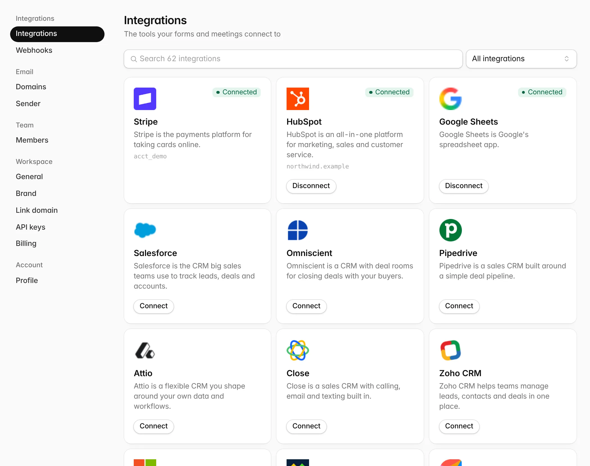
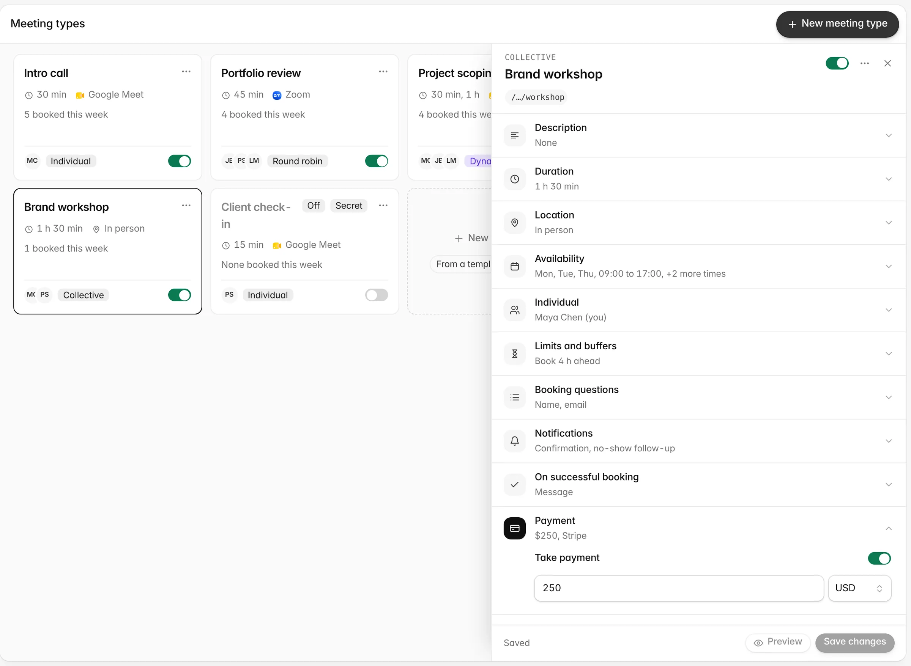

import { Aside, CardGrid, LinkCard, Steps } from '@astrojs/starlight/components';

You can charge for a meeting, like a paid strategy session, or take a payment inside a form. Guests pay your own account. Claritia never holds the money.

## Connect Stripe

<Steps>

1. **Open Integrations**

   Go to **Settings**, then **Integrations**. Find the **Stripe** card. You can type "Stripe" in the search box or pick **Payments** in the category menu.

   

1. **Connect your account**

   Click **Connect**. Stripe opens. Sign in, or make a new Stripe account, and approve Claritia.

1. **Finish on Stripe if asked**

   If Stripe still needs details before you can take payments, the card shows **Finish on Stripe**. Click **Continue on Stripe** to complete them. Once done, the card says **Connected**.

</Steps>

## Make a meeting paid

<Steps>

1. **Open the meeting type**

   Go to **Meeting types** and click the card.

1. **Turn on payment**

   Open **Payment** and turn on **Take payment**.

   

1. **Set the price**

   Type the **Amount** and pick the **Currency**. Click **Save changes**.

</Steps>

Guests now pay when they book. The meeting shows **Waiting on payment** until the payment goes through, then turns booked.

### Pay with PayPal or Square

Paid meetings can also take PayPal or Square. Connect the tool in **Settings**, then **Integrations**. Then open the meeting's **All settings** and pick it under **Paid with**.

## What happens when a guest pays

1. The guest picks a time and fills in their details.
2. Claritia holds that time for 10 minutes and opens checkout on Stripe, PayPal or Square.
3. While they pay, the meeting shows **Waiting on payment** in **Upcoming**. Its webhook status is `pending_payment`.
4. Claritia books the meeting only once it reads the payment back from the payment tool. Then the calendar invite and the confirmation email go out.
5. If someone else booked the time before the payment came in, the payment is refunded at once.
6. If checkout can't start, the meeting is canceled and the time opens again.

A guest who left checkout can finish from their manage link: it shows **Waiting for payment** with **Complete payment**.

## Errors you may see

| Message | Fix |
| - | - |
| **Paid meetings are on Starter and up.** | Upgrade, or turn off **Take payment**. |
| **Pick the currency for the price.** | Pick a **Currency**. |
| **Only owners can connect payments.** | Ask a workspace owner to connect Stripe. |
| **Stripe didn't answer. Try again in a moment.** | Try again. |
| **Connect Stripe in Settings, Payments before publishing a form that takes payment.** | Connect Stripe, then publish the form. |
| **Canceled. The refund didn't go through; refund it in Stripe.** | Refund the payment in your Stripe account. |
| **Couldn't disconnect Stripe.** | Click **Retry** on the Stripe card. |
| **This meeting can't take payments yet.** | Guests see this when Stripe isn't connected. Connect Stripe, or switch off **Take payment**. |

## Stop taking payments

To stop charging for one meeting, open it and switch off **Take payment**.

To stop all Stripe payments, go to **Settings**, then **Integrations**, and click **Disconnect** on the **Stripe** card. Confirm **Disconnect Stripe?**. Every meeting type paid through Stripe turns off, with its price kept. Types paid with PayPal or Square stay on. Booked meetings stay booked, and paid ones can still be refunded. See [Stripe](/integrations/stripe/#disconnect).

## Refunds

When you cancel a paid meeting from its page, click **Cancel and refund**. The guest gets their money back. If the refund doesn't go through, Claritia tells you, and you can refund it in Stripe.

## Take a payment in a form

Add a **Payment** question to any form. It can charge a fixed amount, or the result of a **Calculation** question, like a price worked out from the answers. The form charges through your connected Stripe account. A payment that a rule hides is never charged.

You can also add a payment page from **Add page** in Form Studio. See [Questions, pages and logic](/forms/questions-and-logic/).

<Aside type="note">
Paid meetings and Stripe payments in forms are on Starter and up. Stripe's own fees come out of each payment.
</Aside>

## Next steps

<CardGrid>
  <LinkCard title="Take paid bookings with Stripe" href="/recipes/paid-bookings-with-stripe/" description="The whole job, step by step." />
  <LinkCard title="Stripe" href="/integrations/stripe/" description="Connecting and disconnecting." />
  <LinkCard title="Meeting types" href="/meetings/meeting-types/" description="Every other meeting setting." />
  <LinkCard title="Integrations" href="/integrations/" description="Every tool you can connect." />
</CardGrid>
