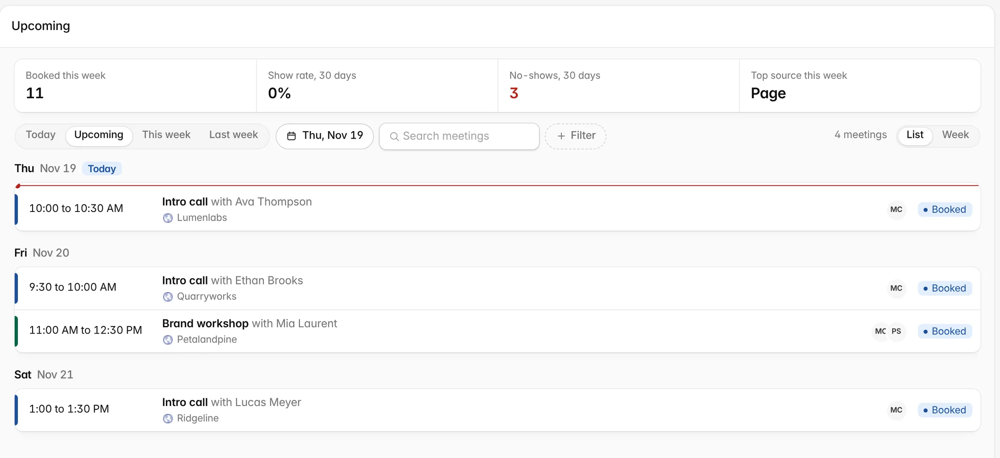
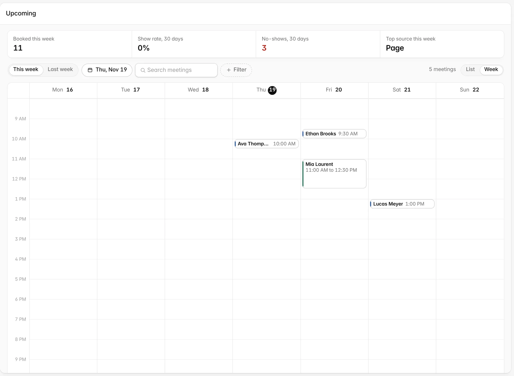
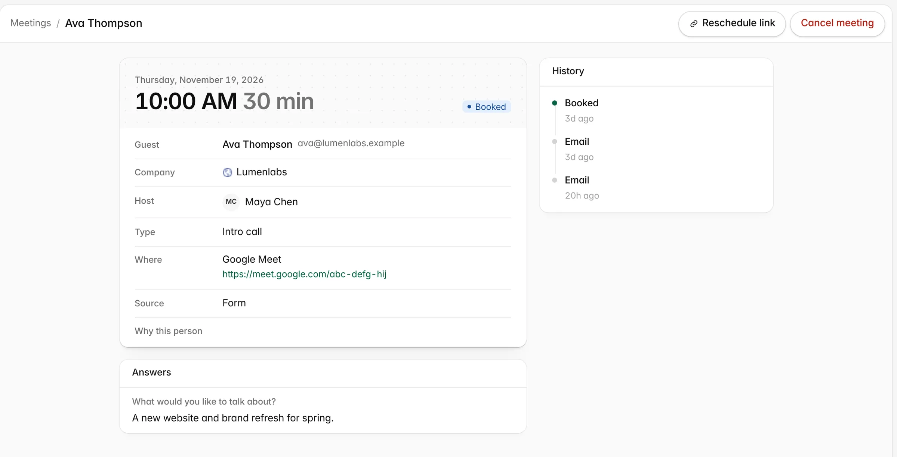

import { Aside, CardGrid, LinkCard } from '@astrojs/starlight/components';

**Upcoming** lists every meeting on the calendar. Open it from the sidebar, under **Meetings**.

<video class="cl-clip" src="/videos/upcoming.mp4" autoplay muted loop playsinline preload="metadata" width="1280" height="800" aria-label="Opening a meeting from Upcoming, then switching to the Week view" title="Opening a meeting from Upcoming, then switching to the Week view"></video>

## The numbers at the top

| Number | What it counts |
| - | - |
| **Booked this week** | Meetings booked this week |
| **Show rate, 30 days** | The share of past meetings that were held |
| **No-shows, 30 days** | Meetings where the guest didn't come |
| **Top source this week** | Where most bookings came from, like a form |

## Find a meeting

One row of controls sits under the numbers:

- **The span**: **Today**, **Upcoming**, **This week**, **Last week**, or a day you pick.
- **Search meetings** by guest or meeting name.
- **Filters** for host, meeting type, status, source, and meetings booked in Claritia.
- **List** or **Week** view.

The list groups meetings by day, with a line at the current time. Busy times from your own calendar show as thin gray rows, so you can see your whole day. Press J and K to move between meetings and Enter to open one.

## One meeting

Click a meeting to open its panel. It shows when it is, who's coming, where it happens, the guest's answers and the meeting's history. **Why this person** explains the rule and the turn that picked the host. **Join** shows 10 minutes before the start.

| Action | When |
| - | - |
| **Held** | After the meeting starts. Marks that it happened. |
| **No-show** | After the meeting starts. Marks that the guest didn't come. |
| **Reschedule link** | Before the meeting. Copy a link the guest can use to move or cancel it. |
| **Cancel meeting** | Before the meeting. Add a **Reason for the guest**, which goes in the email. A paid meeting offers **Cancel and refund**. |

If you don't mark a meeting, Claritia marks it held 24 hours after it ends.

### After a no-show

When you mark a no-show, the guest can get a follow-up email with a link to book again. Turn it on or off in the meeting type's **Notifications** section, or in the **No-show follow-up** workflow. See [Meeting emails and reminders](/email/meeting-emails/).

<Aside type="tip">
After each meeting, the host gets a **How did it go** email with one-click buttons to mark it held or a no-show.
</Aside>

## Next steps

<CardGrid>
  <LinkCard title="Meeting emails and reminders" href="/email/meeting-emails/" description="Every email a meeting sends." />
  <LinkCard title="Webhooks" href="/integrations/webhooks/" description="Send each meeting to your own system." />
</CardGrid>
