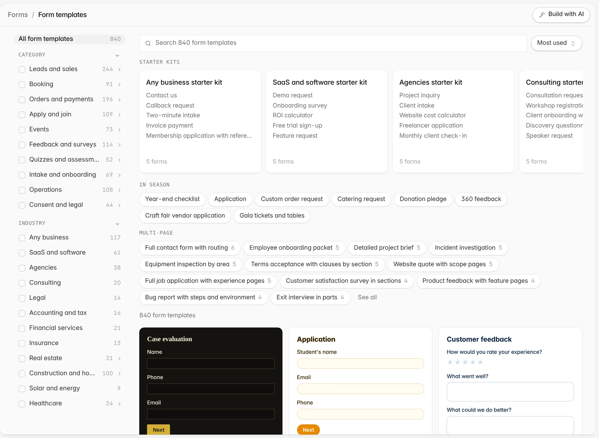
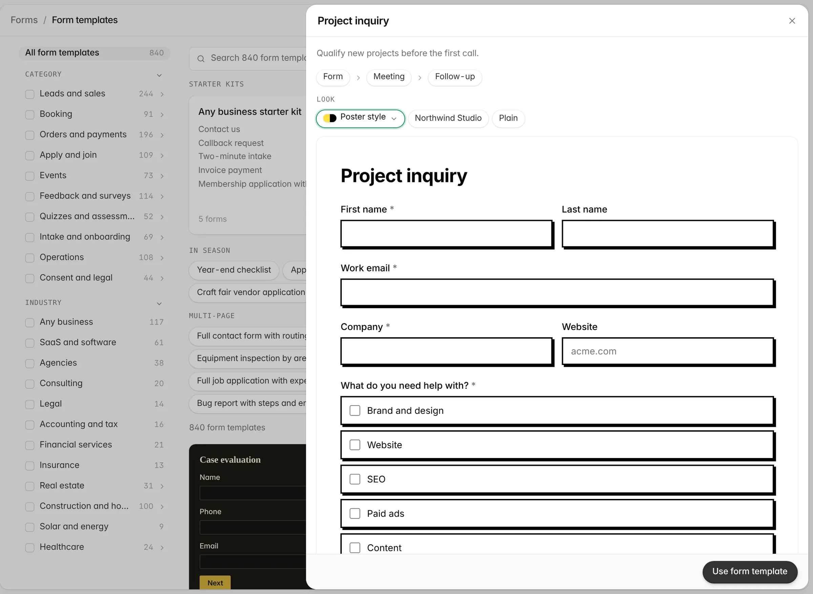
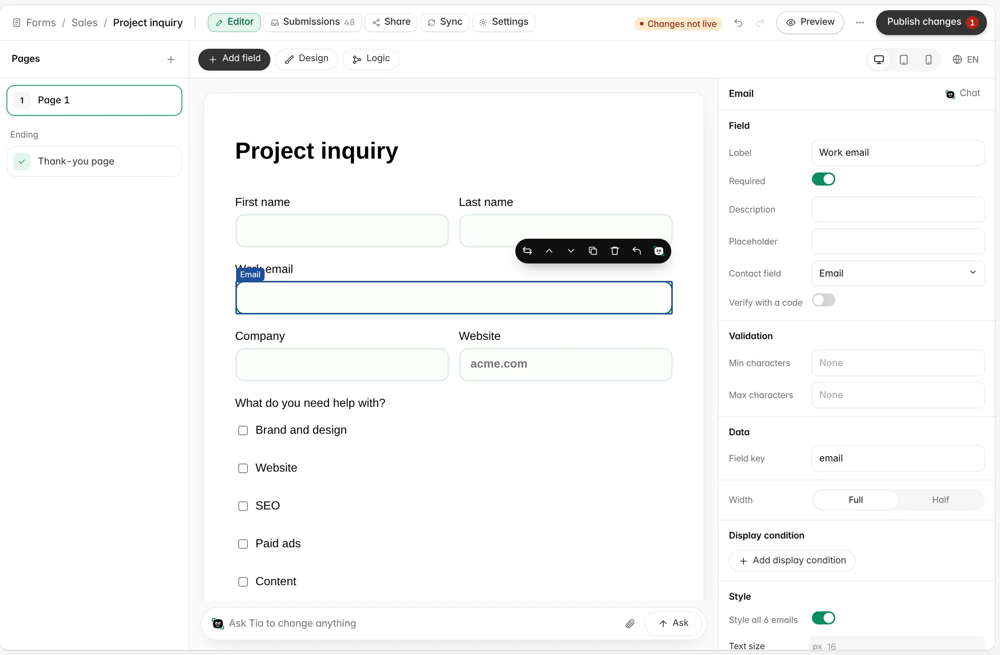
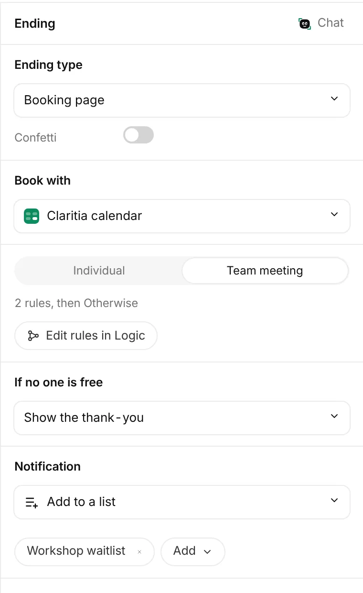
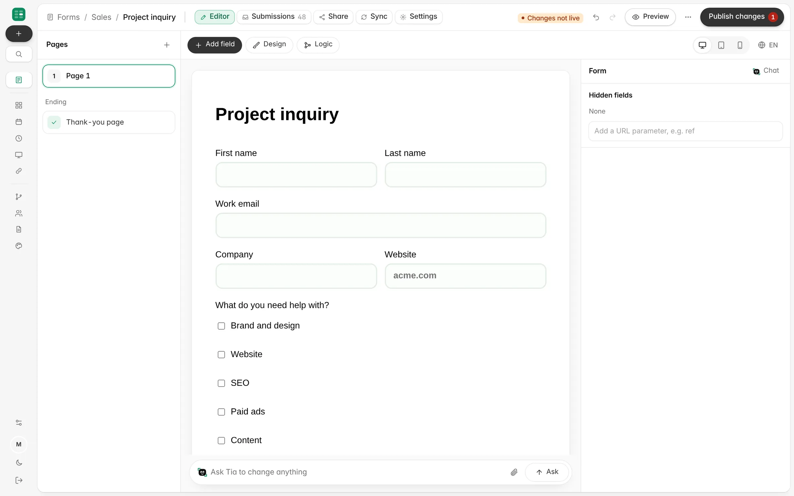
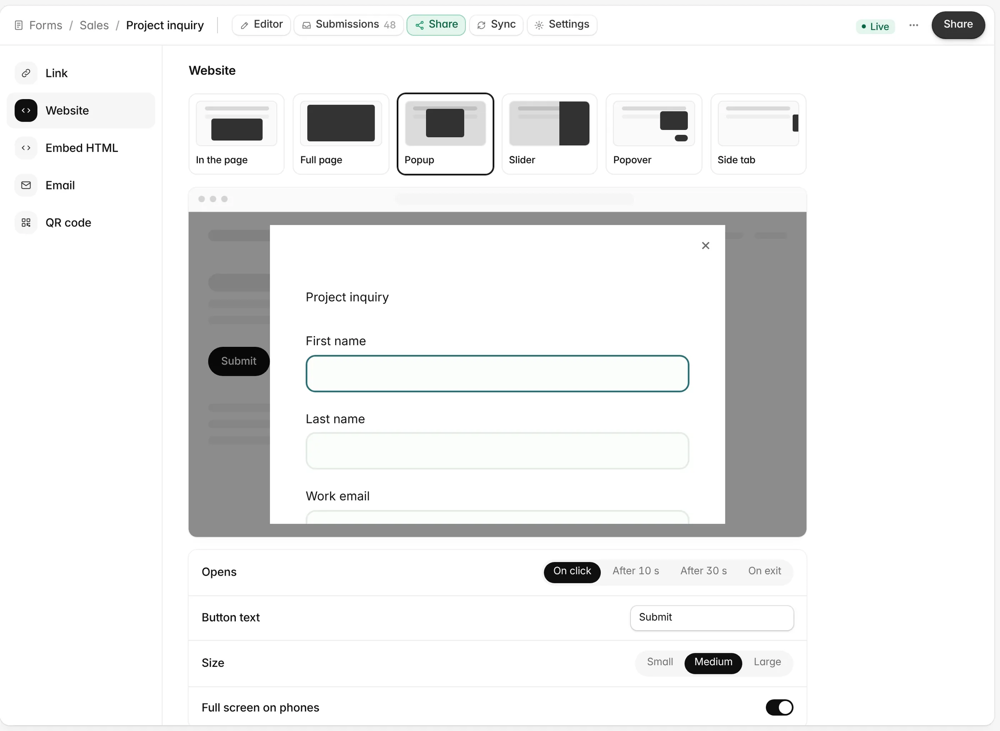
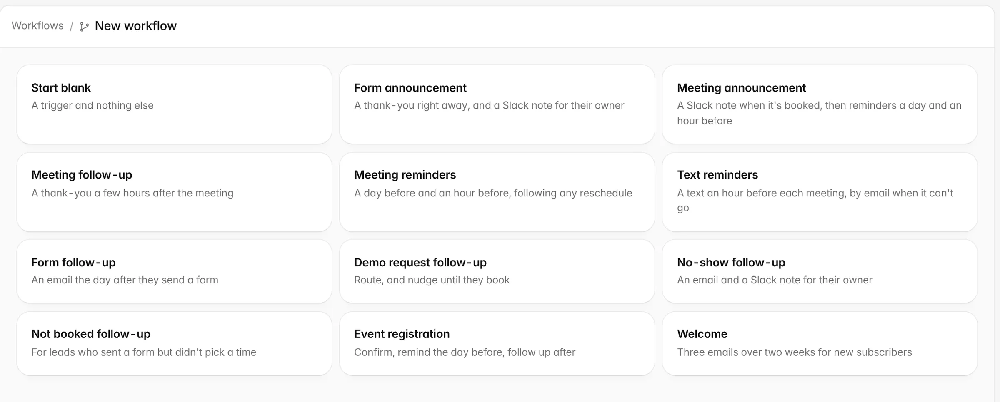
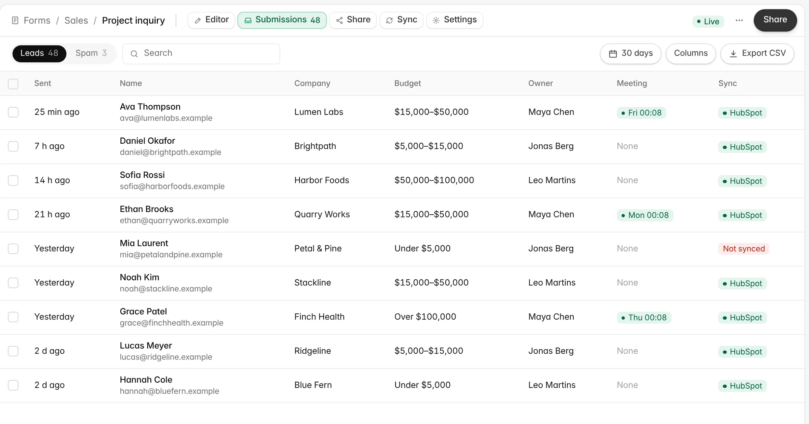

import { Aside, CardGrid, LinkCard, Steps } from '@astrojs/starlight/components';

Visitors on your pricing page are close to buying. This recipe gives them a short form in a popup, then lets them book a demo the moment they send it. People who leave without a time get a nudge two hours later.

**Goal:** a booked demo from every serious pricing-page visitor.

**You need:** a connected calendar and a meeting type, like "Product demo". **Time:** about 20 minutes. **Plan:** any plan. The follow-up workflow's custom wording is listed on Starter and up.

<Steps>

1. **Start from the Book a demo template**

   Open **Forms**, click **Form templates**, and search for "demo". Click a demo request template to open it.

   

1. **Use the template**

   The panel shows what the form comes with and the look it uses. Click **Use form template**. The form opens in Form Studio as a draft.

   

1. **Keep the questions short**

   Click a question to change it in the panel on the right. Keep the work email, name and one or two qualifying questions, like team size. Every extra question costs you leads.

   

1. **Book on the spot**

   Click **Ending** under **Pages**. Set **Ending type** to **Booking page**, **Book with** to **Individual**, and pick your demo meeting.

   

1. **Publish**

   Click **Publish**. The form is live, and the calendar shows right after the send, with the person's name and email filled in, so most people book in one click.

   

1. **Add it to the pricing page as a popup**

   Open **Share**, then **Website**, and pick **Popup**. Set **Opens** to **On click** and the **Button text** to "Book a demo". Copy the code into your pricing page's footer code.

   

1. **Follow up with people who don't book**

   Open **Email**, then **Workflows**, click **New workflow** and pick **Not booked follow-up**. It waits 2 hours, sends "Still want to talk?" with your booking link, then posts a Slack note for the lead's owner after 2 more days. It stops as soon as they book. Pick the form in the trigger, fill in the button's link, and click **Publish**.

   

1. **Watch it work**

   Open the form's **Submissions** tab. Each lead shows their meeting, owner and where they synced.

   

</Steps>

## What good looks like

- Most fills book a time in the same visit.
- The **Submissions** tab shows a meeting next to most leads.
- People who didn't book get one friendly reminder, never a pile.

<Aside type="tip">
Want different leads to book with different people? Set **Book with** to **Team meeting** instead. See [Route leads to the right rep](/recipes/route-leads-by-answer/).
</Aside>

## Related

<CardGrid>
  <LinkCard title="On submission" href="/forms/on-submission/" description="Every ending option." />
  <LinkCard title="Share and embed" href="/forms/share-and-embed/" description="Every way to put a form on a site." />
</CardGrid>
