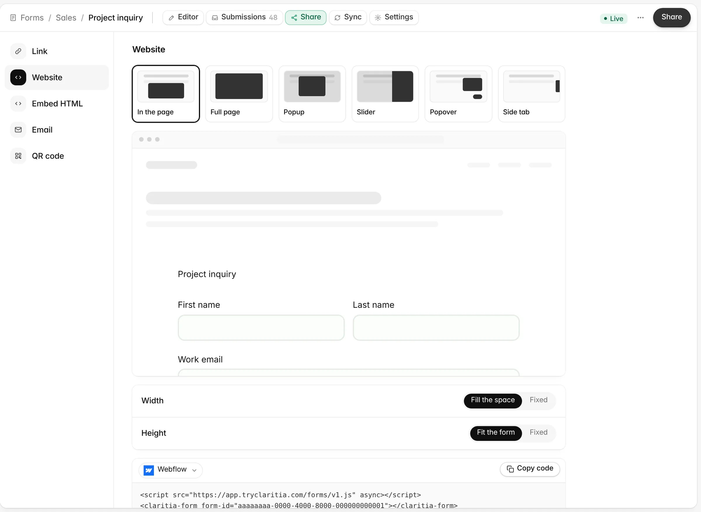
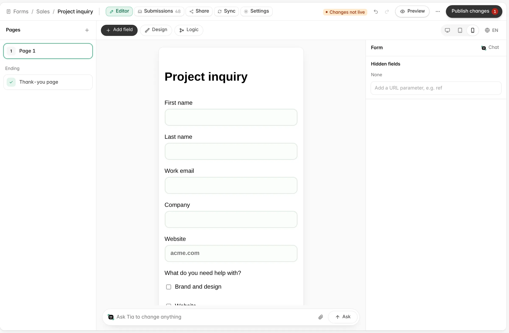
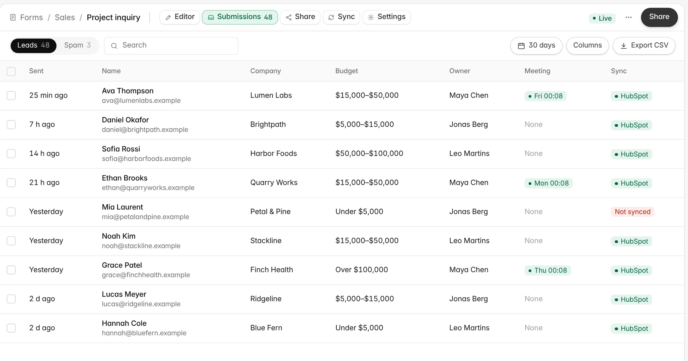
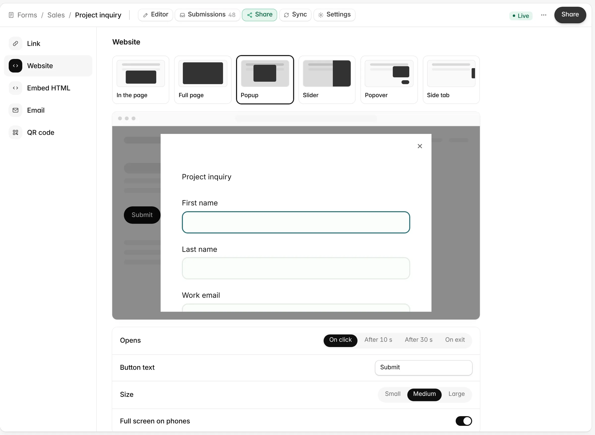

import { Aside, CardGrid, LinkCard, Steps } from '@astrojs/starlight/components';

This recipe puts a Claritia form on a page of your Webflow site. The same steps work for WordPress, Framer, Squarespace and Shopify: Share shows each one's own steps.

**Goal:** fills from your Webflow site land in Claritia, with routing, booking and syncs.

**You need:** a published form and a Webflow site you can edit. **Time:** about 10 minutes. **Plan:** website embeds are on every plan.

<Steps>

1. **Open Share, then Website**

   Open the form, click **Share**, then **Website**. Pick how it shows: **In the page**, **Full page**, **Popup**, **Slider**, **Popover** or **Side tab**. For a form inside a page, pick **In the page**.

   

1. **Set the size**

   For **In the page**, leave **Width** on **Fill the space** and **Height** on **Fit the form**, or pick **Fixed** and type the pixels. The preview shows how it looks.

   

1. **Copy the code for Webflow**

   Under the preview, pick **Webflow** in the site menu and click **Copy code**. The code is two lines: the Claritia script and a `<claritia-form>` tag with your form's id.

   

1. **Add a Code Embed in Webflow**

   Open the page in the Webflow Designer. Open the Add panel and drag a **Code Embed** element to where the form goes. Paste the code, then click **Save and close**.

   

1. **Publish the site**

   Publish your Webflow site. The form shows on the published site, not inside the Designer.

   

1. **Send a test fill**

   Fill the form on the live page. Open the form's **Submissions** tab in Claritia: the fill is there, with the page it came from.

   

</Steps>

### A popup instead

For **Popup**, **Slider**, **Popover** or **Side tab**, the code goes in the site's footer so it works on every page. In Webflow, open **Site settings**, then **Custom code**, paste it in **Footer code** (Before `</body>` tag), click **Save**, then publish.

## What good looks like

- The form fits its box with no inner scroll bar.
- Fills show in **Submissions** within seconds, with the page they came from.
- Changes you publish in Claritia show on the site without touching Webflow again.

<Aside type="tip">
You don't need to paste the code again when you change the form. The embed always shows the live version.
</Aside>

## Related

<CardGrid>
  <LinkCard title="Share and embed" href="/forms/share-and-embed/" description="Every share option." />
  <LinkCard title="Webflow forms" href="/integrations/webflow-forms/" description="Keep Webflow's own forms and bring fills in." />
</CardGrid>
