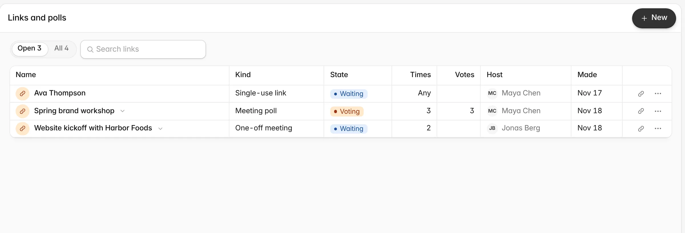
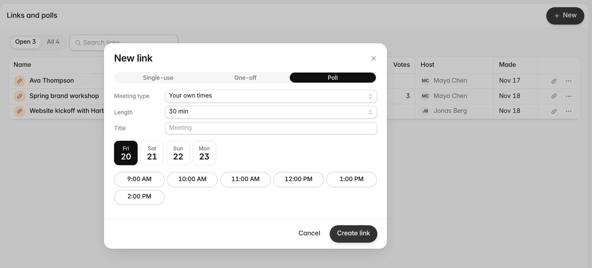
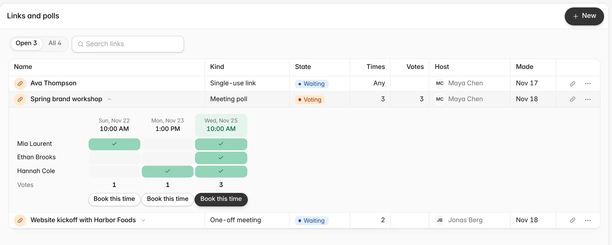
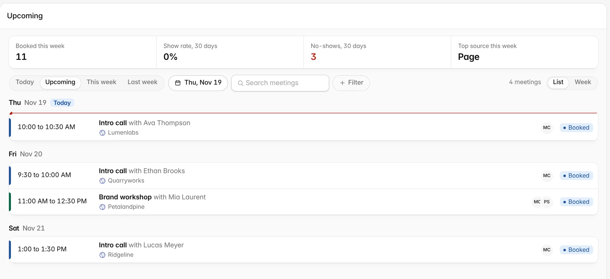

import { Aside, CardGrid, LinkCard, Steps } from '@astrojs/starlight/components';

Finding a time for a workshop or a kickoff with several people takes too many emails. A poll asks once, and books the time that works.

**Goal:** one booked meeting, with every voter invited.

**You need:** a connected calendar. **Time:** about 5 minutes, plus the voting. **Plan:** polls are listed on Starter and up (check).

<Steps>

1. **Make a poll**

   Open **Links and polls** under **Meetings**, click **New** and pick **Meeting poll**. Or use **Create** in the sidebar, then **Poll**.

   

1. **Pick the meeting and times**

   Pick a meeting type, or **Your own times** with a **Length** and **Title**. Then pick a day and click 2 to 20 of your free times over the next two weeks. Click **Create link**, copy the link from **Link ready**, and click **Done**.

   

1. **Share the link**

   Paste the link in an email or chat to the group. Each person ticks every time that works and adds their name and email. The poll shows **Voting** in the list.

   

1. **Book the winner**

   Click the poll to see the votes under each time. Click **Book** under the best one, and confirm **Book [time]?**.

   

1. **Everyone's invited**

   The meeting goes on your calendar, and every voter gets the invite and the confirmation email. The poll shows **Booked**, and its link says **This poll is closed.**

   

</Steps>

## What good looks like

- One link, one round of votes, one booked time.
- Voters get reminders like any other guest.

<Aside type="tip">
Just one guest? A **Single-use link** books once and closes. A **One-off meeting** offers up to 10 of your times for one booking.
</Aside>

## Related

<CardGrid>
  <LinkCard title="Links and polls" href="/meetings/links-and-polls/" description="Every kind of link." />
  <LinkCard title="What guests see" href="/meetings/guest-experience/" description="The booking page from their side." />
</CardGrid>
