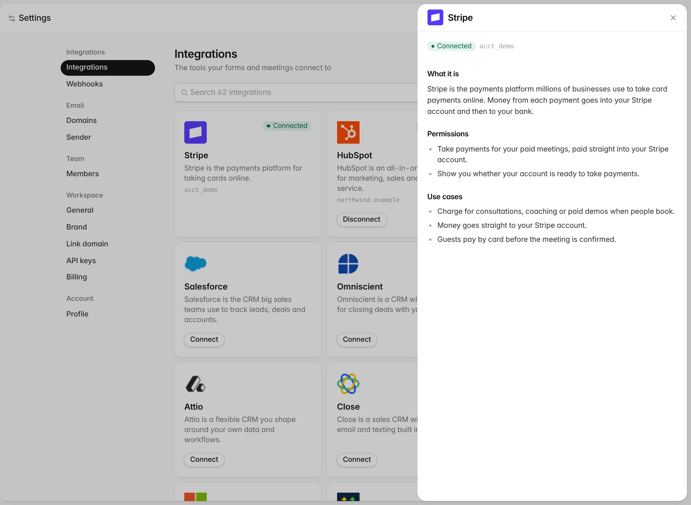
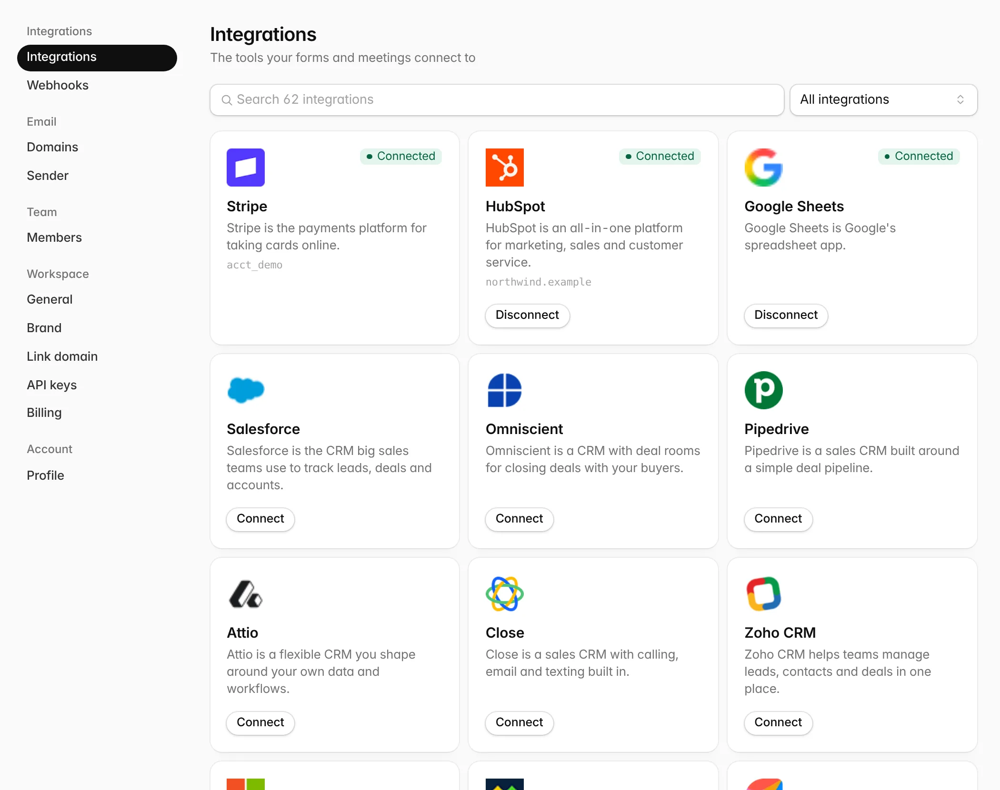
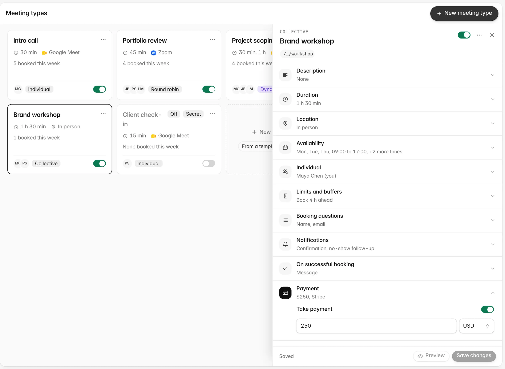
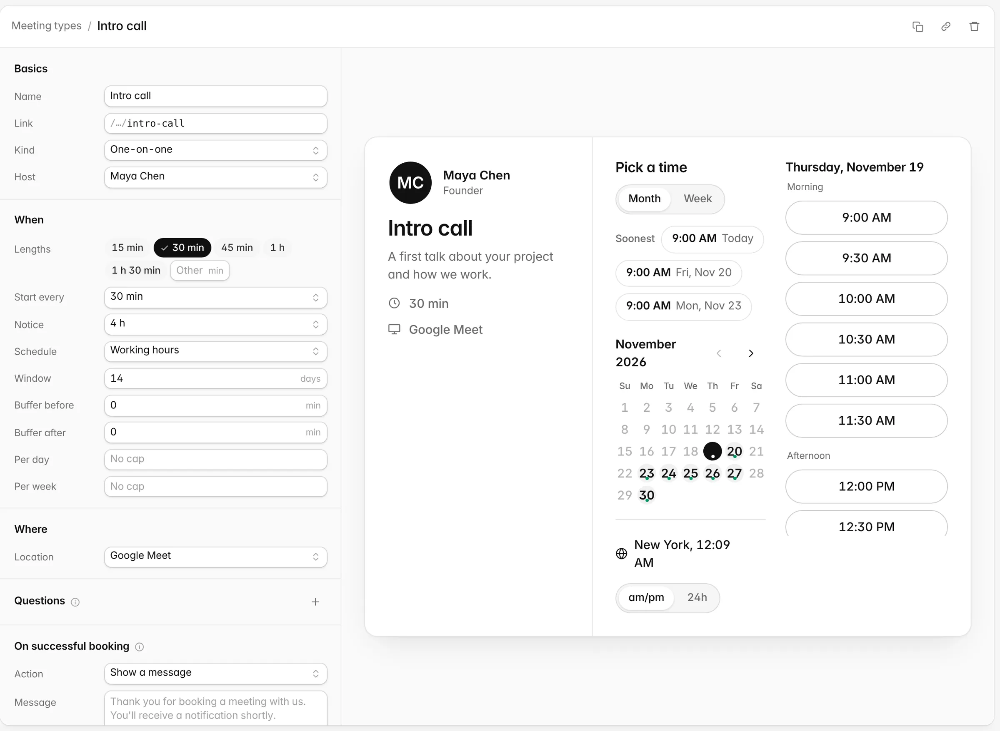
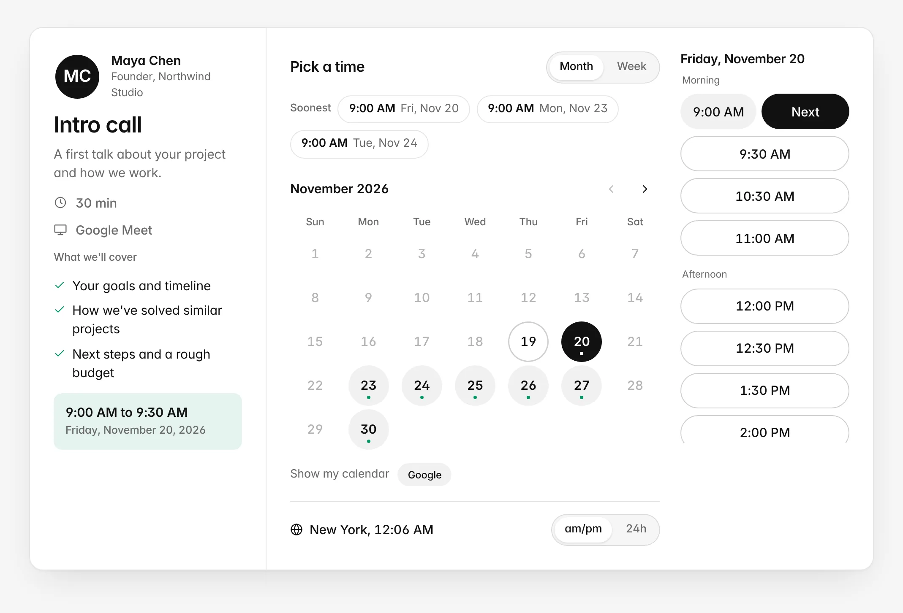
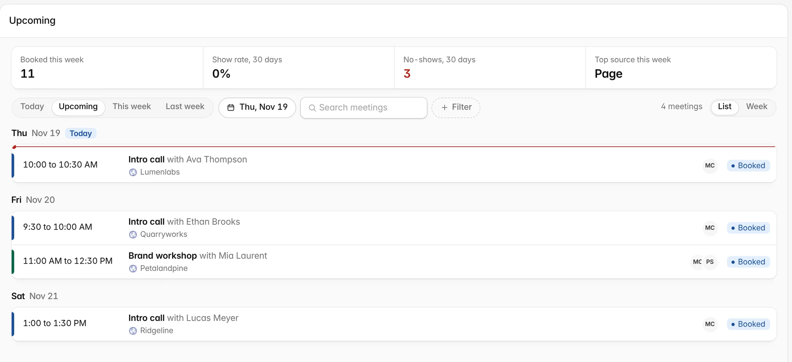
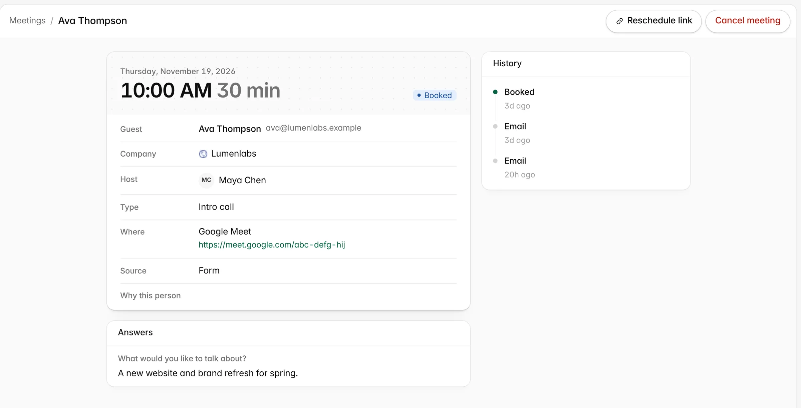

import { Aside, CardGrid, LinkCard, Steps } from '@astrojs/starlight/components';

Charge for a strategy session, a coaching call or a workshop seat when people book. Money goes straight to your own Stripe account.

**Goal:** guests pay when they book, and you never chase an invoice.

**You need:** to be a workspace owner. **Time:** about 15 minutes, plus Stripe's own sign-up if you're new to it. **Plan:** paid meetings are on Starter and up.

<Steps>

1. **Connect Stripe**

   Go to **Settings**, then **Integrations**, and click **Connect** on the **Stripe** card. Sign in to Stripe and approve Claritia.

   

1. **Finish on Stripe if asked**

   If the card says **Finish on Stripe**, click **Continue on Stripe** and add what Stripe asks for. When it's done, the card says **Connected**.

   

1. **Turn on payment**

   Open **Meeting types**, click the meeting, and open **Payment**. Switch on **Take payment**, then set the **Amount** and **Currency**.

   

1. **Check the rest of the settings**

   Open the meeting's menu, then **All settings**. Under **Payment**, **Paid with** is **Stripe**. Set a longer **notice** if you need time to prepare. Click **Save changes**.

   

1. **Share the meeting**

   Show the meeting on your booking page, share its link, or book it from a form's Ending. Guests pick a time and then pay on Stripe's checkout.

   

1. **Watch payments come in**

   In **Upcoming**, a meeting waiting for its payment shows **Waiting on payment**. Claritia holds the time for 10 minutes while the guest pays. Once Stripe confirms, it's booked and the invite goes out.

   

1. **Refund when you cancel**

   Open the meeting and click **Cancel and refund**. If Stripe can't refund, Claritia says **Canceled. The refund didn't go through; refund it in Stripe.**

   

</Steps>

## What good looks like

- No booking without a payment.
- If two people go for the same time, the second never pays for a time they can't have: a late payment is refunded at once.
- Guests can move a paid meeting themselves from their confirmation email, without paying again.

<Aside type="tip">
Prefer PayPal or Square? Connect them in **Integrations** and pick them under **Paid with**. See [PayPal](/integrations/paypal/) and [Square](/integrations/square/).
</Aside>

## Related

<CardGrid>
  <LinkCard title="Stripe" href="/integrations/stripe/" description="Connecting, holds and refunds." />
  <LinkCard title="Paid meetings" href="/meetings/paid-meetings/" description="Every paid meeting setting." />
</CardGrid>
