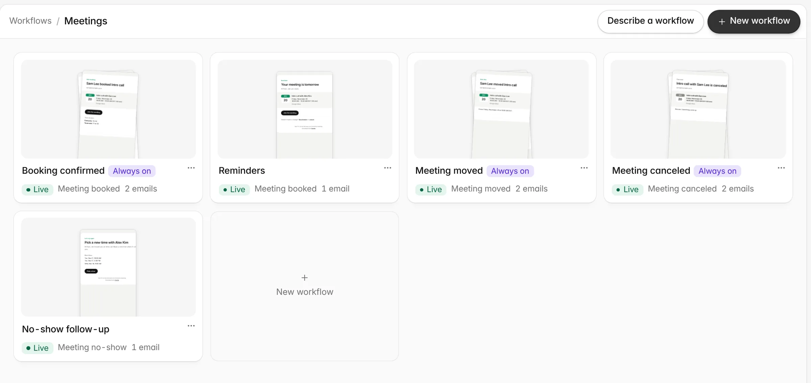
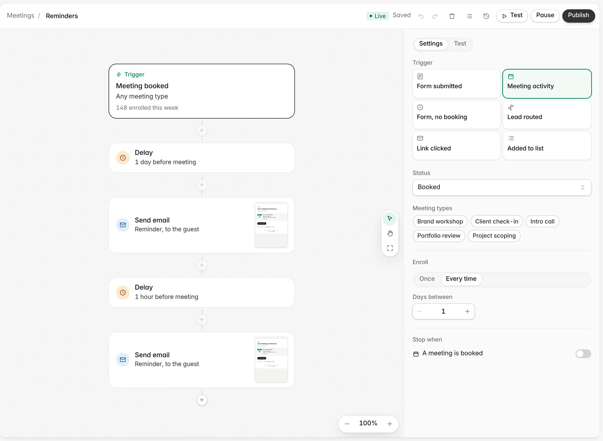
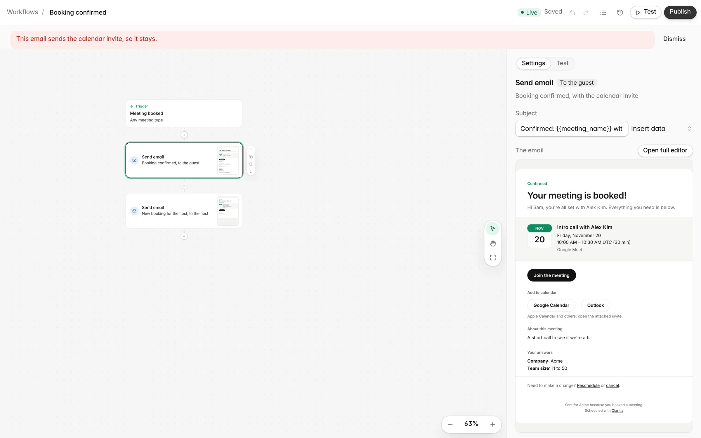
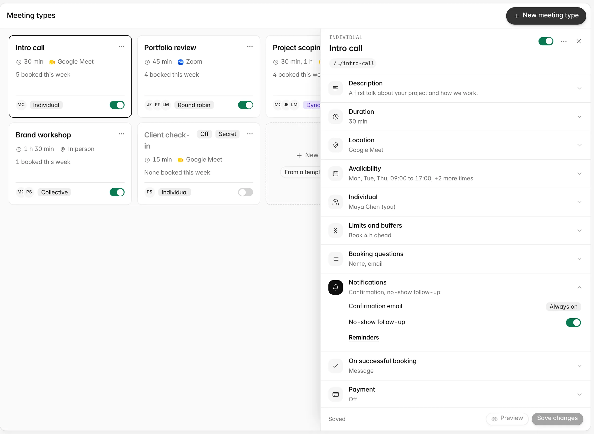
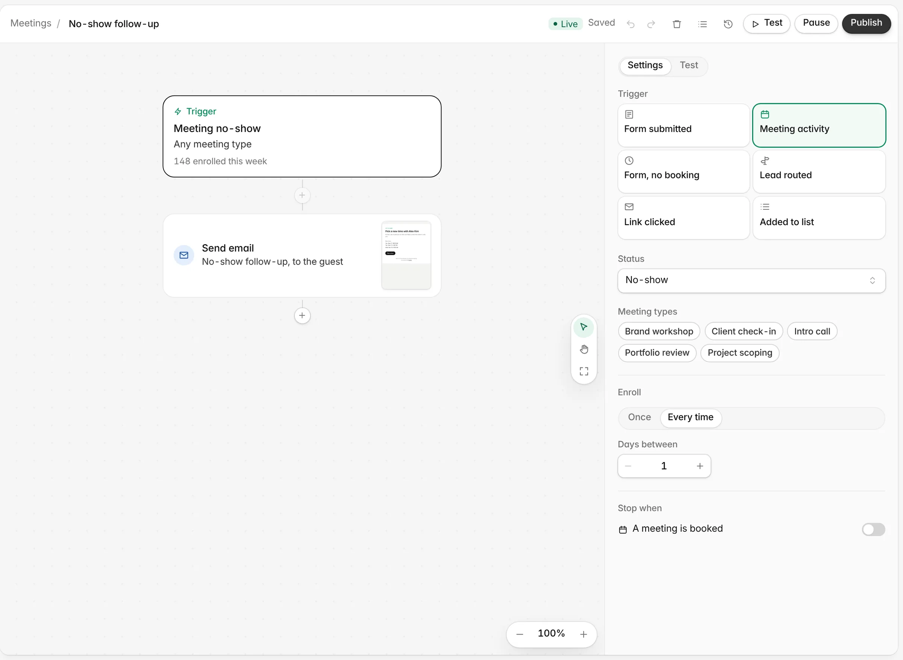
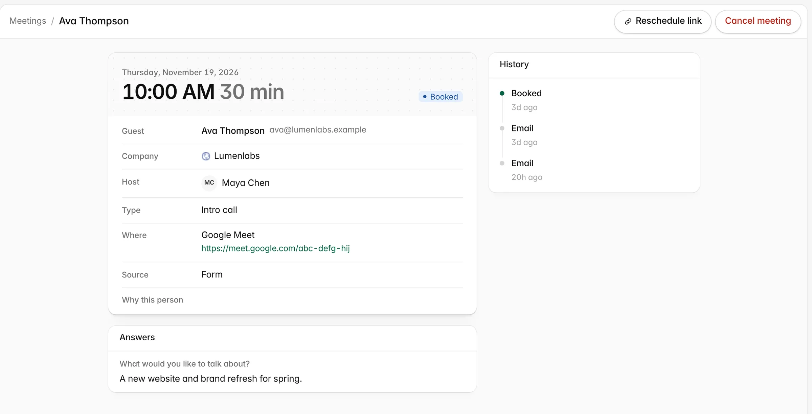

import { Aside, CardGrid, LinkCard, Steps } from '@astrojs/starlight/components';

Reminders cut no-shows, and a kind follow-up wins back the people who still miss. Claritia's meeting emails are already live workflows. This recipe tunes them.

**Goal:** fewer missed meetings, and a second chance for the ones that are.

**You need:** a meeting type people can book. **Time:** about 15 minutes. **Plan:** reminders a day and an hour before are on every plan. Your own wording and times are listed on Starter and up, and the no-show follow-up on Pro and up.

<Steps>

1. **Open the Meetings folder**

   Go to **Email**, then **Workflows**, and open the **Meetings** folder. It holds **Booking confirmed**, **Reminders**, **Meeting moved**, **Meeting canceled** and **No-show follow-up**.

   

1. **Set when reminders go**

   Open **Reminders**. Each **Delay** step says how long before the meeting the next email goes, like **1 day before meeting** and **1 hour before meeting**. Click a delay to change it, or add another delay and email for a third reminder.

   

1. **Change the words**

   Click a **Send email** step to edit the reminder in the panel. Merge fields like `{{meeting_time}}`, `{{meeting_link}}` and `{{reschedule_link}}` fill in for each meeting.

   

1. **Turn on the no-show follow-up for a meeting**

   Open the meeting type and its **Notifications** section. Switch on **No-show follow-up**. The **Confirmation email** is always on.

   

1. **Check the No-show follow-up workflow**

   Open **No-show follow-up** in the Meetings folder. It starts on **Meeting no-show** and sends the guest an email with your next times. Change its words, or add a Slack or Teams note for the host. Click **Publish**.

   

1. **Mark no-shows**

   After a meeting starts, open it from **Upcoming** and click **No-show**. The follow-up goes out. Click **Held** for meetings that happened. If you don't mark it, Claritia marks it held 24 hours after it ends.

   

</Steps>

<video class="cl-clip" src="/videos/workflows.mp4" autoplay muted loop playsinline preload="metadata" width="1280" height="800" aria-label="Opening the Meetings folder, the Reminders workflow and its email step" title="Opening the Meetings folder, the Reminders workflow and its email step"></video>

## What good looks like

- Every booked meeting gets its reminders, and a moved or canceled one never does.
- The **No-shows, 30 days** number at the top of **Upcoming** goes down.
- Missed guests book again from the follow-up.

<Aside type="note">
**Booking confirmed**, **Meeting moved** and **Meeting canceled** send the calendar invite, so they can't be paused or deleted.
</Aside>

## Related

<CardGrid>
  <LinkCard title="Meeting emails and reminders" href="/email/meeting-emails/" description="Every email a meeting sends." />
  <LinkCard title="Upcoming meetings" href="/meetings/upcoming/" description="Mark held and no-show." />
</CardGrid>
