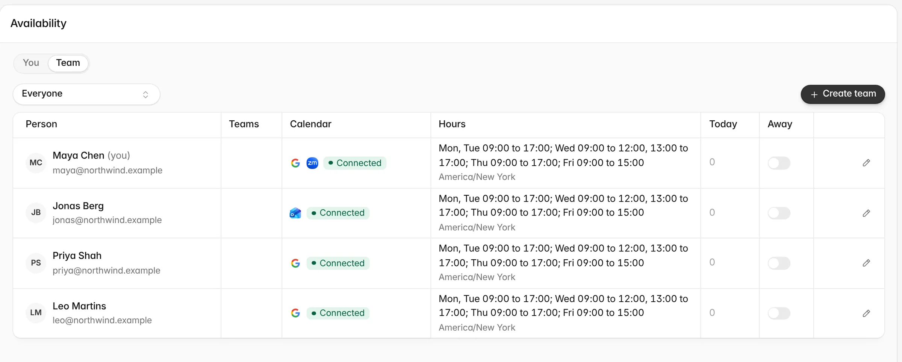
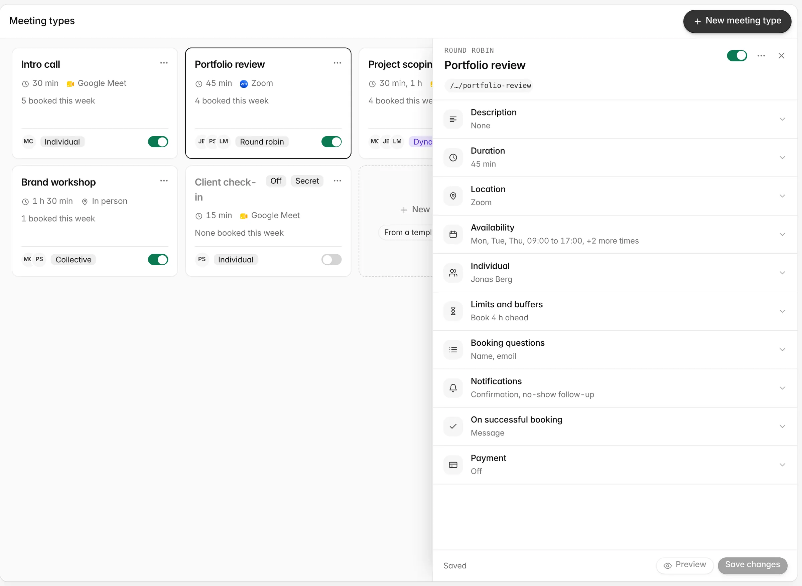
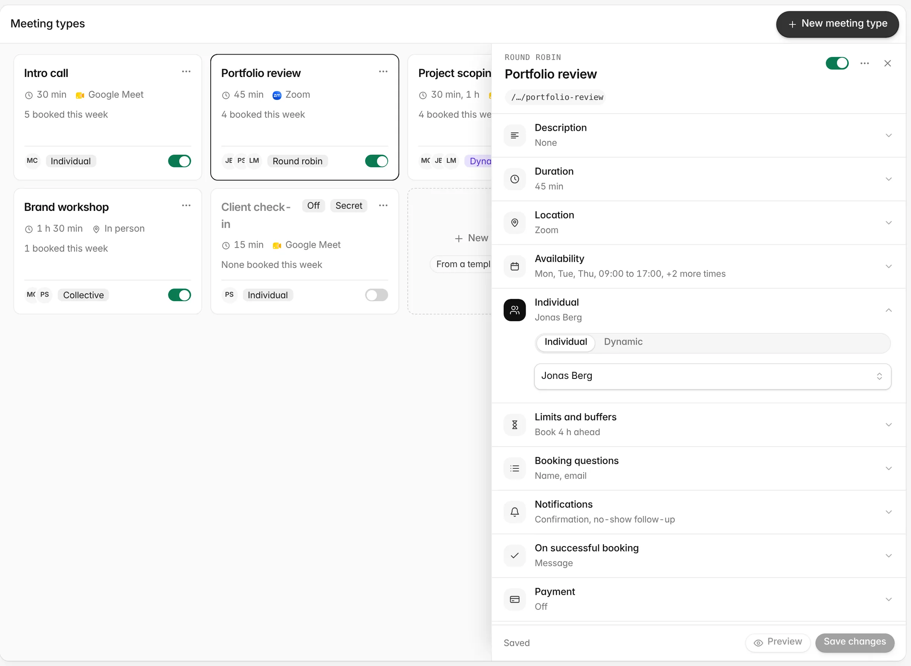
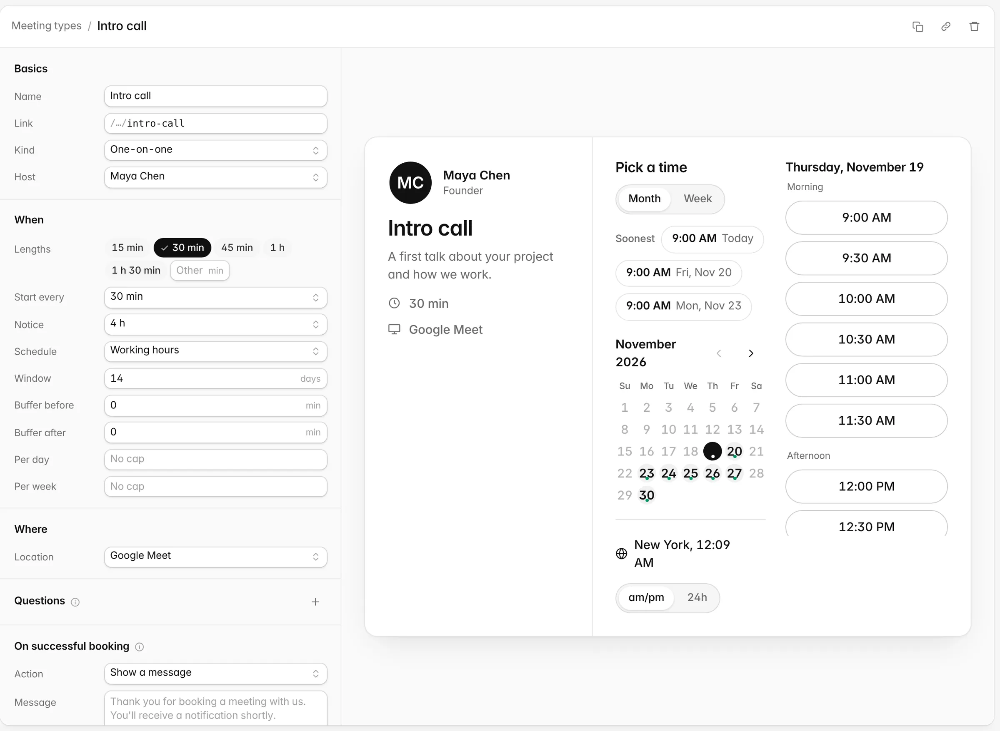
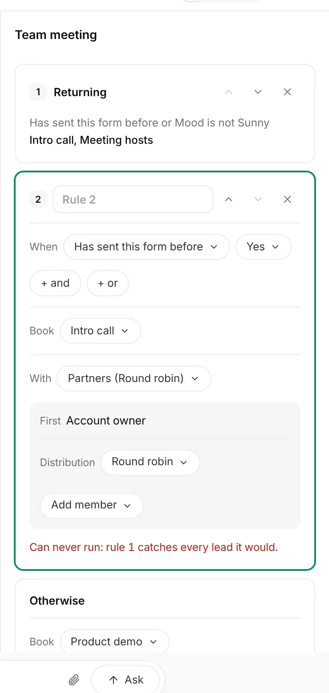
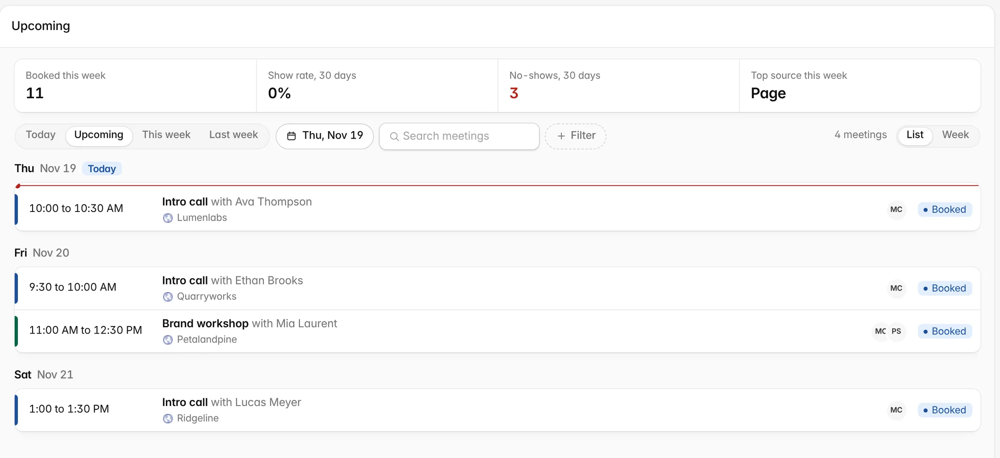

import { Aside, CardGrid, LinkCard, Steps } from '@astrojs/starlight/components';

Give leads one link, and let Claritia share the meetings across your team. Each booking goes to the person most due, as long as they're free.

**Goal:** an even share of meetings, with no one booked while away.

**You need:** your teammates in the workspace, each with a calendar connected. **Time:** about 15 minutes. **Plan:** round robin and collective meetings are on Pro and up. Every host is a seat.

<Steps>

1. **Get everyone ready**

   Each teammate connects their own calendar in **Availability**, then **Calendars**, and sets their hours. On the **Team** view, check everyone's calendar and hours, and switch **Away** on for anyone out.

   

1. **Open the meeting type**

   Go to **Meeting types** and click the meeting the team shares, like "Portfolio review". Its card shows **Round robin** and the hosts' initials.

   

1. **Pick who hosts**

   Open the host section. Pick **Individual** for one person, or **Dynamic** to send guests to a team by their answers. For a straight round robin, use a form's **Team meeting** or the meeting's **All settings**, below.

   

1. **Set the kind and weights**

   Open the meeting's menu, then **All settings**. Pick the **Round robin** kind and add the hosts. Give each person a weight from 1 to 10, and a priority for ties. **Flexible** shows every free host's times. **Strict** shows only the next host's times.

   

1. **Or share by team from a form**

   In a form's **Ending**, pick **Team meeting** and set **With** to a team. Pick its **Distribution**: **Round robin**, **Weighted round robin** or **Load balanced**. **First** is always **Account owner**, so a known lead books with their owner.

   

1. **Check the shares**

   Open **Upcoming** and filter by host. Open any meeting: **Why this person** shows whose turn it was.

   

</Steps>

## What good looks like

- Over a few weeks, each person's count in **Upcoming** is about even, or matches their weights.
- No one gets a meeting on a day off or past their daily cap.
- A guest who moves their meeting stays with the same host, unless you let moves go to anyone in the pool.

<Aside type="tip">
Need everyone in the room? Pick **Collective**: guests only see times when every member is free.
</Aside>

## Related

<CardGrid>
  <LinkCard title="Team meetings" href="/meetings/team-meetings/" description="Every way a team shares meetings." />
  <LinkCard title="Availability and teams" href="/meetings/availability-and-teams/" description="Hours, days off and teams." />
</CardGrid>
