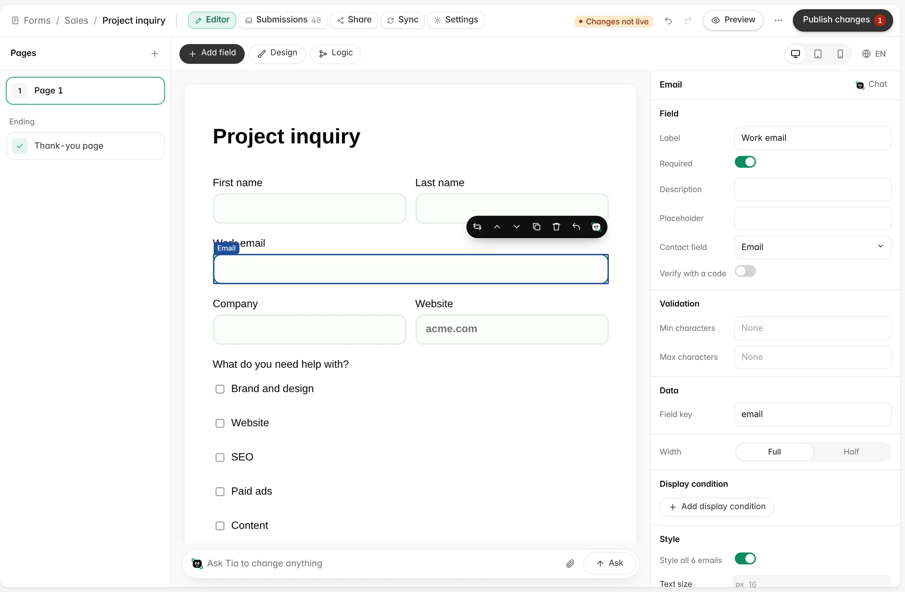
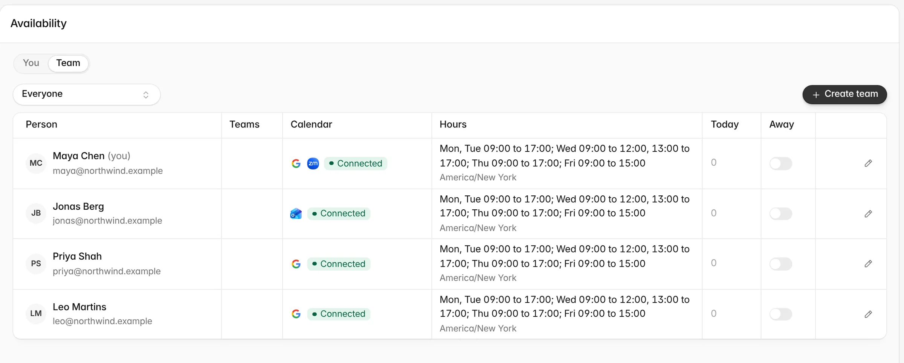
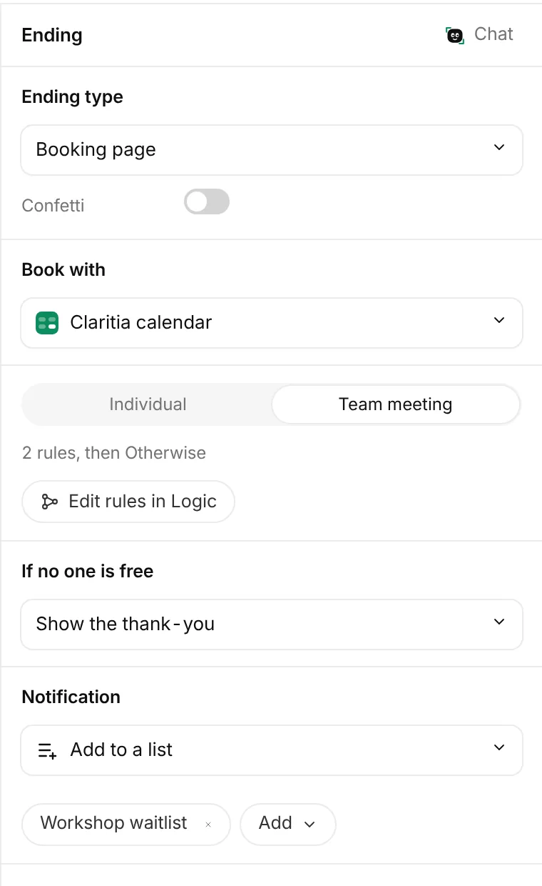
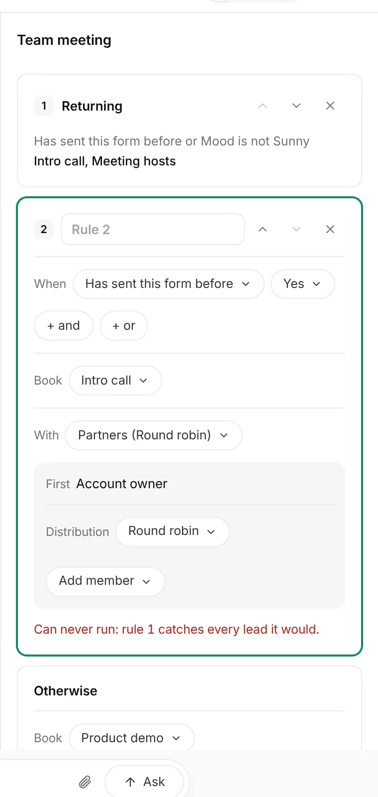
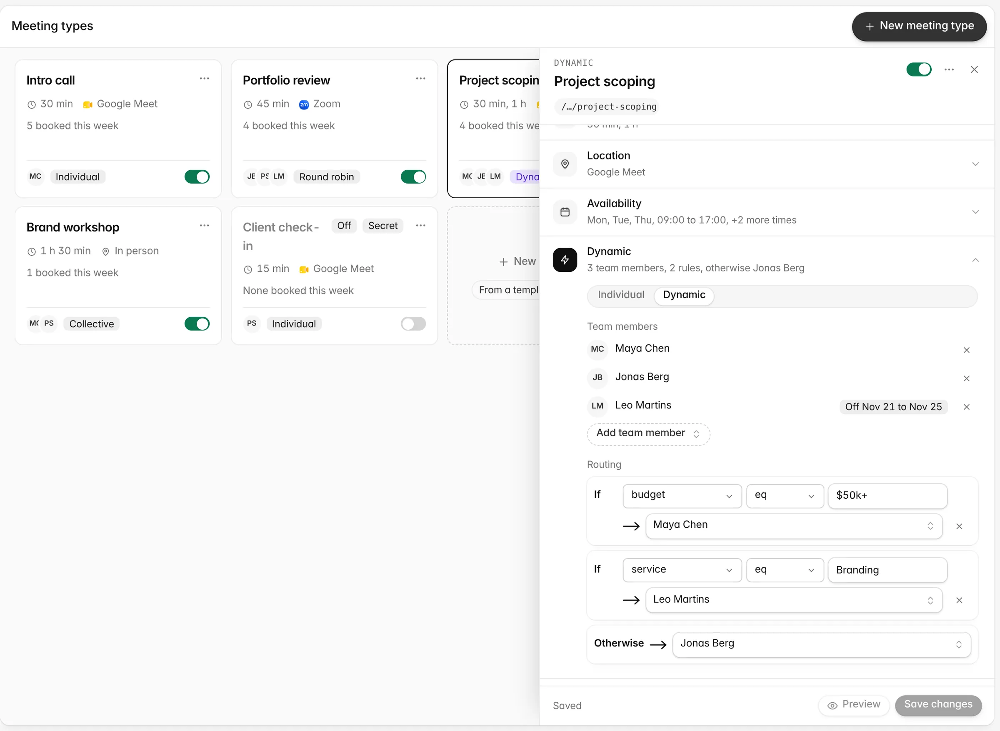
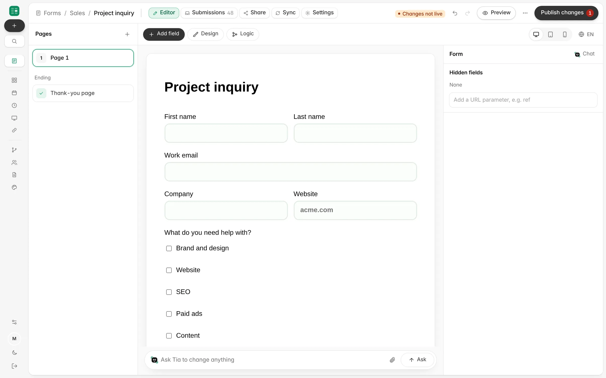
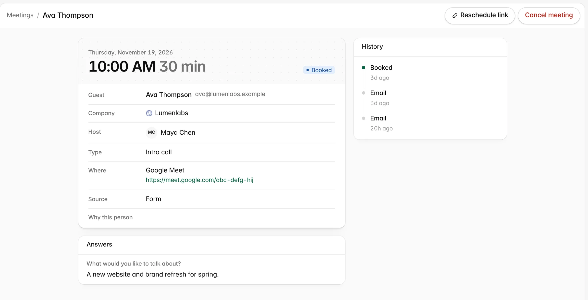

import { Aside, CardGrid, LinkCard, Steps } from '@astrojs/starlight/components';

Not every lead should book with the same person. This recipe sends each lead to the right rep based on what they answer, and books them with that rep straight away.

**Goal:** large deals go to your senior rep, everyone else shares out fairly.

**You need:** a form with a qualifying question, like **Company size**, and your reps in the workspace with calendars connected. **Time:** about 20 minutes. **Plan:** routing by answer and team meetings are on Pro and up. Below Pro, the rules are kept but don't run, and every lead books the **Otherwise** meeting.

<Steps>

1. **Ask the question that decides**

   In Form Studio, add a choice question your rules can test, like **Company size** with "1–10", "11–50", "51–200" and "200+". Make it required, so every lead has an answer.

   

1. **Make a team for everyone else**

   Open **Meetings**, then **Availability**, then **Team**. Each rep connects their own calendar and sets their hours. Check nobody's away.

   

1. **Open the form's Ending**

   In Form Studio, click **Ending**, set **Ending type** to **Booking page** and **Book with** to **Team meeting**.

   

1. **Add a rule for big companies**

   Add a rule: **When** "Company size" is "200+", **Book** your demo meeting, **With** your senior rep. Add a second rule for a region if you like. **Otherwise** catches everyone else: pick your team with **Round robin**.

   

1. **Or put the rules on the meeting**

   To use the same rules on every form and on the meeting's own link, open the meeting type and set its host to **Dynamic** instead. Add the same rules there and set **Otherwise**.

   

1. **Publish and test**

   Click **Publish changes**. Fill the live form once with "200+" and once with "1–10", and check who each booking goes to.

   

1. **See why someone got a lead**

   Open a meeting from **Upcoming**. **Why this person** shows the rule that matched and why that rep was picked.

   

</Steps>

## What good looks like

- Every "200+" lead lands on your senior rep's calendar.
- The round robin spreads the rest about evenly. Check it in **Upcoming** with the host filter.
- A lead who already has an owner books with that owner first.

<Aside type="note">
Rules run in order, and the first one that matches wins. Put the narrowest rule first.
</Aside>

## Related

<CardGrid>
  <LinkCard title="Team meetings" href="/meetings/team-meetings/" description="Individual, Dynamic and how teams take turns." />
  <LinkCard title="Run a round-robin team meeting" href="/recipes/round-robin-team-meeting/" description="Share meetings fairly." />
</CardGrid>
