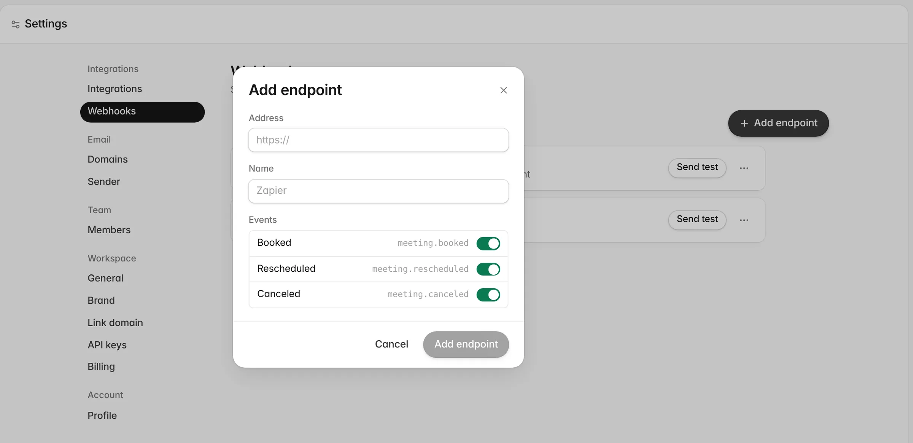
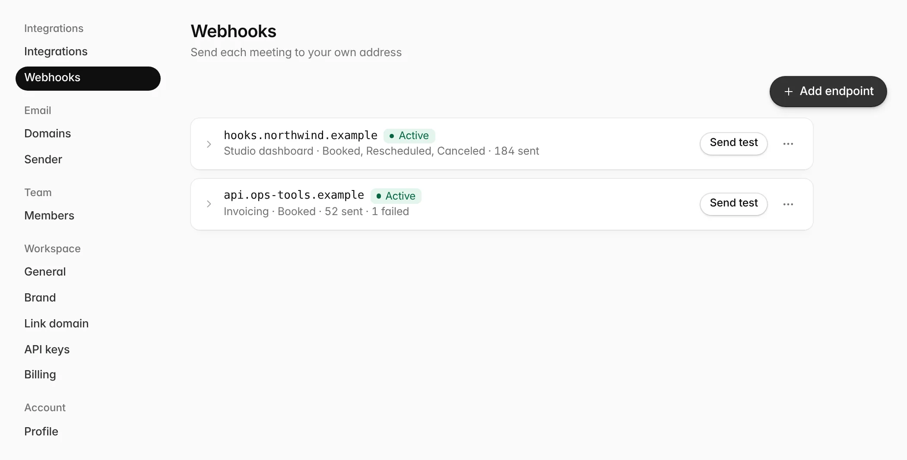
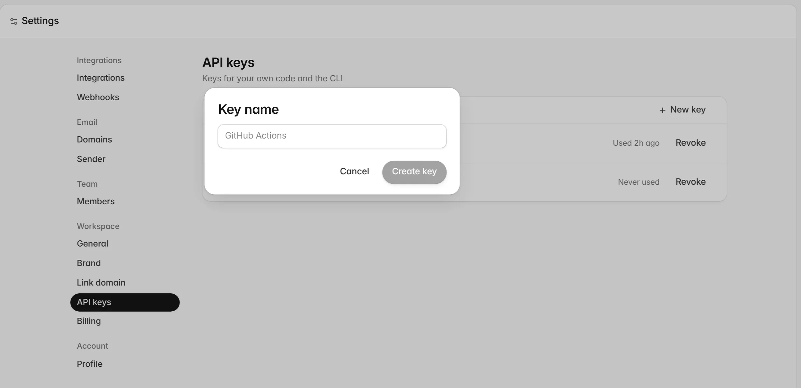
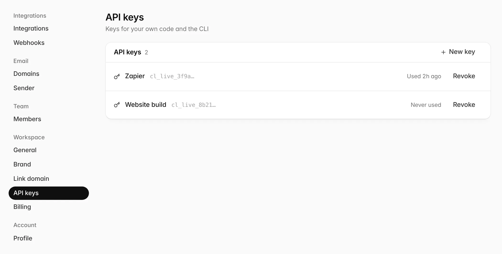

import { Aside, CardGrid, LinkCard, Steps } from '@astrojs/starlight/components';

Your billing tool, dashboard or data warehouse can hear about every meeting the moment it changes. This recipe adds a webhook endpoint, checks its signature, and adds form fills through the API.

**Goal:** your app gets each booking within seconds, and never twice.

**You need:** to be a workspace owner, and a public `https://` address on your server. **Time:** about 20 minutes. **Plan:** webhooks are on every plan.

<Steps>

1. **Add an endpoint**

   Go to **Settings**, then **Webhooks**, and click **Add endpoint**. Type your **Address** and a **Name**, like "Invoicing". Every event is on to start: **Booked**, **Rescheduled** and **Canceled**, plus **Held** and **No-show**. Switch off what you don't need.

   

1. **Copy the signing secret**

   Click **Add endpoint**. The **Signing secret** shows once. Click **Copy secret** and keep it on your server.

   

1. **Check each send**

   Each send has an `x-claritia-signature` header, `t=<seconds>,v1=<hex>`. Make an HMAC-SHA256 of the time, a dot and the raw body with your secret, and compare. Answer `200` within 15 seconds.

   ```js
   import { createHmac, timingSafeEqual } from "node:crypto";
   const parts = Object.fromEntries(header.split(",").map((p) => p.split("=")));
   const expected = createHmac("sha256", secret).update(`${parts.t}.${rawBody}`).digest("hex");
   const ok = expected.length === parts.v1.length && timingSafeEqual(Buffer.from(expected), Buffer.from(parts.v1));
   ```

   

1. **Send a test**

   Click **Send test** on the endpoint. It sends a sample with `"test": true` and shows **Sent, 200** or why it failed. Click the endpoint to see **Last 50 sends** and each body.

   

1. **Add form fills with the API**

   Meeting webhooks don't carry form fills. For those, make an API key: go to **Settings**, then **API keys**, click **New key** and name it.

   

1. **Subscribe a fill hook**

   Copy the key, which shows once, and subscribe your address to `form.submitted`:

   ```bash
   curl -X POST https://app.tryclaritia.com/api/v1/hooks \
     -H "Authorization: Bearer clr_your_key" \
     -H "Content-Type: application/json" \
     -d '{"url": "https://example.com/claritia", "event": "form.submitted"}'
   ```

   

</Steps>

## What good looks like

- Each booking reaches your app within about a minute. A booking's first send waits a minute so the video link is in.
- Your app drops repeats by `x-claritia-delivery`, since retries keep the same id.
- The endpoint stays **Active**. If it shows **Failing**, the reason is right under it.

<Aside type="note">
Failed sends are retried after about 1, 5 and 30 minutes, then 2 and 6 hours, up to 8 tries. **Send again** on a send retries it by hand.
</Aside>

## Related

<CardGrid>
  <LinkCard title="Webhook events" href="/api-reference/webhook-events/" description="Every payload and field." />
  <LinkCard title="POST /hooks" href="/api-reference/hooks/" description="Subscribe from code." />
</CardGrid>
