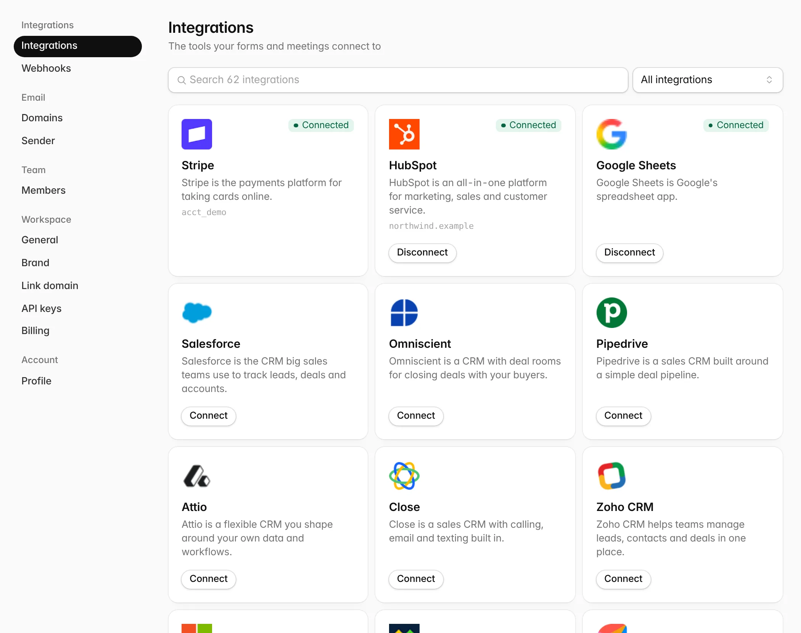
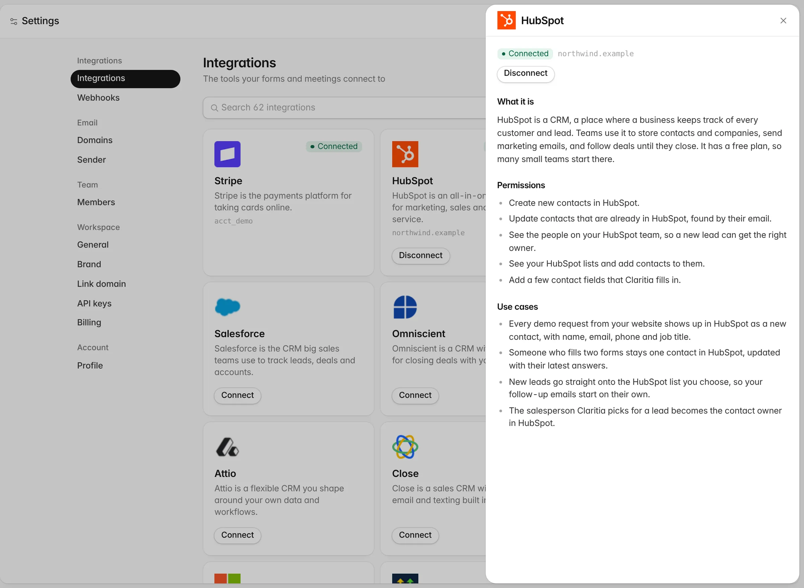
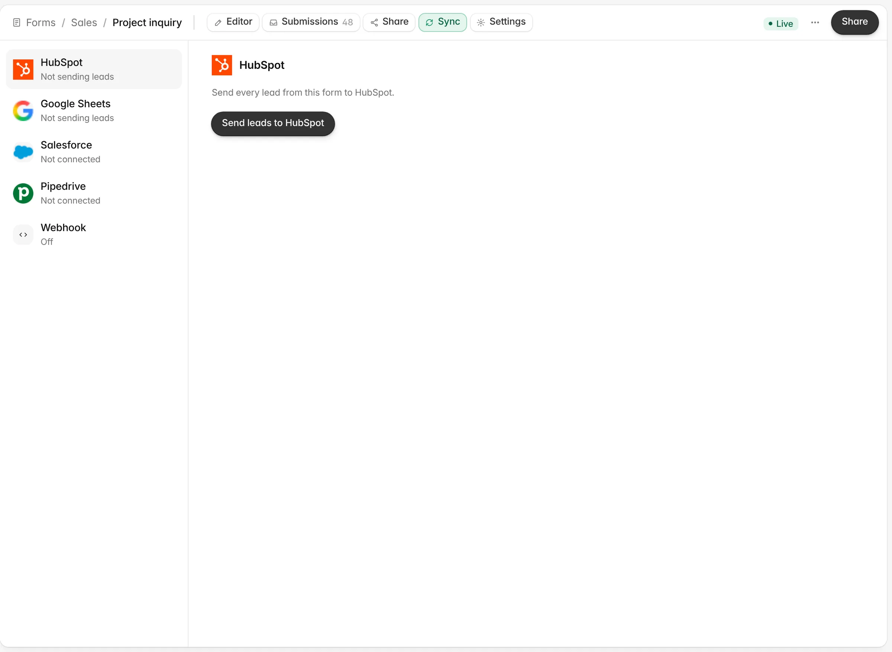
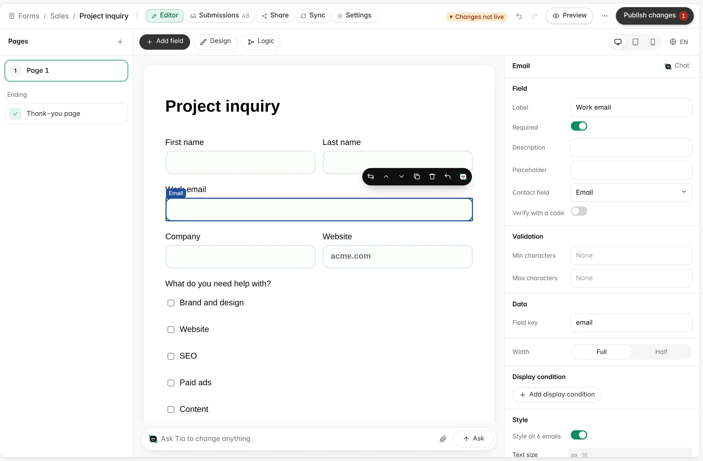
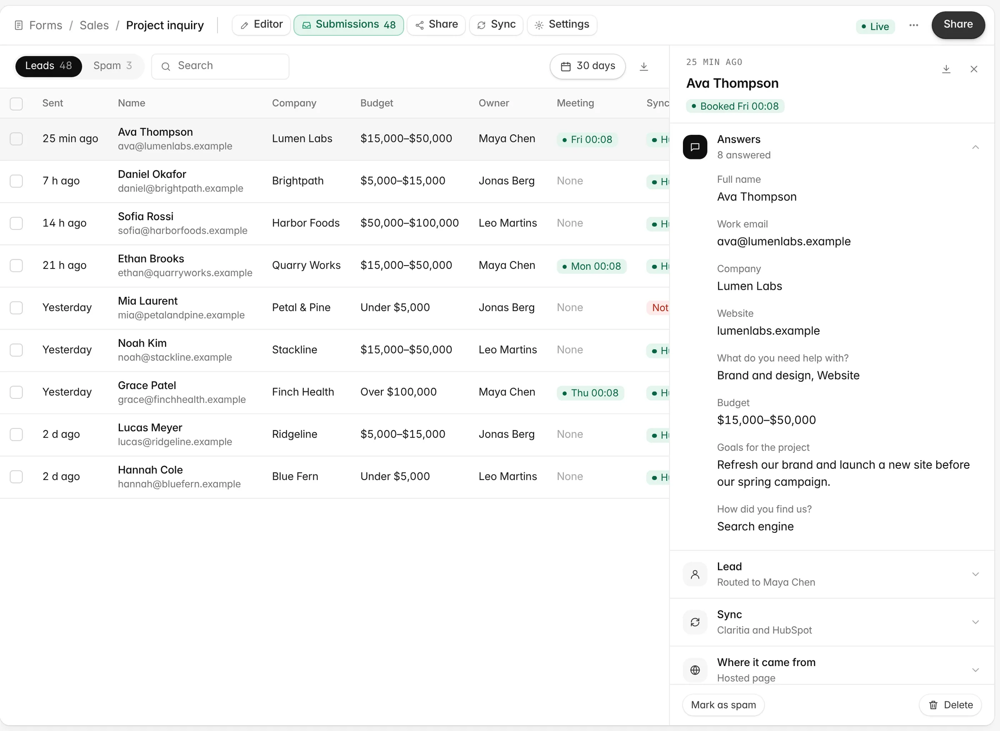

import { Aside, CardGrid, LinkCard, Steps } from '@astrojs/starlight/components';

Every lead stays in Claritia, and a copy goes to HubSpot as a contact the moment the form is sent. This recipe sets that up for one form. The same steps work for Salesforce, Pipedrive and the other CRMs.

**Goal:** every fill is a HubSpot contact, with the right owner and the answers in the right fields.

**You need:** to be a workspace owner to connect HubSpot. **Time:** about 10 minutes. **Plan:** HubSpot is listed on Starter and up.

<Steps>

1. **Connect HubSpot**

   Go to **Settings**, then **Integrations**, and click **Connect** on the **HubSpot** card. Sign in to HubSpot and approve Claritia. You come back to a card marked **Connected**, with your HubSpot account.

   

1. **Check what it can do**

   Click the HubSpot card to open its sheet. It lists what Claritia can do in HubSpot: create and update contacts by email, see your team for owners, see your lists, and add a few fields it fills in.

   

1. **Turn it on for a form**

   Open the form, click **Sync** and pick **HubSpot** on the left. Click **Send leads to HubSpot**.

   

1. **Set the rules**

   Under **When the email is already in HubSpot**, pick **Update it** or **Leave it**. Set **Owner** to **Routing's pick**, so the rep your form books becomes the contact owner, or **HubSpot decides**. Turn on **Send email consent** to pass on the consent box.

   

1. **Map the questions**

   The **Fields** table shows each question and the **HubSpot field** it fills. To change one, click the question in **Build** and pick its field in the question's panel. A choice question with answers HubSpot doesn't know shows **Check choices**.

   

1. **Send a test fill and check it**

   Fill the live form once. In **Submissions**, open the fill: its panel shows where it was sent, with **Try again** if it didn't arrive. Then find the contact in HubSpot.

   

</Steps>

## If a lead doesn't arrive

- The form's row on **Forms** shows **[n] not synced**.
- The HubSpot pane in **Sync** shows how many didn't arrive this week and why, with **Send again**. A lead HubSpot turned down as a duplicate has **Create anyway**.
- Claritia retries on its own first, after about 1, 5 and 30 minutes, then 2 and 6 hours.

## What good looks like

- Every fill shows as a HubSpot contact within seconds.
- A person who fills two forms stays one contact, with their newest answers.
- The rep who takes the meeting owns the contact.

<Aside type="tip">
Using several forms? Turn HubSpot on in each one's **Sync** tab. The connection in **Integrations** is shared, so you connect only once.
</Aside>

## Related

<CardGrid>
  <LinkCard title="HubSpot" href="/integrations/hubspot/" description="Access, what syncs and disconnect." />
  <LinkCard title="Send leads to your tools" href="/integrations/send-leads/" description="Every Sync setting." />
</CardGrid>
