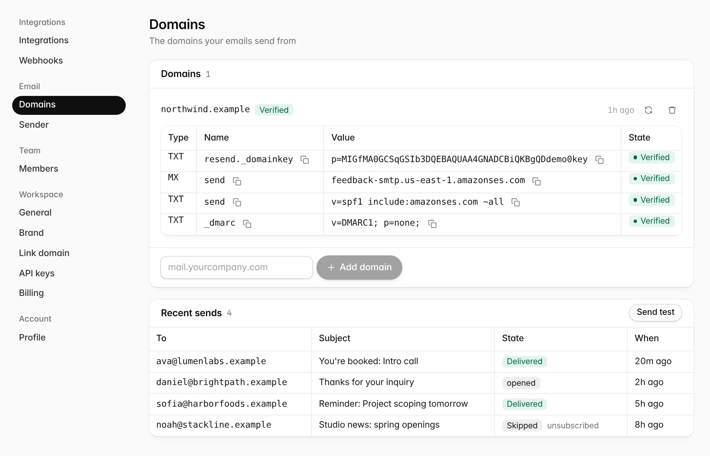
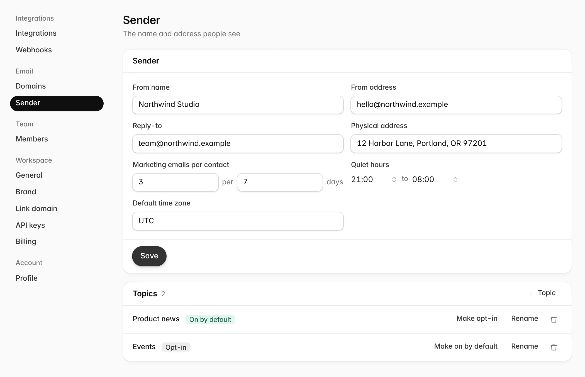
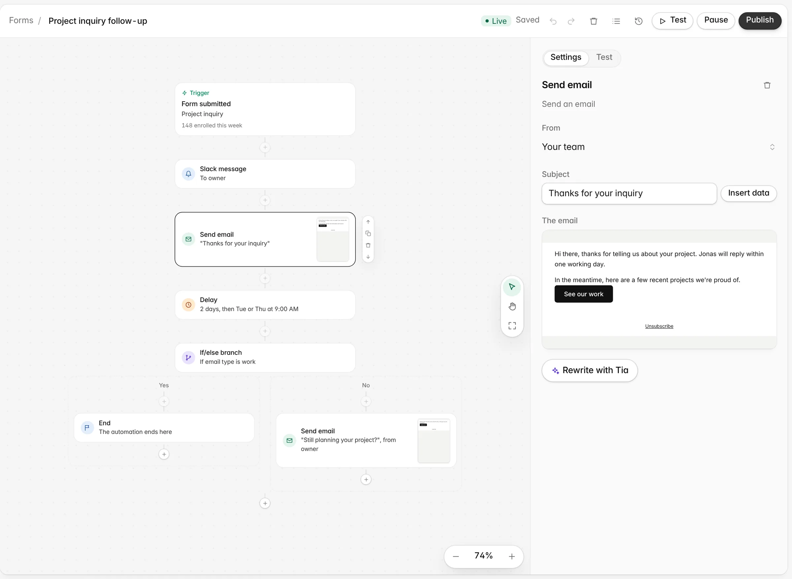

import { Aside, CardGrid, LinkCard, Steps } from '@astrojs/starlight/components';

Emails from your own domain reach the inbox more often and look like you. This recipe adds a domain, proves it's yours with three DNS records, and sets up your sender.

**Goal:** workflow and campaign emails come from `hello@mail.yourcompany.com` and land in the inbox.

**You need:** to be a workspace owner, and access to your domain's DNS settings. **Time:** 15 minutes, plus DNS time, from a few minutes to a day. **Plan:** follow-up emails from your own domain are listed on Pro and up on the pricing page (check).

<Steps>

1. **Add the domain**

   Go to **Settings**, then **Domains**, and click **Add domain**. Use a subdomain just for email, like `mail.yourcompany.com`. It keeps your sending apart from your team's own email.

   

1. **Copy the DNS records**

   Claritia shows each record with its **Type**, **Name** and **Value**: a DKIM record, the SPF records and a DMARC record. Copy each one into your DNS settings, at the company where you bought the domain.

   

1. **Wait for Verified**

   Each record shows **Verified**, **Waiting** or **Wrong**. Claritia checks every few minutes. Click **Check now** to check at once. Sending opens once DKIM, SPF and DMARC check out.

   

1. **Set your sender**

   Go to **Settings**, then **Sender**. Fill in the **From name**, a **From address** on your new domain, a **Reply-to** and your **Physical address**. Check **Marketing emails per contact** and **Quiet hours**. Click **Save**.

   

1. **Send a test**

   Open a workflow's email step and send yourself a test. Check it lands in your inbox, not spam.

   

1. **Watch your sends**

   Back on **Domains**, **Recent sends** shows each email and its state. A skipped email says why, like **Frequency cap** or **No consent**.

   

</Steps>

## Keep sending healthy

- A new domain warms up: big campaigns spread over a few days at first.
- Bounces and spam complaints stop emails to that address at once.
- If complaints reach 0.2% or hard bounces 5% of the week's sends, Claritia pauses sending and says why. Fix the list, then click **Resume**.

## What good looks like

- All three records show **Verified**.
- Tests land in the inbox with your name and domain.
- **Recent sends** shows few skips, each with a clear reason.

<Aside type="tip">
DNS changes can take a while. If a record still says **Wrong** after an hour, look for a typo or a second, older SPF record.
</Aside>

## Related

<CardGrid>
  <LinkCard title="Sending domain" href="/email/sending-domain/" description="Every domain setting." />
  <LinkCard title="Sender settings" href="/email/sender/" description="From, limits, quiet hours and topics." />
</CardGrid>
