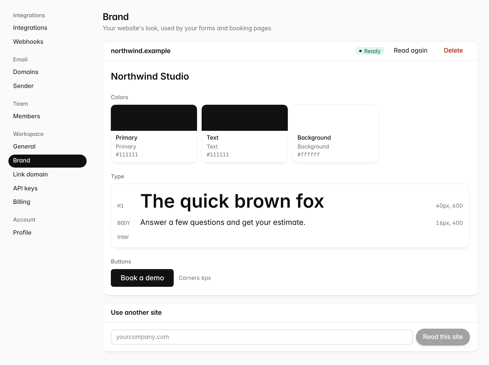
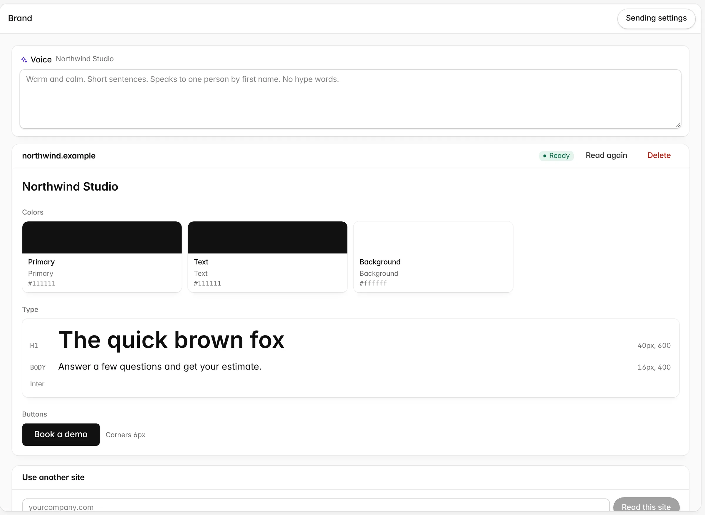

import { Aside, CardGrid, LinkCard, Steps } from '@astrojs/starlight/components';

Your brand makes every form, booking page and email look like you. Claritia reads your website and turns it into a **brand book**: your logo, your colors by role, type, buttons, corners, imagery, voice and rules. Forms, booking pages, email templates and Tia all use it.

You find it in two places with the same brand book: **Settings**, then **Brand**, and **Email**, then **Brand**. The line under the title says **Your website's look, used by your forms and booking pages**.

## Read your site

<Steps>

1. **Open Brand**

   Go to **Settings**, then **Brand**. With no brand yet, the card says **No brand yet**.

1. **Type your website**

   Under **Use another site**, type your site in **Website**, like `yourcompany.com`, and click **Read this site**. The button reads **Reading**.

1. **Wait for the brand book**

   The card shows **Reading**, then **Writing the brand book**, for a minute or so. When it's done, it shows **Ready**.

1. **Look it over**

   Check the parts below. If your site changes later, click **Read again**.

</Steps>

If you set your website during sign-up, your brand is already there.

If Claritia can't read the site, the card shows **Couldn't read**, with the reason under it. Check the address works in a browser, then try again.

## What the brand book holds

| Part | Shows |
| - | - |
| **Name and tagline** | Your brand's name and its tagline from the site |
| **Colors** | Each color with its role and hex code. Roles are **Primary**, **Secondary**, **Accent**, **Background**, **Surface**, **Text**, **Muted text**, **Border** and **Dark**. |
| **Type** | Your heading and body fonts, with each text style's size and weight, shown with "The quick brown fox" |
| **Buttons** | Your main button with a call to action from your site, like "Book a demo", the second button when your site has one, and **Corners** in pixels |
| **Voice** | How your site talks, with **Says:** for words it uses and **Avoids:** for words it doesn't |
| **Imagery** | The kind of pictures your site uses |
| **Rules** | Short do's and don'ts read from your site |

## Where the brand shows

- **Forms** that use your brand, picked in Form Studio's design panel. See [Themes and design](/forms/design/).
- **Booking pages**, when you pick the brand under **Styling** on **Booking page**. Branded booking pages are on Starter and up.
- **Email templates**, previewed in your colors and logo. See [Email templates](/email/templates/).
- **Tia**, who writes forms and emails in your voice.

## More than one site

A workspace can keep more than one brand, for example for two products or two clients.

- To add one, type its site under **Use another site** and click **Read this site**. Claritia reads it into its own brand book.
- The others show under **Other sites**, with their count. Click **Use as brand** to switch back to one.
- Click **Delete** on a brand and confirm **Delete [brand]?**. Forms and booking pages in that brand go back to Claritia's look.

## The voice Tia writes in

On **Email**, then **Brand**, the **Voice** box sits above the brand book. It holds the short brief Tia writes every email and workflow from, like "Warm and calm. Short sentences. Speaks to one person by first name. No hype words."

Change it by hand to fit how your team talks, up to 2,000 characters. It saves when you click away from the box, and shows **Saving…**, then **Saved**. **Sending settings** at the top opens **Settings**, then **Domains**.

<Aside type="note">
Your own web address for forms and booking pages is on its own page. See [Link domain](/workspace/link-domain/).
</Aside>

## Next steps

<CardGrid>
  <LinkCard title="Themes and design" href="/forms/design/" description="Put your brand on a form." />
  <LinkCard title="Link domain" href="/workspace/link-domain/" description="Your own address for forms and booking pages." />
</CardGrid>
