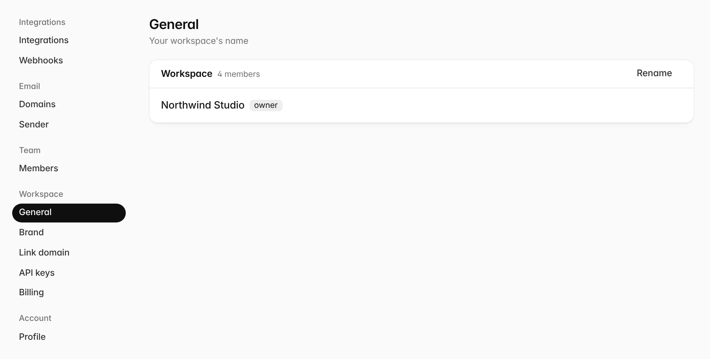

import { Aside, CardGrid, LinkCard, Steps } from '@astrojs/starlight/components';

**Settings**, then **General**, holds your workspace's name. The line under the title says **Your workspace's name**.

## What it shows

The **Workspace** card shows:

- The workspace's name.
- A tag with your role, **owner** or **member**.
- How many members the workspace has, like **5 members**.

## Rename the workspace

Only owners see **Rename**.

<Steps>

1. **Click Rename**

   On the **Workspace** card, click **Rename**. A box asks for the **Workspace name**, filled with the current one.

1. **Type the new name**

   Type it and confirm. The new name shows at once in the sidebar and here. If the save fails, the old name comes back and the error shows.

</Steps>

The name shows in the sidebar, on the approve page apps like Zapier and Claude open, and in `GET /me` from the API.

A new workspace gets its name from sign-up. See [Sign up](/get-started/sign-up/).

## Switch workspaces

If you're in more than one workspace, click the workspace name at the top of the sidebar and pick another. See [The interface](/get-started/the-interface/#workspaces).

<Aside type="note">
To add or remove people, or change roles, use **Settings**, then **Members**. See [Members and seats](/workspace/members-and-seats/).
</Aside>

## Next steps

<CardGrid>
  <LinkCard title="Members and seats" href="/workspace/members-and-seats/" description="Invite your team." />
  <LinkCard title="Roles and permissions" href="/reference/roles-and-permissions/" description="What owners and members can do." />
</CardGrid>
