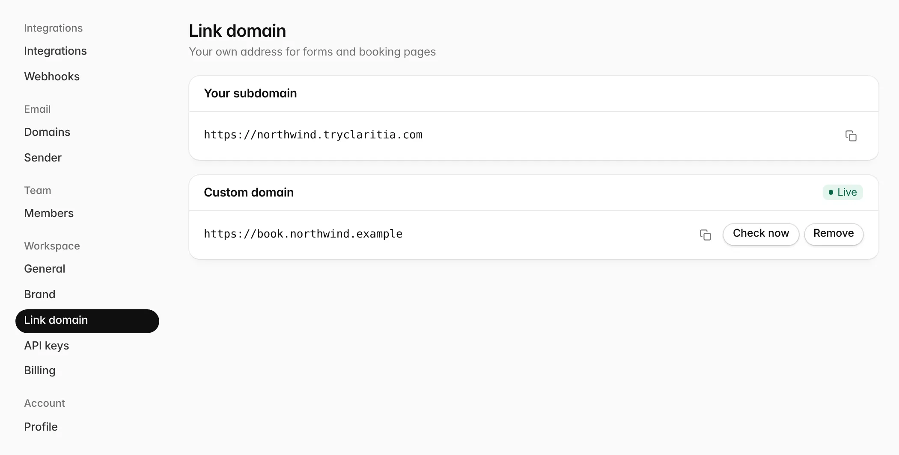

import { Aside, CardGrid, LinkCard, Steps } from '@astrojs/starlight/components';

Forms and booking pages live on Claritia's address by default. **Settings**, then **Link domain**, shows your workspace's own subdomain and lets you add a custom domain, so links read like your company.

## Your subdomain

The **Your subdomain** card shows your workspace's address on Claritia, like `https://northwind.tryclaritia.com`, with **Copy**. It shows when your workspace has one. Your forms and booking pages work on it with no setup.

## Add a custom domain

A custom domain is on the **Business** plan. On other plans, the card says **Your own domain is on Business.** Only owners can add or remove it. Others see **An owner adds the domain.**

<Steps>

1. **Pick a subdomain**

   Use a subdomain of a domain you own, like `forms.acme.com` or `book.acme.com`. Your main website stays where it is.

1. **Add it**

   Type it in **Domain**, which shows `forms.acme.com` as an example, and click **Add domain**. The button reads **Adding** while it saves.

1. **Add the CNAME record**

   Claritia shows one record to add at your DNS provider, with **Copy name** and **Copy value**:

   | Type | Name | Value |
   | - | - | - |
   | `CNAME` | The subdomain you added, like `forms` | The Claritia address shown on the page |

1. **Wait for Live**

   The domain shows **Waiting** until the record is in place, then **Live**. Click **Check now** to check at once. It reads **Checking** while it looks. Next to the state, **Checked [time]** says when Claritia last looked.

</Steps>

Once it's **Live**, Claritia makes a security certificate for the domain on its own, and **Copy** appears next to `https://` and your domain. New links use your domain. Links on Claritia's address keep working.

### States

| State | Means |
| - | - |
| **Waiting** | Claritia hasn't seen the CNAME yet. DNS can take a few minutes to a few hours. |
| **Live** | The record points at Claritia and the domain works. |
| **Not pointing** | The record is missing or points somewhere else. |

Claritia checks each domain again every 30 minutes. If a live domain's record stops pointing at Claritia, it turns **Not pointing** with the reason `The CNAME for [domain] doesn't point at Claritia any more.`

## Remove the domain

Click **Remove** and confirm **Remove [domain]?**. Links on it stop working. Links on Claritia's address keep working. A workspace has one custom domain at a time, so remove the old one before you add another.

## Rules and errors

| Message | Fix |
| - | - |
| `Enter a domain, like forms.acme.com.` | Type a domain. |
| `That isn't a domain. Enter one like forms.acme.com.` | Check the spelling. Leave out spaces and paths. |
| `Use a subdomain, like forms.acme.com, so your website stays where it is.` | Add a part before your domain. `acme.com` and `www.acme.com` aren't allowed. |
| `Use your own domain, not tryclaritia.com.` | Use a domain you own. |
| `That domain is already in use.` | Another workspace uses it. |
| `Remove the domain you have first.` | One custom domain per workspace. |
| `Only owners add a domain.` / `Only owners remove the domain.` | Ask a workspace owner. |
| `Your own domain is on Business.` | Upgrade to Business in **Settings**, then **Billing**. |

<Aside type="tip">
With your own domain, you can give a form's link a readable ending, like `forms.acme.com/demo-request`. See [Share and embed](/forms/share-and-embed/).
</Aside>

## Next steps

<CardGrid>
  <LinkCard title="Brand" href="/workspace/brand-and-domains/" description="Your logo, colors and fonts." />
  <LinkCard title="Sending domain" href="/email/sending-domain/" description="Send emails from your own domain." />
</CardGrid>
