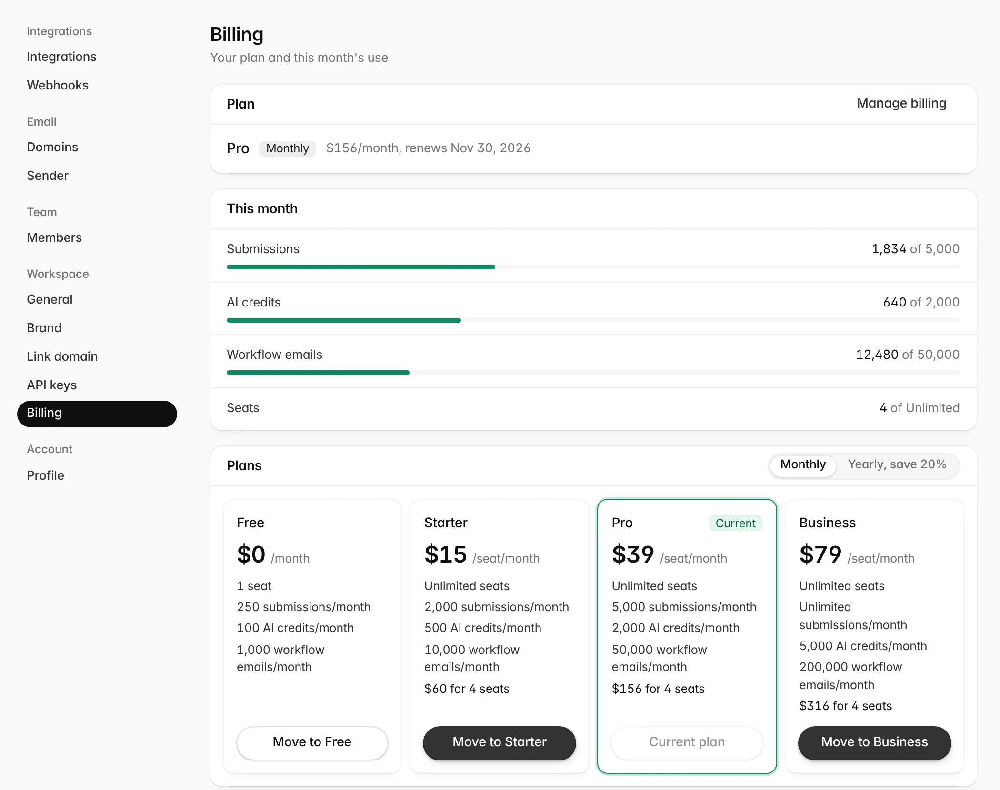

import { Aside, CardGrid, LinkCard, Steps } from '@astrojs/starlight/components';

Claritia starts free for one person. Paid plans are priced per seat, and a seat is a teammate people can book. Every plan has unlimited forms and unlimited editors.

## Prices

| Plan | Monthly | Yearly (per month) |
| - | - | - |
| **Free** | $0 | $0 |
| **Starter** | $15 per seat | $12 per seat |
| **Pro** | $39 per seat | $31 per seat |
| **Business** | $79 per seat | $63 per seat |

Paying yearly saves 20%. A yearly plan is paid for the year up front.

## Monthly limits

| | Free | Starter | Pro | Business |
| - | - | - | - | - |
| **Seats** | 1 | Unlimited | Unlimited | Unlimited |
| **Submissions** | 250 | 2,000 | 5,000 | Unlimited |
| **AI credits** | 100 | 500 | 2,000 | 5,000 |
| **Workflow emails** | 1,000 | 10,000 | 50,000 | 200,000 |
| **Calendars per seat** | 1 | 6 | 6 | 6 |
| **Meeting types** | 1 | Unlimited | Unlimited | Unlimited |

### When you reach a limit

- **Submissions on Free**: your forms keep working and every submission is saved. Submissions past 250 show once you upgrade, or on the 1st of the next month.
- **Submissions on Starter and Pro**: every submission is saved and shows right away. Extra submissions are $5 per 1,000.
- **AI credits**: Tia waits for the next month. Your forms, meetings and reminders keep running.
- **Workflow emails**: emails past the limit wait. They're never dropped.

On Free, Claritia emails you once a month when you've used 200 of your 250 submissions.

## What each plan adds

| Plan | Adds |
| - | - |
| **Free** | The AI form builder, multi-page forms, logic, calculations, file uploads, 840 templates, booking inside forms, Google Meet, Teams and Zoom links, reminders a day and an hour before, webhooks and CSV export |
| **Starter** | Unlimited meeting types, Stripe payments, e-signatures, your own brand, redirect on completion, booking pages for each person and the team, group meetings, polls, single-use links, paid meetings, your own wording and times on meeting emails, and the CRM, sheet, task and chat integrations |
| **Pro** | Follow-up emails from your own domain, no Claritia branding, routing by any answer, round robin with weights and priority, meetings with everyone free, team pools, daily and weekly limits, away days, and no-show follow-ups |
| **Business** | Unlimited submissions, partial answers (**Left early**), drop-off by question, your own domain for forms and booking pages, account owner first, paired round robin, Salesforce and chat help |

See every feature on the [pricing page](https://tryclaritia.com/pricing).

## See this month's use

Go to **Settings**, then **Billing**. **This month** shows your submissions, AI credits, workflow emails and seats, each against your plan's limit.

## Change your plan

<Steps>

1. **Open Billing**

   Go to **Settings**, then **Billing**. Only the workspace owner can change the plan.

1. **Pick monthly or yearly**

   Use the switch above the plans: **Monthly**, or **Yearly, save 20%**.

1. **Choose a plan**

   On Free, click the plan's button, like **Choose Pro**. Stripe's checkout opens. On a paid plan, click the button of the plan you want, like **Move to Business**, and confirm. The price difference is prorated.

</Steps>

An upgrade starts right away. To cancel, or to update your card and see invoices, click **Manage billing**. It opens Stripe's billing page. A cancel takes effect at the end of the period you paid for.

<Aside type="caution">
If a payment fails, the plan shows **Payment due**. Update your card in **Manage billing** to keep your plan.
</Aside>

### Moving to a lower plan

Your forms, fills, links, polls, connected tools and meetings all stay. Booked meetings are never canceled. Features of the higher plan stop for new work: links and polls close to guests, new fills skip your tools, and routing rules stop running. Upgrade again and they start again: links and polls open, rules run, and fills from Typeform, Tally, Webflow, Calendly and Cal.com come in. Fills that skipped a tool can go with **Send again**. See [Plan limits](/reference/plan-limits/#moving-to-a-lower-plan).

## Next steps

<CardGrid>
  <LinkCard title="Plan limits" href="/reference/plan-limits/" description="Every limit on each plan." />
  <LinkCard title="Members, roles and seats" href="/workspace/members-and-seats/" description="Who counts as a seat." />
  <LinkCard title="Questions people ask" href="/reference/faq/" description="Credits, seats and billing." />
</CardGrid>
