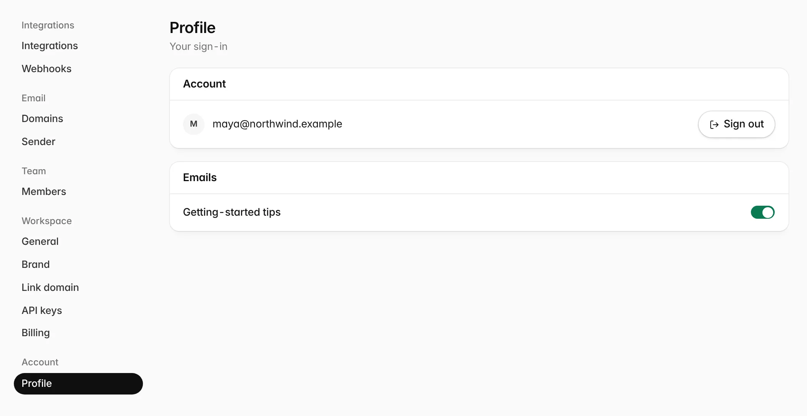

import { Aside, CardGrid, LinkCard } from '@astrojs/starlight/components';

**Settings**, then **Profile**, is about you, not the workspace. The line under the title says **Your sign-in**.

## Account

The **Account** card shows the email you sign in with. Click **Sign out** to sign out on this browser. You can also sign out from your account row at the foot of the sidebar, or with **Sign out** in the ⌘K command bar.

Claritia signs you in with a code or link sent to that email, or with Google or Microsoft. See [Sign up](/get-started/sign-up/).

## Getting-started tips

In your first weeks, Claritia sends the person who made the workspace a few short emails. Each asks for one step, like connecting a calendar, and is skipped once that step is done. You get at most one a day, during working hours in your workspace's time zone.

Switch **Getting-started tips** off to stop them. Each tip email also has a link to turn them off. If the switch doesn't save, it says **That didn't save. Try again.**

## Your booking page and hours

Your own photo, name, headline, booking link and working hours live in **Meetings**:

- Photo, name, headline and link: **Booking page**, with **You** picked. See [Booking page](/meetings/booking-page-and-links/).
- Working hours and days off: **Availability**. See [Availability and teams](/meetings/availability-and-teams/).
- Calendars: **Availability**, then **Calendars**. See [Connect your calendar](/get-started/connect-your-calendar/).

<Aside type="tip">
Light or dark is set per computer, from your account row or the command bar. See [The interface](/get-started/the-interface/#light-and-dark).
</Aside>

## Next steps

<CardGrid>
  <LinkCard title="Security and privacy" href="/workspace/security-and-privacy/" description="How Claritia keeps your account safe." />
  <LinkCard title="General" href="/workspace/general/" description="The workspace's name." />
</CardGrid>
